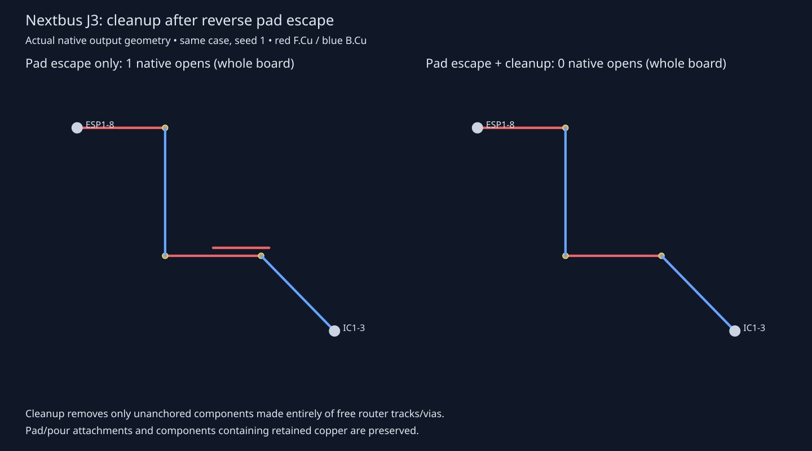

# Cleanup after reverse pad escape

This is additional integration evidence for PR #8. Its production source remains
independent of PR #5. The composed candidate starts at `eea1256` and replaces only
`src/route/passes.ts` with that file from `f7378c5`. The pad-escape regression test
and helper are also included. This is reproducible without merging either PR.

The baseline is the completed pad-escape-only sweep from cycle 4 (`f7378c5`),
not main. Both sweeps use the same host, cores 20–25, frozen inputs, settings,
checker/runtime hashes, shuffled order and three seeds per case. The validator
requires those controls to match and verifies every composed source file hash.
No benchmark input, checker, rule or score is changed.

The engine probe confirms that the isolated `/ESP_RX` track is removed while
all four attached track records and all three vias on that net stay identical.
Both versions report zero terminal incompletes and zero added engine violations.
The completed native sweep results are recorded in `composition-summary.json`.
The native render reads the output boards directly.

Reproduce from a checkout containing both commits (use an unused temporary path):

```bash
git worktree add -b agent/validate-composition /tmp/router-composed eea1256
git -C /tmp/router-composed checkout f7378c5 -- src/route/passes.ts test/pad-escape.test.ts test/helpers/pad-escape.ts
git -C /tmp/router-composed commit -m 'Record composed routing validation source'
cd /tmp/router-composed
bun install --frozen-lockfile
bun run typecheck && bun run check:layers
bun test test/pad-escape.test.ts test/route-core.test.ts
cd /home/hyper/bench/wt/fp-bugs
taskset -c 20-25 nice -n 10 python3 benchmarks/autorouter/benchmark.py --router fab-router --fab-router-source /tmp/router-pad-escape-only --out /tmp/pad-escape-only-run
taskset -c 20-25 nice -n 10 python3 benchmarks/autorouter/benchmark.py --router fab-router --fab-router-source /tmp/router-composed --out /tmp/composed-run
cd /home/hyper/bench/wt/fr-bugs
python3 docs/pr-assets/agent-fab-router-fix-orphan-copper/validate-composition.py /tmp/pad-escape-only-run /tmp/composed-run /tmp/router-composed /tmp/composition-summary.json
/usr/bin/python3 docs/pr-assets/agent-fab-router-fix-orphan-copper/render-composition.py /tmp/pad-escape-only-run /tmp/composed-run
```

Prepare `/tmp/router-pad-escape-only` separately at `f7378c5` with locked Bun
dependencies before running the commands. The original baseline is reused here;
it is not counted a second time in the shared results log. Timing on this shared
host, with tests partly overlapping, is descriptive and supports no speed claim.

Checks on the independent PR #8 source passed: typecheck, layer check (65 files,
zero violations), 871 tests / zero failures / 398476 assertions (231.80 seconds).
The composed source passed typecheck, layer checks and all 30 tests in
`pad-escape.test.ts` and `route-core.test.ts` (82 assertions). A complete unit
suite on the composed source was not run; the 871-test result applies only to
PR #8. The full native sweep covers the composed source.

| Native result | Pad escape only | Pad escape + cleanup | Repeats |
| --- | ---: | ---: | ---: |
| Nextbus J3 passing attempts | 0/3 | 3/3 | 3 |
| Nextbus J3 opens | 1 each | 0 each | 3 |
| Nextbus J3 new DRC errors | 0 each | 0 each | 3 |
| Full passing attempts | 48/78 | 51/78 | 26 × 3 |
| Full cases valid 3/3 | 16/26 | 17/26 | 26 × 3 |
| Full opens | 60 | 57 | 26 × 3 |
| Full new DRC errors | 21 | 21 | 26 × 3 |
| Median route seconds | 1.116479 | 1.018165 | 26 × 3 |

Every other case retains its pass/open/error result. No attempt gains opens or
new errors or loses a pass. The remaining 21 errors are thermal starvation;
this combination does not solve thermal modelling. Compared with main's
historical 39/78 attempts, this combination passes 51/78, but the extra three
passes measured here require **both** fixes. Do not attribute 51/78 to PR #8
alone (its independent result remains 39/78).



The first archived-snapshot launch failed before any attempt because Git metadata
was absent. A locally committed snapshot was then used for the completed sweep;
its source hashes match the stated combination. The shell session ended during
the run, but the bounded benchmark process completed normally: all 78 attempts,
`complete=true`, `controls_preserved=true`, and no surviving child process.
