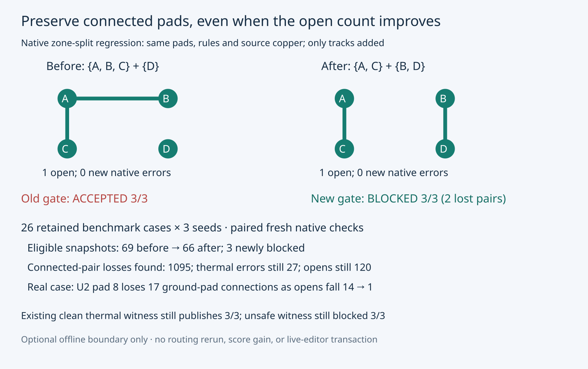

# Native connected-terminal acceptance regression

An added foreign-net track can split a filled zone while another added track connects
an isolated pad. Native error totals and open totals can remain unchanged even though
previously connected source pads are disconnected. The old optional gate accepted that
board; native pad-group preservation now blocks it before bundle publication.

Same machine, cores 20–25, three repeats per control; 26 retained benchmark cases × three
seeds. Full corpus uses fresh paired native checks on the exact routing outputs from
cycle 196 (implementation 8fa7ead0). Router execution is not repeated in this cycle.

| Measurement | Before | After |
|---|---:|---:|
| Full corpus eligible/published snapshots | 69/78 | 66/78 |
| Newly blocked existing outputs | 0 | 3 |
| Lost terminal pairs detected across corpus | unchecked | 1095 |
| Native new errors / opens in retained outputs | 27 / 120 | 27 / 120 |
| Zone-split unsafe control accepted (3 repeats) | 3/3 | 0/3 |
| Unchanged control eligible (3 repeats) | 3/3 | 3/3 |
| Previously repaired thermal witness eligible | 3/3 | 3/3 |
| Unsafe thermal witness eligible | 0/3 | 0/3 |

The newly blocked outputs are recorded individually in results.json. The real
hellscribe-j2-large board isolates U2 pad 8 from 17 previously connected ground pads
while opens fall from 14 to 1; there are no new native errors. Aquarius also loses 348 source
pad pairs per seed, overlapping its existing thermal rejection. All native reports,
partitions, source boards/rules and exact accepted bundles are in the archive.
The original scored routing run remains 39/78 passes, 13/26 cases valid in all three seeds, 120 opens and 27 thermal errors.
No automatic thermal repair, editor transaction, routing gain or pin bump is claimed.

Source setup/layer/net/copper/zone/pad protections remain enabled. The native DRC
process saves only disposable refilled copies; matching native Python bindings then
build transitive pad groups from those copies. Regenerated UUIDs are allowed; ambiguous
physical terminal identities, changed inventories, version mismatches, native/helper
failures and lost source pairs block publication. Results include partitions, total
losses and at most 32 witness pairs. Original board/project/rule buffers remain exact.

## Reproduce

From the engine checkout, with bun, native CLI and matching python3 pcbnew bindings:

```bash
bun test test/native-terminal-connectivity.test.ts test/native-candidate-bundle.test.ts
bun run typecheck
bun run check:layers
bun run test
ASSET=docs/pr-assets/agent-fab-router-native-drc-gate/c198-terminal-connectivity
mkdir replay-c198
tar -xJf "$ASSET/native-evidence.tar.xz" -C replay-c198
python3 "$ASSET/verify.py" "$PWD/replay-c198"
python3 "$ASSET/recheck.py" --archive "$PWD/replay-c198" --source "$PWD" --out "$PWD/rechecked-c198"
```

The archived before tool is pinned to 24aa80ca; recheck.py extracts that revision from
local git history. It rechecks all 78 pairs and 12 controls with 400-second outer phase
timeouts and native per-process 120-second timeouts. It never reroutes or writes the
source snapshots. For original routing generation and complete before/after native
scores, see [the full routing evidence](https://github.com/fabPlane/fab_router/tree/agent/fab-router-fix-placement-precision/docs/pr-assets/agent-fab-router-fix-placement-precision/c196).

Final checks: 905 tests, 0 failures; typecheck and layer checks pass. Public full logs retained. The exact replay command was additionally exercised on
one real benchmark pair and one synthetic pair (eight native checks).
Controls setup failure and the exploratory non-transitive GetConnectedPads audit are
retained explicitly, excluded from final tables. See provenance.json for all limits.


