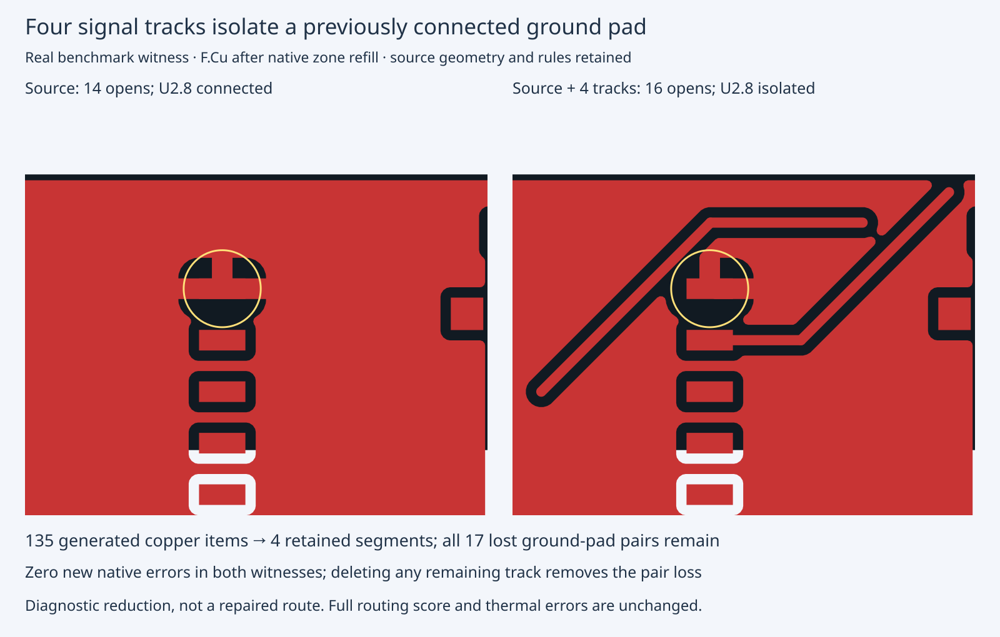

# Four-track ground-pad isolation witness

This cycle isolates the added copper responsible for the existing hellscribe J2large
seed-1 source-connectivity failure. It adds a real-board native regression to the
existing acceptance fix; it does not change routing or repair geometry.

The exact retained input and its original rules come from the placement-corrected
engine `8fa7ead0` run. All 275 source copper items, 139 pads and authored zones remain.
The candidate's 135 additional copper items are reconstructed on that source,
then delta debugging deletes only additions. UUIDs and serialization are allowed
to differ. Each trial refills only its disposable native board.

Four 0.25 mm F.Cu signal segments remain, two on each of `Net-(Q5-Pad1)` and
`Net-(Q6-Pad1)`. Their clearances separate U2.8 at (81.661, 101.219) mm from the
rest of its previously connected ground zone. Every single-item deletion from
this set restores all previously connected pad pairs. This establishes a
**one-minimal** cause on this fixed source, not a globally smallest board or a
route-search root-cause fix. It is a filled-zone partition problem; a lower open
count alone cannot prove source connectivity preservation.

Native 10.0.6 on `hyper-ms-lin`, cores 20–25; same source and rules throughout:

| Diagnostic geometry | Added items | Opens | New native errors | Lost source pad pairs | Repeats |
| --- | ---: | ---: | ---: | ---: | ---: |
| Source alone | 0 | 14 | 0 | 0 | 1 discovery control |
| Full generated copper | 135 | 1 | 0 | 17 | 3 fresh paired checks |
| Reduced added copper | 4 | 16 | 0 | 17 | 3 discovery + 3 fresh paired checks |
| Remove any one of those four | 3 | 15–16 | 0 | 0 | each deletion checked |

The reduced witness increases opens and must not be offered as an improvement.
The full generated candidate demonstrates the old acceptance bug: opens improve
14 → 1 and native errors stay zero, but 17 source connections are lost.
The new real-board regression fails against the pre-connectivity gate (accepted
`true`, expected `false`) and passes against the current gate. It also exercises
the reduced witness and all four single-track deletions. The production gate
implementation is unchanged this cycle.

The last actual complete routing run remains **39/78 passed, 13/26 cases valid
3/3, 120 opens, 27 new thermal errors**. Routing was not rerun here, and none of
those scored outcomes or thermal errors has been fixed by this diagnostic.

## Reproduce

Run from the repository root with the native CLI and matching Python bindings:

```bash
bun test test/native-real-zone-split.test.ts
bun run typecheck
bun run check:layers
bun run test
ASSET=docs/pr-assets/agent-fab-router-native-drc-gate/c199-real-zone-split
mkdir replay-c199
tar -xJf "$ASSET/native-evidence.tar.xz" -C replay-c199
python3 "$ASSET/verify.py" "$PWD/replay-c199"
taskset -c 20-25 nice -n 10 timeout 600 python3 "$ASSET/recheck.py" \
  --source "$PWD" --out "$PWD/rechecked-c199"
taskset -c 20-25 nice -n 10 timeout 2400 python3 "$ASSET/minimize.py" \
  --input "$PWD/replay-c199/original/input/board.kicad_pcb" \
  --candidate "$PWD/replay-c199/original/candidate/board.kicad_pcb" \
  --helper "$PWD/tools/native-terminal-groups.py" --out "$PWD/minimized-c199"
```

`native-evidence.tar.xz` retains all 87 discovery checks, their saved refilled
boards, rules, reports and physical terminal partitions, plus both original
input/output snapshots. No trial was omitted. `verify.py` independently counts
partition losses with subgroup-size arithmetic and verifies every report and
single-item deletion from both original and extracted archives. `recheck.py`
records six fresh paired source/candidate checks, separate from the discovery.
The exact originally executed script is retained as `execution-minimize.py`;
`minimize.py` exposes the same discovery algorithm with explicit paths.
Nonfatal native property/debug diagnostics are retained in the execution log.
The initial unextended full check and focused check are also retained; the final
full check includes the four single-deletion assertions.



Final required validation: typecheck passes; 65 files have zero layer violations;
906 tests pass with zero failures, including the new real-board native regression
and its four single-track deletions. The portable minimizer also reproduces the
four essential tracks in 11 saved native checks; its separate archive and replay
log are retained alongside the six paired source/candidate checks.
