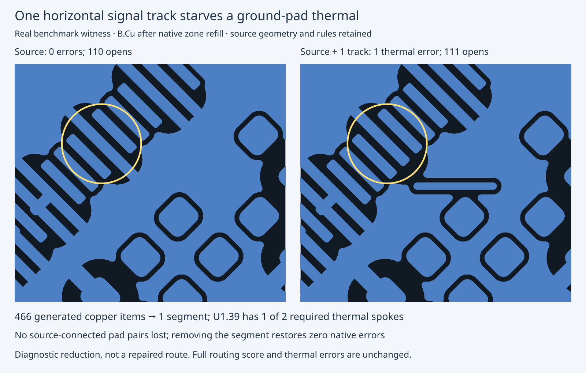

# Aquarius native thermal reduction

A single horizontal B.Cu segment beside GNDD U1.39 reproduces a starved thermal
from the scored Aquarius J4 failure. It preserves all source geometry and source
terminal pairs. The generator currently returns no single-track paths for an
axial segment. No search family or production routing code changes in this cycle.

Same retained seed-1 board, same machine/native 10.0.6, three fresh refill repeats:

| Witness | Added copper | New errors per repeat | Opens | Lost source pairs |
|---|---:|---:|---:|---:|
| Source control | 0 | 0 | 110 | 0 |
| Full output | 466 | 6 thermal | 15 | 348 |
| Reduced output | 1 segment | 1 thermal | 111 | 0 |

All three repetitions match. Twenty deletion/native checks and nine new repeat
checks are retained without omission. Deleting the remaining segment removes the
thermal error. This establishes a one-segment added-copper reproducer, not a
minimized source board, legal route repair, new router run, or score improvement.
The new 16-assertion native regression covers both full and reduced boards plus
an unchanged control. It guards existing rejection behavior; no fail-first fix
is claimed. Fixture license and unchanged sidecars are included.

Latest retained complete scored run (cycle204; NOT rerun here): default pipeline
39/78 passes,13/26 valid,120 opens,27 thermal errors (last default run cycle203);
optional pipeline45/78 passes,15/26 valid,120 opens,18 thermal errors.
All optional errors remain Aquarius. The placement-corrected full witness here
shows that pad-coordinate preservation alone does not fix the thermal/pair loss.



Exact fresh native regression and required checks from repository root:

```sh
taskset -c 20-25 nice -n 10 bun test test/native-aquarius-thermal.test.ts --timeout 120000
taskset -c 20-25 nice -n 10 bun run typecheck
taskset -c 20-25 nice -n 10 bun run check:layers
taskset -c 20-25 nice -n 10 bun run test
```

Portable retained-evidence replay (no new native checks):

```sh
mkdir /tmp/c205-replay
tar -xJf docs/pr-assets/agent-fab-router-native-drc-gate/c205-aquarius-thermal/native-evidence.tar.xz -C /tmp/c205-replay
python3 /tmp/c205-replay/verify.py /tmp/c205-replay /tmp/c205-replay/repo
# Optional fresh native deletion search, exclusive output directory:
taskset -c 20-25 nice -n 10 timeout 3600 python3 /tmp/c205-replay/reproduce-minimize.py /tmp/c205-fresh-minimized
```

Original minimization/recheck commands and exact source paths are retained in
`minimize.py` and `recheck.py`; original source/routed boards and all disposable
refilled trials live in the archive. Raw logs include harmless native diagnostics.
Next: add bounded endpoint-preserving axial detours, then investigate full-output
source-pair losses before any repair can pass the strict source-connectivity gate.
Do not repeat the failed unchanged whole-board geometry sweep or weaken guards.
