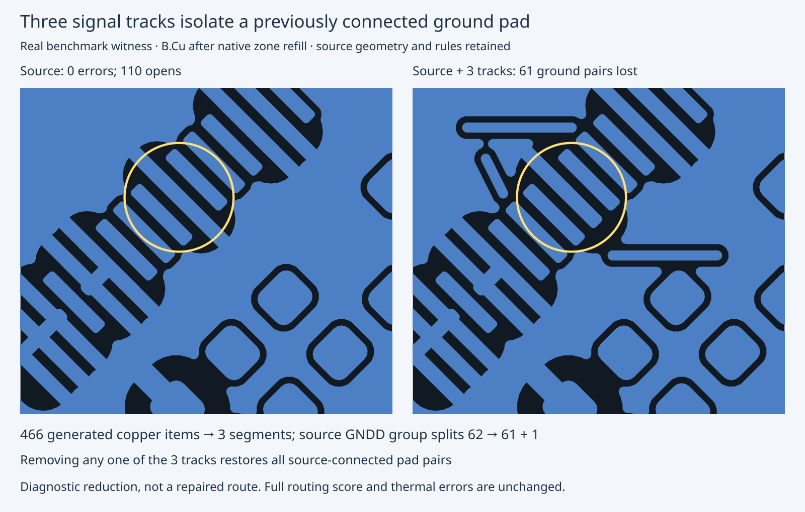

# Three-track ground partition reproducer

Three foreign-net B.Cu signal segments from the retained placement-corrected
Aquarius J4 seed-1 output isolate GNDD U1.39 from its 61 source-connected peers
when the native checker refills zones. All are 0.2032 mm wide. The nets are
`Net-(C1-Pad1)`, `+3V3`, and `Net-(R1-Pad1)`. One track is the earlier horizontal
thermal witness; all three are necessary for this source-connected group split.
Removing any one restores every source pair, even where a thermal error remains.
Thus a thermal error and a ground partition are related but distinct failures.

Same source/rules/machine/native 10.0.6; three fresh repetitions of EACH witness:

| Witness | Added copper | New thermal errors | Opens | Lost source pairs |
|---|---:|---:|---:|---:|
| Source | 0 | 0 | 110 | 0 |
| Before reduction: full output | 466 | 6 | 15 | 348 |
| After reduction: three tracks | 3 | 1 | 114 | 61 |

All three repetitions match. Removing each single track from the reduced witness
restores zero lost source pairs and 112 opens. Thermal counts are 0, 1, 1 for the
three deletions. The independent replay verifies all 74 discovery/refill checks
and 9 repeated checks, including every single deletion. Raw native diagnostics,
boards, partitions, reports, sidecars, original source/output and license are
retained without omission. No native process failed or trial was stopped.

The regression checks loss, offending terminal identity, deletion necessity,
thermal/open counts, unchanged source bytes and an accepted source-only control.
It is new failure coverage, not a newly implemented routing fix. Original source
has duplicate graphical UUIDs; these are retained exactly here. No rules or
acceptance guard were weakened. This cut is not a candidate routing repair.

Latest complete scored summaries are RETAINED, not rerun in this cycle:

| Pipeline | Passing runs | Valid cases (3/3) | Opens | New thermal errors |
|---|---:|---:|---:|---:|
| Default (cycle203) | 39/78 | 13/26 | 120 | 27 |
| Optional before axial fix (cycle206) | 45/78 | 15/26 | 120 | 18 |
| Optional after axial fix (cycle206) | 45/78 | 15/26 | 120 | 18 |

No new scored gain, timing claim, engine fix or pin bump. Next: use this cut to
verify connection-preserving detours and ground-refill behavior before attempting
full-board repair; full Aquarius still has 348 lost pairs and six thermal errors.
The perf agent retains ownership of route/stall/relaxation functions.



Exact commands from the repository root:

```sh
taskset -c 20-25 nice -n 10 bun test test/native-aquarius-connectivity.test.ts --timeout 180000
taskset -c 20-25 nice -n 10 bun run typecheck
taskset -c 20-25 nice -n 10 bun run check:layers
taskset -c 20-25 nice -n 10 bun run test
mkdir /tmp/c207-replay
tar -xJf docs/pr-assets/agent-fab-router-native-drc-gate/c207-aquarius-connectivity/native-evidence.tar.xz -C /tmp/c207-replay
python3 /tmp/c207-replay/verify.py /tmp/c207-replay
# Optional fresh native deletion minimization; output must not already exist:
taskset -c 20-25 nice -n 10 timeout 2400 python3 /tmp/c207-replay/reproduce-minimize.py /tmp/c207-fresh
```

Required checks PASS with explicit exit 0: typecheck, layer checks, 916 tests,
0 failures, 398766 assertions (676.02 s). Focused regression: 15 assertions PASS.
Original and extracted evidence replay both PASS. No stopped/failed native jobs.

`checks.log` records the required complete checks. `source-hashes.json` records
all engine source/native helpers and the new regression; production files were
unchanged. The archived helper replays independently of the local worktree.
