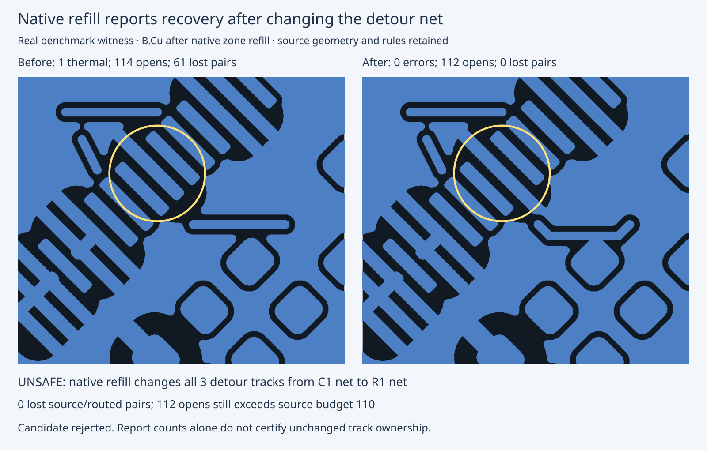

# Native refill changes detour ownership in the Aquarius reduction

The three-track complete-board witness from cycle207 partitions the GNDD group.
This diagnostic checks all six existing endpoint-preserving paths for each of
its three tracks: 18 proposals plus source and reduced controls. No production
code, frozen input, source geometry, rule, checker or acceptance policy changes.

Native 10.0.6 refill **reassigns the three detour tracks to another signal net**
for five of the 18 proposals. All three proposals with zero reported errors and
zero lost source pairs are among these unsafe ownership changes. Therefore their
report counts do not demonstrate a valid repair. Each still exceeds the source
open budget, so the existing gate rejects the diagnostic fixture. This does not
prove that the gate detects native reassignment generally: it currently compares
copper before invoking native checking, not against the saved native board.
A separate load/build/save-only control shows all three detour tracks already
have the R1 net immediately after `pcbnew.LoadBoard`, before explicit connectivity
build, refill, DRC or save. The cause is native load-time reassignment of connected
tracks, not a successful geometric repair. Next work should guard this concrete
post-load fidelity gap before expanding
search. No safe thermal/connectivity repair or scored improvement is claimed.

Same source, machine, native version and rules; three fresh repeats per witness
(retained seed-1 geometry, not three new routing seeds):

| Before/after diagnostic | Native errors | Opens | Lost source pairs | Detour tracks reassigned |
|---|---:|---:|---:|---:|
| Source control | 0 | 110 | 0 | 0 |
| Before: three-track cut | 1 thermal | 114 | 61 | 0 |
| After: first horizontal detour | 0 | 112 | 0 | 3 |

Each repeat matches. All source-connected and currently routed-connected terminal
pairs are retained by the native-saved detour, but that does not authorize the
net change. Submitted `Net-(C1-Pad1)` becomes `Net-(R1-Pad1)` for detours 0/2/4 of
track0; submitted `+3V3` becomes `Net-(R1-Pad1)` for detours 2/4 of track1. All
other proposal ownership is unchanged. All 18 exceed 110 opens. Some introduce
clearance errors; every trial and native diagnostic is retained.

The native regression proves the reassignment by comparing copper in both
directions against the exact expected net change. It also verifies that the
gate rejects the 112-open candidate, preserves source bytes, and continues to
cover the original partition, all single deletions and the source control.
This adds regression/diagnostic coverage, not a behavioral fail-first fix.

The independent replay checks all 29 reports/terminal partitions, exact segment
geometry and explicit expected ownership changes, source/routed pair counts and
unchanged project/custom rules. It never treats net changes as normalization.
`submitted-reconstructed.kicad_pcb` files are reconstructed byte-for-byte from
the retained fixture and unchanged proposal helper; they were not captured
before native save. The actual saved native boards/reports/logs are retained.
The first audit correctly failed on the unexpected ownership change; after
investigation, the final audit checks the exact unsafe change explicitly.
A one-off audit-inspection command had an AttributeError and was corrected;
no native attempt was stopped, failed or omitted.

Latest complete scored summaries are retained, NOT rerun in cycle208:

| Pipeline | Passing runs | Valid cases 3/3 | Opens | New thermal errors |
|---|---:|---:|---:|---:|
| Default (cycle203) | 39/78 | 13/26 | 120 | 27 |
| Optional before/after (cycle206, each 26 cases x 3 seeds) | 45/78 | 15/26 | 120 | 18 |

Full Aquarius remains unresolved: six thermal errors and 348 lost source pairs
per seed. No new routing score, speed or integration pin bump is claimed.



Exact reproduction from repository root; use new output directories:

```sh
taskset -c 20-25 nice -n 10 bun test test/native-aquarius-connectivity.test.ts --timeout 180000
taskset -c 20-25 nice -n 10 bun run typecheck
taskset -c 20-25 nice -n 10 bun run check:layers
taskset -c 20-25 nice -n 10 bun run test
mkdir /tmp/c208-replay
tar -xJf docs/pr-assets/agent-fab-router-native-drc-gate/c208-connectivity-detours/native-evidence.tar.xz -C /tmp/c208-replay
python3 /tmp/c208-replay/verify.py /tmp/c208-replay
# Optional fresh 20-check sweep; requires native 10.0.6 and pcbnew:
taskset -c 20-25 nice -n 10 timeout 900 python3 /tmp/c208-replay/reproduce.py /tmp/c208-fresh
# Optional fresh 9-check repeated controls:
taskset -c 20-25 nice -n 10 timeout 900 python3 /tmp/c208-replay/reproduce-recheck.py /tmp/c208-fresh-recheck
```

Minimal load-only reproducer: a single `SIGNAL_A` segment touches one
`SIGNAL_B` pad. Native loading immediately assigns that segment to `SIGNAL_B`.
No zones, routing, refill, DRC or save are needed. The archive includes the
submitted/saved minimal boards, exact helper and native log. From its extraction:

```sh
python3 /tmp/c208-replay/minimal-load.py
```

This isolates the native behavior; it does not yet close the gate's post-load
ownership gap or establish the effect on existing complete scored outputs.

Required checks PASS: typecheck; 65 files / zero layer violations; 916 tests,
zero failures, 398774 assertions (721.18 s). The updated native regression has
23 assertions and passes focused and in the complete suite. Final static checks
also pass. No production executable changed.
