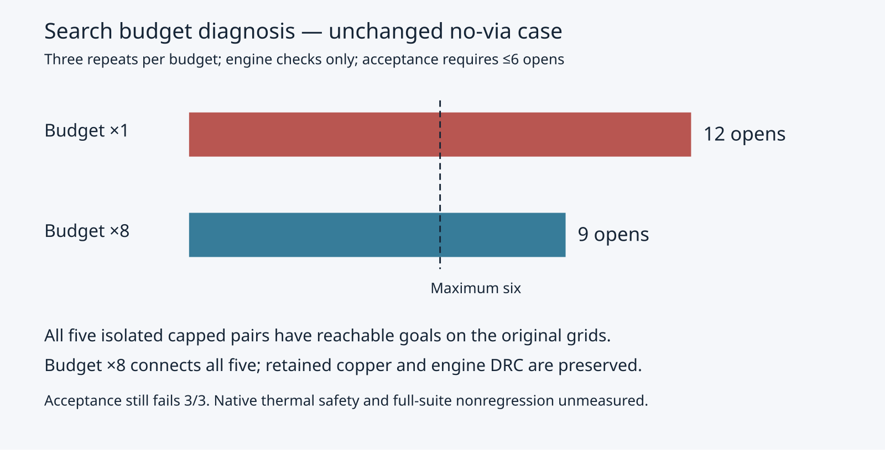

# Distinguish search budgets from blocked grids

Evidence only. No production engine changes. This follows the rejected trail fallback and does not combine it with that proposal.

On the same host (cores 20–25), input, seed, settings and runner, three repeats per budget:

| Measurement | Original pop budget | Budget ×8 |
| --- | ---: | ---: |
| Five isolated pairs connected, each repeat | 0/5 | 5/5 |
| Goals reachable by exhaustive hard-grid flood, each repeat | 5/5 | 5/5 |
| Added engine DRC violations / changed retained records | 0 / 0 | 0 / 0 |
| No-via acceptance opens, each repeat | 12 | 9 |
| Acceptance passing (unchanged maximum six) | 0/3 | 0/3 |
| Added vias | 0 | 0 |

The five pairs are nets 2, 4, 5, 7 and 9. Each isolated attempt reparses the original DSN, keeps every obstacle, and disables rip-up and optimisation. Exhaustive flood uses the same region, directions, node predicate, exact edge predicate and goal exemption as hard A*. It projects out incoming direction because direction only changes cost, not edge legality. The reachable goal proves grid reachability, not exact terminal connection or successful insertion. The larger-budget driver additionally verifies terminal connectivity, retained geometry and zero added engine violations.

The original budget counts popped directional states but is derived from cell count (minimum 4000, cap 30000). More than one incoming direction and stale entries may consume pops for the same cell. The trace now establishes that all five pairs are budget failures on reachable grids; it does not establish that an eightfold budget is the right production policy. On nets 7 and 9, even the larger-budget coarse search finds a path that fails insertion before the finer search succeeds. The angle-shaping problem remains separate.

The acceptance run uses the unchanged case and maximum six; both versions fail all repeats. No native benchmark was run for this proposal. Historical exact-main native coverage remains 39/78 passes, 13/26 cases valid 3/3, 120 opens and 27 new thermal errors; those numbers are not coverage for budget ×8. Native thermal safety and other-case nonregression remain unknown, so this proposal is not promoted. Timing is shared-host diagnostic data only.

Reproduce from repository root; output must be new:

```bash
taskset -c 20-25 nice -n 10 timeout 900 python3 docs/pr-assets/agent-fab-router-no-via-triage/components/probe.py --out /tmp/search-components --repeats 3
python3 docs/pr-assets/agent-fab-router-no-via-triage/components/render.py /tmp/search-components/results.json --out /tmp/search-components-image
taskset -c 20-25 nice -n 10 timeout 900 bash -c 'bun run typecheck && bun run check:layers && bun run test'
```

The probe archives pinned main `69cf598`, applies diagnostic instrumentation in disposable trees, preserves and hashes the input/case/runner and every source file before and after execution, and records all results and logs. `results.json` includes full source identities and raw reports. `factor-*-search.ts` and `factor-*-passes.ts` retain the exact instrumented source. The main engine and active tests remain unchanged.

The earlier trail test is now stored as `trail-fallback.fixture.ts` so ordinary Bun discovery does not execute a deliberately failing rejected experiment. Its portable runner still installs identical test bytes under `test/trail-fallback.test.ts` in disposable trees. A one-repeat runner verification preserved four failing baseline tests versus four passing candidate tests and 12 versus 10 acceptance opens; both acceptance versions still fail.


