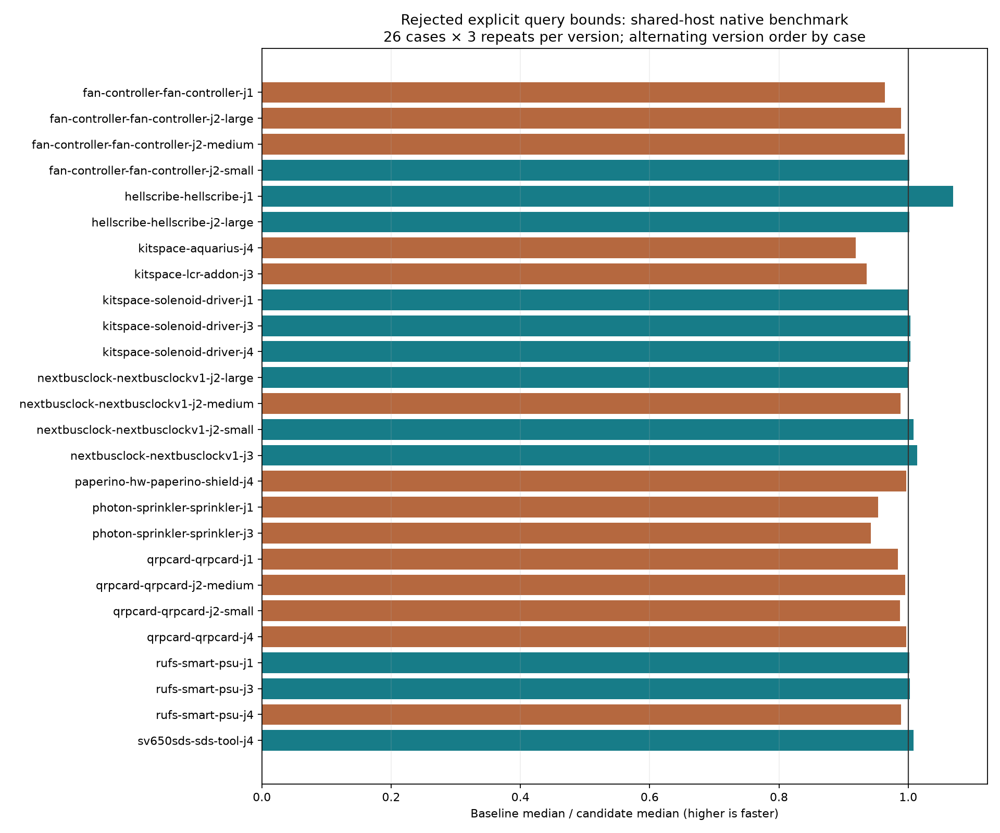

# Explicit lattice bounds experiment

This experiment replaces the spread in `Lattice.hits` with explicit x0/y0/x1/y1 fields, preserving the allocated query snapshot and the original collector. It is **rejected**: native sum of case medians increases 4.5%, despite a favorable plain-Box microbenchmark and fixed-pass ladder result. Shared-host measurements do not establish a causal slowdown, but do not justify shipping a speedup either. Final `src`, `spec`, `tools` and `test` trees match baseline `69cf598`. The retained changes are measurement tools and evidence only.

Baseline `69cf598` versus experimental `9cc0301`, same Linux host `hyper-ms-lin`, cores 12–19, nice 10. Final microbenchmarks, native runs, ladder runs and CPU profiles execute sequentially without overlap with own tests. Two preliminary micro runs overlap each other by 4.5 seconds; their raw scratch records are exploratory and excluded below. Frozen benchmark cases, rules, checker, settings and runtime are unchanged.

| Measurement | Baseline | Rejected candidate | Repeats/version |
|---|---:|---:|---:|
| Native sum of 26 case medians, s | 120.909 | 126.317 | 3/case |
| Native total route time, s | 361.710 | 376.331 | 78 attempts |
| Native passing attempts | 39/78 | 39/78 | 3/case |
| Native cases passing 3/3 | 13/26 | 13/26 | 3/case |
| Native opens / new errors | 120 / 27 | 120 / 27 | 78 attempts |
| Fixed 2-pass L1 median, s | 0.173689 | 0.140897 | 3 |
| Fixed 2-pass L2 median, s | 20.558326 | 19.546569 | 3 |
| Profiled Paperino route median, s | 13.341100 | 15.924330 | 3 |

All 78 paired native SES hashes, pass/fail, opens, native error types, fidelity checks, vias and length match. The analyzer also verifies source/configuration hashes and chronological schedule. Twelve case medians are faster and fourteen slower; Aquarius contributes most of the aggregate difference. Existing native failures remain: these results are not a DRC-clean suite or a five-router ranking. Per-case p95 uses the nearest-rank definition, hence the maximum of three repeats. Timings include failed attempts for performance diagnosis rather than scoring.

All 12 fixed-pass ladder sessions match by input, with no timeout. L1 is complete; L2 retains 29 incompletes and zero added router violations. Those router counters are not native DRC results. Exact synthetic ladder inputs are included under `ladder-inputs/`, with hashes in each measurement and `experiment-provenance.json`.

| Workload (10 million calls/row) | Baseline median s | Candidate median s |
|---|---:|---:|
| box-plain | 1.748310 | 1.652450 |
| box-dop8 | 1.747447 | 1.738167 |
| sweep | 1.781046 | 1.731234 |

The Paperino CPU profiles use native settings and three sequential routes/version; all six session hashes match. Total samples: 38,570 → 44,309. Lattice self-sample totals for collect/test/push are 5,415/1,721/570 → 5,039/1,611/513; hits samples are 6 → 13. Inlining and JIT attribution can move work between named functions, so reduced named-function counts are not proof of less routing work. Both profiled and full native timing are adverse. `profile-summary.json` retains route reports, per-node lattice counts, top self samples and raw-profile hashes; raw profiles remain in local scratch.

There is no new slow acceptance claim: this candidate was rejected at the performance gate before adoption. Final production and tests are restored to baseline; no new slow run was launched. The earlier baseline slow failures remain documented in prior experiments. Initial candidate validation passed typecheck, layers (65 files, zero violations) and all 860 unit tests (398,457 assertions, 214.50 s). Final restored-source validation also passes typecheck, layers (65 files, zero violations), all 859 original unit tests (398,454 assertions, 218.65 s), and strict standalone query-harness checking. The temporary candidate snapshot test belongs to the separate collector experiment and is not duplicated in this evidence-only PR.



## Reproduce

```bash
# Run inside this router checkout; use fresh scratch/output directories.
git worktree add -b agent/fab-router-perf-bounds-reproduce /home/hyper/bench/agents/codex-fabpcb-perf/scratch/bounds-reproduce 9cc0301
git worktree add -b agent/fab-router-perf-bounds-base /home/hyper/bench/agents/codex-fabpcb-perf/scratch/bounds-base 69cf598
taskset -c 12-19 nice -n 10 timeout 900 bash -c 'bun run typecheck && bun run check:layers && bun run test'
for kind in box-plain box-dop8 sweep; do
  taskset -c 12-19 nice -n 10 timeout 600 bun docs/pr-assets/agent-fab-router-perf-bounds/query-shapes.ts /home/hyper/bench/agents/codex-fabpcb-perf/scratch/bounds-base /home/hyper/bench/agents/codex-fabpcb-perf/scratch/bounds-reproduce "$kind" "/home/hyper/bench/agents/codex-fabpcb-perf/scratch/bounds-$kind.json"
done
taskset -c 12-19 nice -n 10 timeout 10800 python3 docs/pr-assets/agent-fab-router-perf-bounds/paired-native.py --benchmark-checkout /home/hyper/bench/wt/fp-perf --baseline-source /home/hyper/bench/agents/codex-fabpcb-perf/scratch/bounds-base --candidate-source /home/hyper/bench/agents/codex-fabpcb-perf/scratch/bounds-reproduce --out /home/hyper/bench/agents/codex-fabpcb-perf/scratch/bounds-native
python3 docs/pr-assets/agent-fab-router-perf-bounds/summarize-paired.py /home/hyper/bench/agents/codex-fabpcb-perf/scratch/bounds-native --out /home/hyper/bench/agents/codex-fabpcb-perf/scratch/bounds-summary --label native
taskset -c 12-19 nice -n 10 timeout 2400 bun docs/pr-assets/agent-fab-router-perf-bounds/ladder-route.ts /home/hyper/bench/agents/codex-fabpcb-perf/scratch/bounds-base /home/hyper/bench/agents/codex-fabpcb-perf/scratch/bounds-reproduce docs/pr-assets/agent-fab-router-perf-bounds/ladder-inputs /home/hyper/bench/agents/codex-fabpcb-perf/scratch/bounds-ladder.json
taskset -c 12-19 nice -n 10 /home/hyper/bench/agents/codex-fabpcb-perf/scratch/plot-venv/bin/python docs/pr-assets/agent-fab-router-perf-bounds/plot.py --measurements /home/hyper/bench/agents/codex-fabpcb-perf/scratch/bounds-summary/native-measurements.json --output reproduced-native.png
```

For CPU profiles use the native-exported Paperino work directory (contains board.dsn, dsn-manifest.json and candidate-settings.json). The following is the exact retained input used this cycle; use the corresponding directory from your fresh native results on another host:

```bash
mkdir -p /home/hyper/bench/agents/codex-fabpcb-perf/scratch/bounds-profiles
taskset -c 12-19 nice -n 10 timeout 600 bun --cpu-prof --cpu-prof-dir /home/hyper/bench/agents/codex-fabpcb-perf/scratch/bounds-profiles docs/pr-assets/agent-fab-router-perf-bounds/profile-route.ts /home/hyper/bench/agents/codex-fabpcb-perf/scratch/bounds-base /home/hyper/bench/agents/codex-fabpcb-perf/scratch/cycle5-paired/before/paperino-hw-paperino-shield-j4/runs/run-20261018T172604.932530Z-001/fab-router/work 3
taskset -c 12-19 nice -n 10 timeout 600 bun --cpu-prof --cpu-prof-dir /home/hyper/bench/agents/codex-fabpcb-perf/scratch/bounds-profiles docs/pr-assets/agent-fab-router-perf-bounds/profile-route.ts /home/hyper/bench/agents/codex-fabpcb-perf/scratch/bounds-reproduce /home/hyper/bench/agents/codex-fabpcb-perf/scratch/cycle5-paired/before/paperino-hw-paperino-shield-j4/runs/run-20261018T172604.932530Z-001/fab-router/work 3
```

Plotting requires matplotlib. Use new output paths; completed evidence is immutable. Query preflight compares exact ordered refs for ten thousand queries, with six measured repeats plus an excluded warmup. Source/input hashes, Bun version, CPU affinity and run windows are recorded. The sweep path is unchanged and its timing variation is a control, not an optimization.

## All native cases

All 78 paired SES hashes and quality outcomes match.

| Case | Before median / p95 s | After median / p95 s | Speedup | Passed (both) | Opens / errors (both) |
|---|---:|---:|---:|---:|---:|
| fan-controller-fan-controller-j1 | 3.504 / 3.513 | 3.636 / 3.782 | 0.96× | 0/3 | 15 / 0 |
| fan-controller-fan-controller-j2-large | 0.847 / 0.852 | 0.856 / 0.859 | 0.99× | 3/3 | 0 / 0 |
| fan-controller-fan-controller-j2-medium | 0.717 / 0.720 | 0.721 / 0.723 | 0.99× | 3/3 | 0 / 0 |
| fan-controller-fan-controller-j2-small | 3.126 / 3.250 | 3.121 / 3.134 | 1.00× | 0/3 | 3 / 0 |
| hellscribe-hellscribe-j1 | 1.977 / 1.978 | 1.849 / 1.975 | 1.07× | 0/3 | 9 / 0 |
| hellscribe-hellscribe-j2-large | 0.961 / 0.969 | 0.960 / 0.960 | 1.00× | 0/3 | 3 / 0 |
| kitspace-aquarius-j4 | 43.624 / 43.742 | 47.472 / 47.974 | 0.92× | 0/3 | 45 / 18 |
| kitspace-lcr-addon-j3 | 2.020 / 2.122 | 2.159 / 2.293 | 0.94× | 3/3 | 0 / 0 |
| kitspace-solenoid-driver-j1 | 0.716 / 0.729 | 0.715 / 0.749 | 1.00× | 3/3 | 0 / 0 |
| kitspace-solenoid-driver-j3 | 0.717 / 0.720 | 0.715 / 0.715 | 1.00× | 3/3 | 0 / 0 |
| kitspace-solenoid-driver-j4 | 0.718 / 0.722 | 0.715 / 0.734 | 1.00× | 3/3 | 0 / 0 |
| nextbusclock-nextbusclockv1-j2-large | 2.882 / 2.889 | 2.879 / 2.885 | 1.00× | 3/3 | 0 / 0 |
| nextbusclock-nextbusclockv1-j2-medium | 0.967 / 0.972 | 0.979 / 0.999 | 0.99× | 3/3 | 0 / 0 |
| nextbusclock-nextbusclockv1-j2-small | 0.723 / 0.855 | 0.717 / 0.780 | 1.01× | 3/3 | 0 / 0 |
| nextbusclock-nextbusclockv1-j3 | 7.740 / 8.300 | 7.635 / 7.667 | 1.01× | 0/3 | 9 / 0 |
| paperino-hw-paperino-shield-j4 | 15.829 / 16.543 | 15.879 / 16.356 | 1.00× | 0/3 | 18 / 0 |
| photon-sprinkler-sprinkler-j1 | 10.948 / 10.973 | 11.478 / 11.852 | 0.95× | 0/3 | 6 / 0 |
| photon-sprinkler-sprinkler-j3 | 14.601 / 14.984 | 15.504 / 16.011 | 0.94× | 0/3 | 6 / 0 |
| qrpcard-qrpcard-j1 | 1.347 / 1.869 | 1.368 / 1.406 | 0.98× | 3/3 | 0 / 0 |
| qrpcard-qrpcard-j2-medium | 0.840 / 0.842 | 0.843 / 0.844 | 1.00× | 3/3 | 0 / 0 |
| qrpcard-qrpcard-j2-small | 0.713 / 0.730 | 0.722 / 0.725 | 0.99× | 0/3 | 0 / 6 |
| qrpcard-qrpcard-j4 | 0.979 / 0.987 | 0.982 / 0.983 | 1.00× | 0/3 | 0 / 3 |
| rufs-smart-psu-j1 | 0.718 / 0.735 | 0.717 / 0.744 | 1.00× | 3/3 | 0 / 0 |
| rufs-smart-psu-j3 | 1.735 / 1.737 | 1.730 / 1.730 | 1.00× | 0/3 | 3 / 0 |
| rufs-smart-psu-j4 | 1.092 / 1.106 | 1.105 / 1.128 | 0.99× | 0/3 | 3 / 0 |
| sv650sds-sds-tool-j4 | 0.868 / 0.871 | 0.861 / 0.865 | 1.01× | 3/3 | 0 / 0 |

Sum of case medians: 120.909 → 126.317 seconds.
before: total 361.710s; 39/78 passed; 120 opens; 27 new native errors.
after: total 376.331s; 39/78 passed; 120 opens; 27 new native errors.
