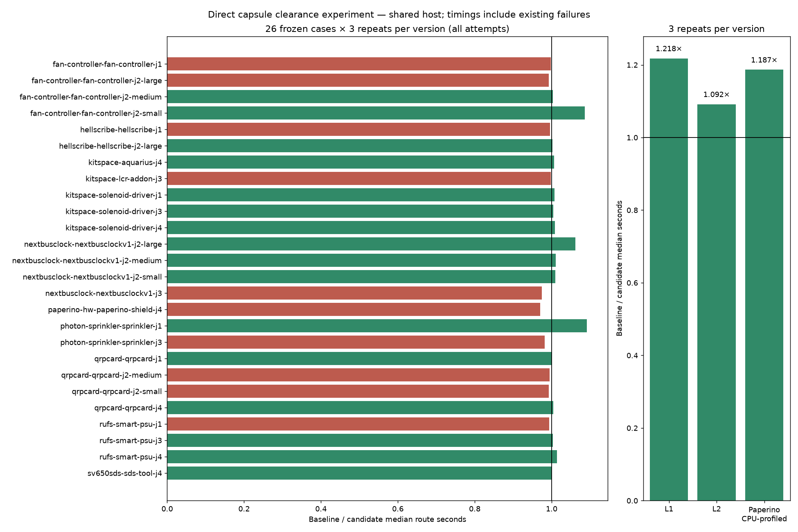
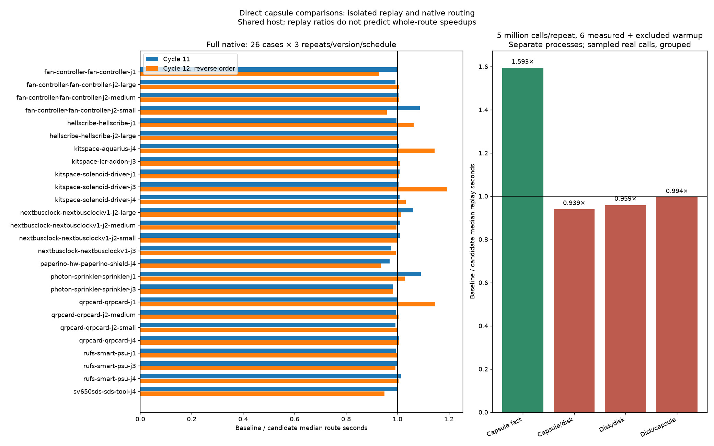

# Direct capsule clearance experiment

The candidate routes a comparison of two nondegenerate capsules directly to `dist2SegSeg`. The previous `coreOf` → `dist2Pts` path calls that same predicate with the same endpoint order. The change avoids constructing two Core objects and their point arrays at source level; JIT allocation elimination means those counts are not measured heap savings. Radius addition, strict versus touching comparison, and every other shape/degenerate fallback retain the existing operations. Shapes remain mutable and are never cached.

Candidate commit: `9719257`. Baseline: `69cf598`. Only `src/route/clear.ts` changes in production. Existing bugs-agent PRs inspected before the experiment modify `src/route/passes.ts`, with no overlap in this function. The previous diagnostic PR measured `coreOf` self samples at about 2–3% of two routes, and sampled clearance as the second core-view caller; those observations motivated this bounded experiment, not a large speedup prediction.

The differential test compares the original clearance operation with the candidate across 10,000 seeded capsule pairs, degenerate cores, strict/contact boundaries, reversed endpoints, near-limit coordinates and other-shape/pieces fallbacks. Existing recorded routing fingerprints must also pass. No input, DRC rule, scoring, router setting or frozen benchmark runtime changes.

## Reproduction

Run on `hyper-ms-lin`, with the private benchmark runtime already staged in the assigned benchmark checkout. Use fresh directories and filenames throughout. The commands create separate pinned worktrees and a fresh evidence directory, so they preserve the committed measurements. Use unused reproduction branch names when repeating them. From the router checkout:

```bash
repo_assets="$PWD/docs/pr-assets/agent-fab-router-perf-capsule"
scratch=/home/hyper/bench/agents/codex-fabpcb-perf/scratch/capsule-reproduce
mkdir "$scratch"
assets="$scratch/assets"
mkdir "$assets"
cp "$repo_assets"/*.py "$repo_assets"/*.ts "$repo_assets"/l?.dsn "$assets/"
baseline="$scratch/baseline"
candidate="$scratch/candidate"
git worktree add -b agent/fab-router-perf-capsule-reproduce-base "$baseline" 69cf598
git worktree add -b agent/fab-router-perf-capsule-reproduce-candidate "$candidate" 9719257
bun install --cwd "$baseline" --frozen-lockfile
bun install --cwd "$candidate" --frozen-lockfile
(cd "$candidate" && taskset -c 12-19 nice -n 10 timeout 900 bash -c 'bun run typecheck && bun run check:layers && bun run test')
python3 "$assets/source-provenance.py" "$baseline" "$candidate" "$assets/source-provenance.json"
taskset -c 12-19 nice -n 10 nice -n 10 timeout 10800 python3 "$assets/paired-native.py" --benchmark-checkout /home/hyper/bench/wt/fp-perf --baseline-source "$baseline" --candidate-source "$candidate" --out "$scratch/cycle11-paired"
python3 "$assets/summarize-paired.py" "$scratch/cycle11-paired" --out "$assets"
taskset -c 12-19 nice -n 10 nice -n 10 timeout 2400 bun "$assets/ladder-route.ts" "$baseline" "$candidate" "$assets" "$assets/ladder.json"
work=("$scratch"/cycle11-paired/before/paperino-hw-paperino-shield-j4/runs/*/fab-router/work)
for repeat in 1 2 3; do
  versions=(before after)
  if [ "$repeat" = 2 ]; then versions=(after before); fi
  for version in "${versions[@]}"; do
    source="$baseline"
    if [ "$version" = after ]; then source="$candidate"; fi
    profiles="$scratch/cycle11-profile-$version-$repeat"
    mkdir "$profiles"
    taskset -c 12-19 nice -n 10 nice -n 10 timeout 600 bun --cpu-prof --cpu-prof-dir "$profiles" "$assets/profile-route.ts" "$source" "${work[0]}" 1 > "$scratch/cycle11-profile-$version-$repeat.log"
  done
done
# Run both full slow reports; preserve exit 1 for existing acceptance failures.
(cd "$baseline" && taskset -c 16-19 nice -n 10 nice -n 10 timeout 7200 bun run acceptance -- --tier slow --report "$scratch/cycle11-acceptance-before.json") > "$scratch/cycle11-acceptance-before.log" 2>&1 &
before_job=$!
(cd "$candidate" && taskset -c 12-15 nice -n 10 nice -n 10 timeout 7200 bun run acceptance -- --tier slow --report "$scratch/cycle11-acceptance-after.json") > "$scratch/cycle11-acceptance-after.log" 2>&1 &
after_job=$!
before_exit=0
wait "$before_job" || before_exit=$?
after_exit=0
wait "$after_job" || after_exit=$?
test "$before_exit" -le 1 && test "$after_exit" -le 1
# Each exit must be 0 or 1, with complete 63-case reports; 124 means outer timeout.
python3 "$assets/compare-acceptance.py" "$scratch/cycle11-acceptance-before.json" "$scratch/cycle11-acceptance-after.json" --out "$assets/slow-comparison.json"
# Instrument only after timed routing runs; original checkout remains unchanged.
python3 "$assets/instrument-capsules.py" "$candidate" 9719257 "$scratch/cycle11-instrumented"
taskset -c 12-19 nice -n 10 nice -n 10 timeout 600 bun "$assets/trace-route.ts" "$scratch/cycle11-instrumented" "${work[0]}" "$assets/capsule-trace.json"
python3 "$assets/source-provenance.py" "$baseline" "$candidate" "$assets/source-provenance.json" --verify
python3 "$assets/summarize-extra.py" "$scratch"
# matplotlib is installed in this agent's scratch venv.
/home/hyper/bench/agents/codex-fabpcb-perf/scratch/plot-venv/bin/python "$assets/plot.py"
```

`source-provenance.json` records the exact committed source and SHA-256 values before the measurements; all hashes are checked again afterwards. The native analyzer independently verifies recorded source/configuration identities, full chronology, all 78 paired sessions and all quality/via/length fields. Ladder inputs are frozen snapshots retained here; newer ladder revisions are outside this experiment. L1/L2 use two passes, seed 1, and a generous 600-second budget to avoid timing truncation. Their incompletes and added router violations are not native DRC results.

Native tables include every attempt, including existing failed cases. Per-case p95 is nearest rank (the maximum of three). Native routing, fixed-pass ladder routes, CPU profiles and own unit tests run sequentially. The measurement supervisor and workers each apply `nice -n 10`; effective worker priority is 19 (verified on L2), while the direct test command has effective priority 15 in this session. The commands above reproduce the nested measurement priority. All route workers are pinned to cores 12–19; Bun version is 1.4.0. Lightweight reporting/source-hash checks overlap native execution. Other services use the host, so timing differences remain subject to host noise. CPU named-function attribution can move under JIT inlining; fewer self samples do not prove work vanished.

## Native and fixed-pass results

Same host, same cases/settings, three repeats per version. Full native execution comprises 52 per-case harness invocations; the analyzer verifies complete 26-case coverage per side and all seed/repeat identities. Every paired native session, pass/fail result, open/error field, fidelity field, via count and track length matches. Both sides retain 13/26 cases passing 3/3. Existing failures mean this is not a DRC-clean suite.

| Measurement | Baseline | Candidate | Repeats per side |
|---|---:|---:|---:|
| Sum of native case medians, s | 124.917 | 124.088 | 3/case |
| Total native route seconds | 376.165 | 368.627 | 78 attempts |
| Native passing attempts | 39/78 | 39/78 | 3/case |
| Native cases passing 3/3 | 13/26 | 13/26 | 3/case |
| Opens / new native errors | 120 / 27 | 120 / 27 | 78 attempts |
| L1 fixed-pass median, s | 0.157707 | 0.129518 | 3 |
| L2 fixed-pass median, s | 20.900182 | 19.147861 | 3 |
| Paperino CPU-profiled median, s | 17.748451 | 14.958360 | 3 |

The native case-median sum is only 0.66% lower; 16 case medians improve and 10 worsen. In particular, native Paperino worsens 15.287 → 15.764 seconds (3.1%), despite its separately profiled median improving. Fixed-pass L2 is 8.4% lower and profiled Paperino 15.7% lower. Repeat variation and host noise limit causal conclusions; no universal routing speedup is claimed. L1 is complete; L2 has 29 incompletes in every run. All 12 fixed-pass sessions match by board, with no timeout/abort and zero added router violations. These counters are not native DRC. All six profiles match each other and the native Paperino session; source/input/settings identities are checked.

CPU profiles retain all raw-file hashes and top self samples in `extra-summary.json`. Total CPU samples are 47,666 → 42,344; named `coreOf` self samples are 1,105 → 938, `closerConvex` 139 → 106, `dist2Pts` 130 → 95, and `dist2SegSeg` 38 → 26. These sample counts are not call counts or proof of measured allocation savings, and inlining can move attribution.



## Validation

Candidate typecheck and layer checks pass (65 files, zero layer violations). All 860 unit tests pass, 440,158 assertions in 215.02 seconds. Final pre-push validation also passes fresh typecheck/layer checks, 32 targeted geometry/clearance/fingerprint tests (308,964 assertions, 11.40 seconds), and strict standalone TypeScript checks for all three diagnostic tools. The original comparison is used as the differential oracle; tests and recorded routing fingerprints are unchanged apart from the new capsule test.

The slow comparator now exits nonzero on pass regressions, increased incompletes, increased added router violations, invariant regressions or unexpected aborts, while retaining the complete adverse comparison. Deliberate pass/violation and invariant/abort mutants are rejected, including a mutant on a case already failing for another reason. A real historical adverse pair with two increased-incomplete cases is rejected; an identical-report control passes. Its overwrite guard rejects an existing output and preserves its SHA-256. These comparator checks are tool validation, not fresh router benchmark results.

## Full native per-case median / p95 table

All 78 paired SES hashes and quality outcomes match.

| Case | Before median / p95 s | After median / p95 s | Median ratio (before / after) | Passed (both) | Opens / errors (both) |
|---|---:|---:|---:|---:|---:|
| fan-controller-fan-controller-j1 | 3.497 / 3.501 | 3.505 / 3.647 | 1.00× | 0/3 | 15 / 0 |
| fan-controller-fan-controller-j2-large | 0.837 / 0.847 | 0.844 / 0.844 | 0.99× | 3/3 | 0 / 0 |
| fan-controller-fan-controller-j2-medium | 0.710 / 0.714 | 0.707 / 0.712 | 1.00× | 3/3 | 0 / 0 |
| fan-controller-fan-controller-j2-small | 3.256 / 3.270 | 2.997 / 3.253 | 1.09× | 0/3 | 3 / 0 |
| hellscribe-hellscribe-j1 | 1.977 / 1.995 | 1.985 / 2.004 | 1.00× | 0/3 | 9 / 0 |
| hellscribe-hellscribe-j2-large | 0.966 / 0.968 | 0.965 / 0.974 | 1.00× | 0/3 | 3 / 0 |
| kitspace-aquarius-j4 | 48.230 / 48.756 | 47.925 / 48.275 | 1.01× | 0/3 | 45 / 18 |
| kitspace-lcr-addon-j3 | 1.971 / 1.974 | 1.976 / 1.977 | 1.00× | 3/3 | 0 / 0 |
| kitspace-solenoid-driver-j1 | 0.709 / 0.709 | 0.704 / 0.704 | 1.01× | 3/3 | 0 / 0 |
| kitspace-solenoid-driver-j3 | 0.711 / 0.714 | 0.708 / 0.708 | 1.00× | 3/3 | 0 / 0 |
| kitspace-solenoid-driver-j4 | 0.716 / 0.719 | 0.710 / 0.711 | 1.01× | 3/3 | 0 / 0 |
| nextbusclock-nextbusclockv1-j2-large | 3.052 / 3.113 | 2.874 / 2.886 | 1.06× | 3/3 | 0 / 0 |
| nextbusclock-nextbusclockv1-j2-medium | 0.988 / 1.002 | 0.978 / 1.005 | 1.01× | 3/3 | 0 / 0 |
| nextbusclock-nextbusclockv1-j2-small | 0.732 / 0.732 | 0.725 / 0.740 | 1.01× | 3/3 | 0 / 0 |
| nextbusclock-nextbusclockv1-j3 | 7.850 / 7.958 | 8.057 / 8.180 | 0.97× | 0/3 | 9 / 0 |
| paperino-hw-paperino-shield-j4 | 15.287 / 16.732 | 15.764 / 16.487 | 0.97× | 0/3 | 18 / 0 |
| photon-sprinkler-sprinkler-j1 | 11.898 / 12.306 | 10.901 / 11.007 | 1.09× | 0/3 | 6 / 0 |
| photon-sprinkler-sprinkler-j3 | 13.258 / 13.630 | 13.504 / 13.884 | 0.98× | 0/3 | 6 / 0 |
| qrpcard-qrpcard-j1 | 1.359 / 1.359 | 1.358 / 1.366 | 1.00× | 3/3 | 0 / 0 |
| qrpcard-qrpcard-j2-medium | 0.839 / 0.840 | 0.843 / 0.843 | 1.00× | 3/3 | 0 / 0 |
| qrpcard-qrpcard-j2-small | 0.710 / 0.713 | 0.715 / 0.727 | 0.99× | 0/3 | 0 / 6 |
| qrpcard-qrpcard-j4 | 0.971 / 0.973 | 0.966 / 0.968 | 1.00× | 0/3 | 0 / 3 |
| rufs-smart-psu-j1 | 0.710 / 0.715 | 0.714 / 0.715 | 0.99× | 3/3 | 0 / 0 |
| rufs-smart-psu-j3 | 1.734 / 1.744 | 1.729 / 1.731 | 1.00× | 0/3 | 3 / 0 |
| rufs-smart-psu-j4 | 1.108 / 1.110 | 1.093 / 1.110 | 1.01× | 0/3 | 3 / 0 |
| sv650sds-sds-tool-j4 | 0.843 / 0.846 | 0.841 / 0.846 | 1.00× | 3/3 | 0 / 0 |

Sum of case medians: 124.917 → 124.088 seconds.
before: total 376.165s; 39/78 passed; 120 opens; 27 new native errors.
after: total 368.627s; 39/78 passed; 120 opens; 27 new native errors.


## Full slow acceptance

Both complete fresh 63-case reports have 51 passing / 12 failing cases, 14 advisories, zero stubs and zero invalid case files. Supervisors exit 1 for those existing failures; neither hits its outer timeout. Baseline uses cores 16–19 and candidate cores 12–15, effective nice 19 on both, concurrently on disjoint four-core sets after the sequential native/ladder/profile measurements. Source identities are checked before and after; report heads match `69cf598` and `9719257` exactly. Complete reports and comparison are in `slow-comparison.json`; raw report hashes are in `slow-summary.json`.

There are no pass regressions, increased final incompletes, added router violations, invariant regressions or unexpected aborts. All final incomplete, via and trace-length fields match; every report has zero added router violations. These are router counters, not native DRC. Two time-budget progress counters worsen and remain part of the evidence:

| Timed slow case | Baseline completed / passes | Candidate completed / passes | Final incomplete change |
|---|---:|---:|---:|
| issue039 default | 360 / 5 | 335 / 4 | none |
| issue230 plane layers | 214 / 10 | 207 / 9 | none |

Lower intermediate counters prevent a claim of identical timed progress or universal speedup. The final quality gate passes; the capsule comparison change is retained.


## Exact branch-use trace

A separate archive of `9719257` adds counters only to `closerConvex`; the router checkout is never instrumented. Paperino records 3,358,472 convex clearance comparisons: 692,280 (20.61%) use the new capsule branch. Compared with the original source, those calls avoid constructing 1,384,560 Core views and their associated point arrays. These are source-level opportunities, not measured heap allocations or GC savings. The larger fallback groups are capsule/disk (1,792,434), disk/disk (554,231), and disk/capsule (287,146); the optimization targets a minority of this workload.

The trace has no timeout/abort and exactly matches all six uninstrumented profile sessions and the native Paperino session. `capsule-trace.json` retains complete counts, settings, input/session fingerprints, report and generator/archive/original/instrumented hashes. Instrumented time is diagnostic only, excluded from every performance comparison. Generator and trace output guards preserve existing evidence. An initial trace launch selected a nonexistent run directory and failed before routing; the corrected launch uses the staged work-directory glob shown above.

## Cycle 12: isolated real-call replay and reversed native schedule

This follow-up changes only diagnostic tools and evidence; production, unit-test and acceptance code remains exactly `9719257`. It measures whether the fast branch helps actual calls and whether its guard taxes fallback calls. Full native routing compares baseline `69cf598` with `6815d27`, whose production source is identical to the original candidate. Every case reverses its baseline/candidate execution order relative to cycle 11. All 52 invocations and 156 attempts complete; source/settings identities and chronology are verified. All 78 paired sessions, quality fields, via counts and lengths match. Both versions again have 39/78 passing attempts, 13/26 cases passing 3/3, 120 opens and 27 existing new native errors.

Sum of native case medians is 124.957 → 119.783 seconds (4.14% lower); total route seconds are 372.469 → 360.875. Sixteen case medians are lower and ten higher. Most aggregate reduction comes from Aquarius, 48.429 → 42.321 seconds. Paperino is again adverse, 15.254 → 16.310 seconds (6.9% slower), after cycle 11's 3.1% slowdown. Shared-host variation and mixed per-case results remain explicit; these measurements do not establish a universal or causal whole-router speedup.

An isolated source archive captures Paperino comparisons using deterministic bounded Algorithm R reservoirs, up to 1,024 snapshots per ordered shape-kind group, with a separate group for the fast branch. The finite xorshift32 random source is deterministic, not a claim of perfect statistical randomness. Selected shapes are cloned immediately to preserve their values despite later mutation. All 3,358,472 call counts and the output session exactly match the previous full-count trace, all six original uninstrumented profiles, and native output. Instrumented capture time (16.319 seconds) is diagnostic only.

The capture retains 6,760 tuples across eight groups. Before timing, every tuple is checked individually against both versions and the original `coreOf`/`dist2Pts` operation. All pass. The fast group has 652 true results in 1,024 samples, all strict comparisons; it contains no touching calls in this workload. Disk/disk includes 74 touching samples. This actual-call sample does not replace the existing synthetic boundary/degeneracy test.

Replay times the four dominant groups through public `closerThan`/`overlaps`, including their dispatch overhead. Each version/group/repeat runs in a separate process: six measured repeats plus an excluded warmup repeat, five million calls per repeat, with alternating version order. Every worker also warms its JIT before timing; every timed pair has identical checksums. The processes cycle their group's sample array, rather than reproducing the full route's interleaving or frequency mix. The other four groups receive exact equality checks but are not timed.

| Workload | Baseline median / max s | Candidate median / max s | Baseline / candidate |
|---|---:|---:|---:|
| fast-capsule | 0.283624 / 0.291101 | 0.178042 / 0.182498 | 1.593× |
| capsule/disk | 0.185799 / 0.206487 | 0.197805 / 0.225910 | 0.939× |
| disk/disk | 0.125746 / 0.127793 | 0.131138 / 0.149639 | 0.959× |
| disk/capsule | 0.162050 / 0.185212 | 0.162976 / 0.167962 | 0.994× |

The capsule branch takes 37.2% less replay time. Capsule/disk is 6.5% slower, disk/disk 4.3% slower, and disk/capsule 0.6% slower. These fallback costs are adverse evidence, not omitted noise controls. Group-specific replay timings do not predict a whole-route speedup or measured allocation savings. The production change remains bounded to capsules; broadening dispatch should first address fallback overhead and be measured as a separate experiment.



All heavy native, capture, replay and unit-test runs are sequential, on cores 12–19. Measurement workers have effective nice 19; direct unit tests have effective nice 15. Only light reporting and TypeScript checks overlap routing. The new capture/replay tools pass strict standalone TypeScript checks. Generator, capture and replay overwrite guards reject existing output and preserve hashes; an inverted-result mutant is rejected during preflight before any timing or output. `replay-validation.json` retains the results. Replay verifies tracked source hashes before and after timing, and its analyzer verifies their equality to the native controls. Input/tool hashes, per-worker chronology and sample coverage are retained. The 1.3 MB bounded sample file is committed for replay without instrumentation.

No fresh slow acceptance or ladder run is claimed for this diagnostic-only follow-up; cycle 11's complete quality gates above apply to the unchanged production code. Fresh typecheck and layer checks (65 files, zero violations) pass after the measurements. All 860 unit tests pass, with 440,158 assertions in 225.53 seconds; strict standalone TypeScript checks pass for both new diagnostic tools. No tests or scoring rules are weakened.

### Reproduce cycle 12 in fresh directories

The following commands use the same host and staged private native runtime. They preserve committed evidence; choose unused directories and branch names. From the router checkout:

```bash
repo_assets="$PWD/docs/pr-assets/agent-fab-router-perf-capsule"
scratch=/home/hyper/bench/agents/codex-fabpcb-perf/scratch/capsule-repeat-reproduce
mkdir "$scratch"
assets="$scratch/assets"
mkdir "$assets"
cp "$repo_assets"/*.py "$repo_assets"/*.ts "$assets/"
cp "$repo_assets/native-measurements.json" "$repo_assets/capsule-trace.json" "$assets/"
baseline="$scratch/baseline"
candidate="$scratch/candidate"
git worktree add -b agent/fab-router-perf-capsule-repeat-base "$baseline" 69cf598
git worktree add -b agent/fab-router-perf-capsule-repeat-candidate "$candidate" 6815d27
bun install --cwd "$baseline" --frozen-lockfile
bun install --cwd "$candidate" --frozen-lockfile
taskset -c 12-19 nice -n 10 nice -n 10 timeout 10800 python3 "$assets/paired-native.py" --benchmark-checkout /home/hyper/bench/wt/fp-perf --baseline-source "$baseline" --candidate-source "$candidate" --reverse-order --out "$scratch/cycle12-paired"
python3 "$assets/summarize-paired.py" "$scratch/cycle12-paired" --out "$assets" --label cycle12-native
python3 "$assets/capture-clearance.py" "$candidate" 9719257 "$scratch/capture-source"
work=("$scratch"/cycle12-paired/before/paperino-hw-paperino-shield-j4/runs/*/fab-router/work)
taskset -c 12-19 nice -n 10 nice -n 10 timeout 600 bun "$assets/capture-clearance.ts" "$scratch/capture-source" "${work[0]}" "$assets/clearance-samples.json"
taskset -c 12-19 nice -n 10 nice -n 10 timeout 900 bun "$assets/replay-clearance.ts" "$baseline" "$candidate" "$assets/clearance-samples.json" "$assets/clearance-replay.json"
/home/hyper/bench/agents/codex-fabpcb-perf/scratch/plot-venv/bin/python "$assets/summarize-replay.py"
(cd "$candidate" && taskset -c 12-19 nice -n 10 timeout 900 bash -c 'bun run typecheck && bun run check:layers && bun run test')
```

### Cycle 12 full native median / p95 table

All 78 paired SES hashes and quality outcomes match.

| Case | Before median / p95 s | After median / p95 s | Median ratio (before / after) | Passed (both) | Opens / errors (both) |
|---|---:|---:|---:|---:|---:|
| fan-controller-fan-controller-j1 | 3.482 / 3.805 | 3.752 / 3.767 | 0.93× | 0/3 | 15 / 0 |
| fan-controller-fan-controller-j2-large | 0.828 / 0.832 | 0.823 / 0.836 | 1.01× | 3/3 | 0 / 0 |
| fan-controller-fan-controller-j2-medium | 0.708 / 0.711 | 0.703 / 0.708 | 1.01× | 3/3 | 0 / 0 |
| fan-controller-fan-controller-j2-small | 2.985 / 3.125 | 3.113 / 3.118 | 0.96× | 0/3 | 3 / 0 |
| hellscribe-hellscribe-j1 | 1.978 / 1.995 | 1.861 / 1.976 | 1.06× | 0/3 | 9 / 0 |
| hellscribe-hellscribe-j2-large | 0.968 / 0.976 | 0.966 / 0.967 | 1.00× | 0/3 | 3 / 0 |
| kitspace-aquarius-j4 | 48.429 / 49.821 | 42.321 / 42.726 | 1.14× | 0/3 | 45 / 18 |
| kitspace-lcr-addon-j3 | 2.303 / 2.562 | 2.278 / 2.310 | 1.01× | 3/3 | 0 / 0 |
| kitspace-solenoid-driver-j1 | 0.722 / 0.802 | 0.718 / 0.723 | 1.01× | 3/3 | 0 / 0 |
| kitspace-solenoid-driver-j3 | 0.858 / 0.995 | 0.719 / 0.742 | 1.19× | 3/3 | 0 / 0 |
| kitspace-solenoid-driver-j4 | 0.758 / 0.856 | 0.735 / 0.740 | 1.03× | 3/3 | 0 / 0 |
| nextbusclock-nextbusclockv1-j2-large | 3.047 / 3.294 | 3.004 / 3.131 | 1.01× | 3/3 | 0 / 0 |
| nextbusclock-nextbusclockv1-j2-medium | 0.963 / 0.966 | 0.967 / 0.967 | 1.00× | 3/3 | 0 / 0 |
| nextbusclock-nextbusclockv1-j2-small | 0.713 / 0.838 | 0.714 / 0.714 | 1.00× | 3/3 | 0 / 0 |
| nextbusclock-nextbusclockv1-j3 | 7.574 / 7.718 | 7.623 / 8.199 | 0.99× | 0/3 | 9 / 0 |
| paperino-hw-paperino-shield-j4 | 15.254 / 15.725 | 16.310 / 16.627 | 0.94× | 0/3 | 18 / 0 |
| photon-sprinkler-sprinkler-j1 | 11.412 / 12.023 | 11.097 / 11.749 | 1.03× | 0/3 | 6 / 0 |
| photon-sprinkler-sprinkler-j3 | 13.624 / 13.664 | 13.868 / 15.063 | 0.98× | 0/3 | 6 / 0 |
| qrpcard-qrpcard-j1 | 1.425 / 1.527 | 1.242 / 1.351 | 1.15× | 3/3 | 0 / 0 |
| qrpcard-qrpcard-j2-medium | 0.849 / 0.855 | 0.846 / 0.910 | 1.00× | 3/3 | 0 / 0 |
| qrpcard-qrpcard-j2-small | 0.713 / 0.717 | 0.715 / 0.721 | 1.00× | 0/3 | 0 / 6 |
| qrpcard-qrpcard-j4 | 0.973 / 0.975 | 0.967 / 0.970 | 1.01× | 0/3 | 0 / 3 |
| rufs-smart-psu-j1 | 0.714 / 0.719 | 0.712 / 0.713 | 1.00× | 3/3 | 0 / 0 |
| rufs-smart-psu-j3 | 1.720 / 1.730 | 1.733 / 1.748 | 0.99× | 0/3 | 3 / 0 |
| rufs-smart-psu-j4 | 1.103 / 1.131 | 1.099 / 1.266 | 1.00× | 0/3 | 3 / 0 |
| sv650sds-sds-tool-j4 | 0.853 / 0.856 | 0.899 / 0.901 | 0.95× | 3/3 | 0 / 0 |

Sum of case medians: 124.957 → 119.783 seconds.
before: total 372.469s; 39/78 passed; 120 opens; 27 new native errors.
after: total 360.875s; 39/78 passed; 120 opens; 27 new native errors.
