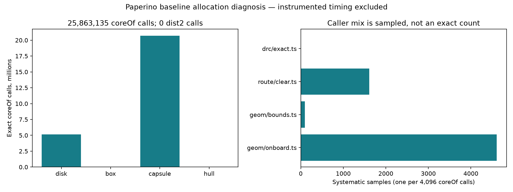
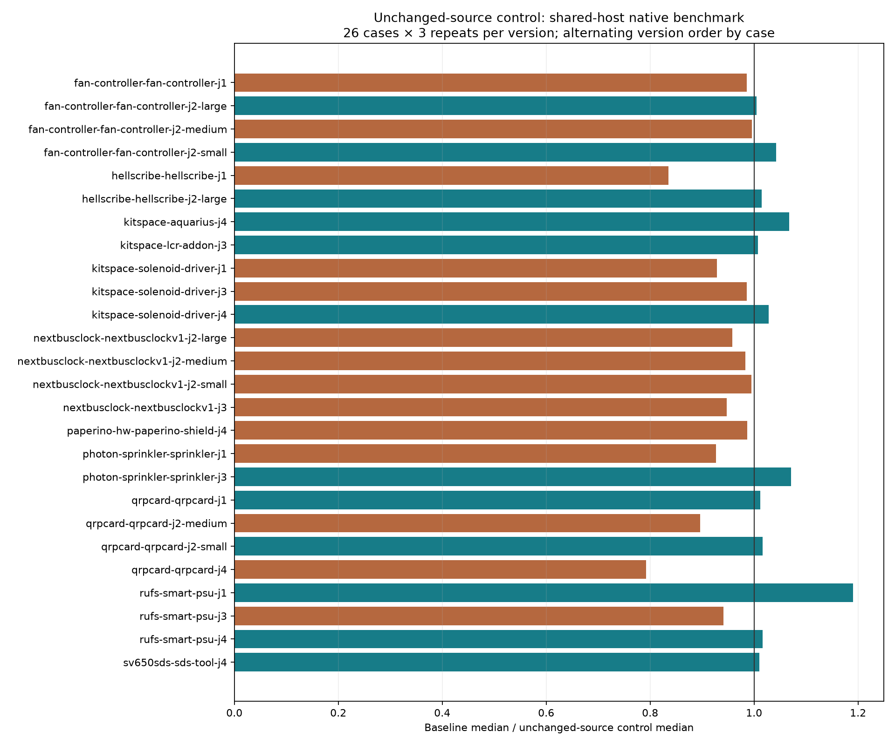

# Convex-core allocation diagnosis

Paperino does not call the public `dist2` wrapper in this native-settings route. A fast path there would miss this workload. Instead, the instrumented baseline records 25,863,135 `coreOf` calls: 20,704,578 capsules, 5,125,664 disks, 30,050 hulls and 2,843 boxes. Capsule cores construct an object and an array on each call. Counts establish source-level allocation opportunities, not how many objects survive JIT optimization or how much GC time they cause.

One stack sample every 4,096 calls points primarily to `withinRim`, followed by clearance comparisons. This is deterministic systematic sampling and may alias periodic callers; caller counts are not exact and do not measure CPU time. The first 64 shape examples per kind are biased diagnostic examples, not a random workload. Raw trace and archive/generator hashes are retained. Tracing creates a separate archive and never edits the router checkout.

No production change is adopted. The existing rim-allocation experiment already addresses the dominant sampled caller; a future experiment should investigate the clearance comparison path with exact boundary/integer behavior, without caching mutable shapes. CPU-profile attribution can move under inlining, so absent named functions do not establish absent work.



The full native experiment is an **unchanged-production-source control**, not a speedup comparison: baseline `69cf598` and diagnostic-tools commit `4ae8dee` have identical `src`, `spec`, `tools` and `test` trees. Same host `hyper-ms-lin`, cores 12–19, nice 10, all 26 frozen cases × three repeats per side, alternating order by case. Heavy unit tests, tracing, native measurements and CPU profiling run sequentially. Lightweight diagnostic TypeScript checks overlap native execution; shared-host timing is a control, not an optimization measurement. Shared-host timing variation remains. Frozen inputs/settings/checker/runtime are unchanged. Native timing includes failed attempts for diagnosis, not ranking. Per-case p95 is nearest rank, the maximum of three repeats.

Full per-case median/p95, passed/opens/errors/vias/length and session fingerprints are in [native-tables.md](native-tables.md) and [native-measurements.json](native-measurements.json). Existing native failures remain; this is not a DRC-clean suite. No fresh ladder or slow-acceptance claim is made for these diagnostic-only changes. Previous baseline slow failures remain applicable.

## Reproduce

Use fresh directories and output filenames. From this checkout:

```bash
assets=docs/pr-assets/agent-fab-router-perf-distance
scratch=/home/hyper/bench/agents/codex-fabpcb-perf/scratch
# Create a separate baseline source, then install its locked dependencies.
git worktree add -b agent/fab-router-perf-distance-reproduce "$scratch/distance-base" 69cf598
bun install --cwd "$scratch/distance-base"
taskset -c 12-19 nice -n 10 timeout 900 bash -c 'bun run typecheck && bun run check:layers && bun run test'
taskset -c 12-19 nice -n 10 timeout 10800 python3 "$assets/paired-native.py" --benchmark-checkout /home/hyper/bench/wt/fp-perf --baseline-source "$scratch/distance-base" --candidate-source "$PWD" --out "$scratch/distance-native"
python3 "$assets/summarize-paired.py" "$scratch/distance-native" --out "$scratch/distance-summary" --label native
work=("$scratch"/distance-native/before/paperino-hw-paperino-shield-j4/runs/*/fab-router/work)
python3 "$assets/instrument-distance.py" "$PWD" 69cf598 "$scratch/distance-instrumented"
taskset -c 12-19 nice -n 10 timeout 600 bun "$assets/trace-route.ts" "$scratch/distance-instrumented" "${work[0]}" "$scratch/distance-trace.json"
mkdir "$scratch/distance-profiles"
taskset -c 12-19 nice -n 10 timeout 600 bun --cpu-prof --cpu-prof-dir "$scratch/distance-profiles" "$assets/profile-route.ts" "$PWD" "${work[0]}" 3 > "$scratch/distance-profile.log"
python3 "$assets/analyze-distance.py" "$scratch/distance-trace.json" "$scratch/distance-profile.log" "$scratch/distance-profiles" "$scratch/distance-profile-summary.json"
# Requires matplotlib; these commands render the committed data alongside the tools.
python3 "$assets/plot-core.py"
python3 "$assets/plot.py"
```

Instrumented wall-clock times are diagnostic only and excluded from native timing tables. The trace output and archive paths must be new. The analyzer verifies shape totals, sample counts and exact session equality with all three uninstrumented profiled routes. The native analyzer checks all 78 paired session hashes, quality fields, source/configuration identities and chronology. Raw profiles remain in local scratch; their hashes and geometry self samples are retained in the summary.

The committed `l2.dsn` snapshot has SHA-256 `ca3a3aa58f2b3f29871f5e88c2a2a9e9b9e669036115ea81d73b32e09de4eea9`, matching `/home/hyper/bench/boards/ladder/l2.dsn` at collection. The newer `*-cycle14.dsn` boards are different workloads and are outside this experiment. To repeat the larger-board diagnostic after the native runs:

```bash
# Reuses the instrumented archive created above, with a 600s route budget and two passes.
taskset -c 12-19 nice -n 10 timeout 900 bun "$assets/trace-route.ts" "$scratch/distance-instrumented" "$assets/l2.dsn" "$scratch/distance-ladder-trace.json" ladder
mkdir "$scratch/distance-ladder-profiles"
taskset -c 12-19 nice -n 10 timeout 1200 bun --cpu-prof --cpu-prof-dir "$scratch/distance-ladder-profiles" "$assets/profile-ladder.ts" "$PWD" "$assets/l2.dsn" 3 > "$scratch/distance-ladder-profile.log"
python3 "$assets/analyze-distance.py" "$scratch/distance-ladder-trace.json" "$scratch/distance-ladder-profile.log" "$scratch/distance-ladder-profiles" "$scratch/distance-ladder-summary.json"
```

## Full native control results

| Measurement | Baseline | Unchanged-source control | Repeats per side |
|---|---:|---:|---:|
| Sum of 26 case medians, seconds | 131.432 | 129.295 | 3/case |
| Total route time, seconds | 395.390 | 388.590 | 78 attempts |
| Passing attempts | 39/78 | 39/78 | 3/case |
| Cases passing 3/3 | 13/26 | 13/26 | 3/case |
| Opens / new native DRC errors | 120 / 27 | 120 / 27 | 3/case |

All 78 paired sessions and quality outcomes match. The 1.6% difference in case-median sum occurs with identical production source and is not an optimization result. All timings include failed attempts; existing errors are retained. The analyzer verifies source/configuration identities and complete chronological schedule.



Validation: typecheck and layer checks pass (65 files, zero violations). All 859 unit tests pass, 398,454 assertions in 211.02 seconds. Strict standalone TypeScript checks pass for all three diagnostic route tools. Instrumentation regeneration produces the exact measured source and its overwrite guard preserves existing content. All four exploratory/final Paperino traces have identical sessions and no timeout. Full native output and all per-case median/p95 values follow.

All 78 paired SES hashes and quality outcomes match.

| Case | Before median / p95 s | After median / p95 s | Median ratio (control) | Passed (both) | Opens / errors (both) |
|---|---:|---:|---:|---:|---:|
| fan-controller-fan-controller-j1 | 3.809 / 3.869 | 3.862 / 3.937 | 0.99× | 0/3 | 15 / 0 |
| fan-controller-fan-controller-j2-large | 0.872 / 1.000 | 0.867 / 0.991 | 1.01× | 3/3 | 0 / 0 |
| fan-controller-fan-controller-j2-medium | 0.749 / 0.760 | 0.752 / 0.755 | 1.00× | 3/3 | 0 / 0 |
| fan-controller-fan-controller-j2-small | 3.615 / 3.767 | 3.467 / 3.736 | 1.04× | 0/3 | 3 / 0 |
| hellscribe-hellscribe-j1 | 2.073 / 2.422 | 2.480 / 2.495 | 0.84× | 0/3 | 9 / 0 |
| hellscribe-hellscribe-j2-large | 0.995 / 1.148 | 0.981 / 0.998 | 1.01× | 0/3 | 3 / 0 |
| kitspace-aquarius-j4 | 51.861 / 54.615 | 48.577 / 48.664 | 1.07× | 0/3 | 45 / 18 |
| kitspace-lcr-addon-j3 | 2.150 / 2.261 | 2.134 / 2.293 | 1.01× | 3/3 | 0 / 0 |
| kitspace-solenoid-driver-j1 | 0.714 / 0.720 | 0.769 / 0.877 | 0.93× | 3/3 | 0 / 0 |
| kitspace-solenoid-driver-j3 | 0.713 / 0.720 | 0.723 / 0.734 | 0.99× | 3/3 | 0 / 0 |
| kitspace-solenoid-driver-j4 | 0.734 / 0.847 | 0.714 / 0.851 | 1.03× | 3/3 | 0 / 0 |
| nextbusclock-nextbusclockv1-j2-large | 2.879 / 2.999 | 3.004 / 3.269 | 0.96× | 3/3 | 0 / 0 |
| nextbusclock-nextbusclockv1-j2-medium | 0.969 / 0.983 | 0.986 / 0.986 | 0.98× | 3/3 | 0 / 0 |
| nextbusclock-nextbusclockv1-j2-small | 0.713 / 0.715 | 0.716 / 0.747 | 0.99× | 3/3 | 0 / 0 |
| nextbusclock-nextbusclockv1-j3 | 7.282 / 7.541 | 7.690 / 7.808 | 0.95× | 0/3 | 9 / 0 |
| paperino-hw-paperino-shield-j4 | 15.209 / 15.298 | 15.405 / 15.596 | 0.99× | 0/3 | 18 / 0 |
| photon-sprinkler-sprinkler-j1 | 11.078 / 13.143 | 11.958 / 12.615 | 0.93× | 0/3 | 6 / 0 |
| photon-sprinkler-sprinkler-j3 | 16.382 / 16.951 | 15.291 / 15.349 | 1.07× | 0/3 | 6 / 0 |
| qrpcard-qrpcard-j1 | 1.389 / 1.434 | 1.372 / 1.430 | 1.01× | 3/3 | 0 / 0 |
| qrpcard-qrpcard-j2-medium | 0.884 / 1.002 | 0.987 / 1.002 | 0.90× | 3/3 | 0 / 0 |
| qrpcard-qrpcard-j2-small | 0.744 / 0.787 | 0.732 / 0.763 | 1.02× | 0/3 | 0 / 6 |
| qrpcard-qrpcard-j4 | 0.996 / 1.312 | 1.257 / 1.290 | 0.79× | 0/3 | 0 / 3 |
| rufs-smart-psu-j1 | 0.864 / 0.889 | 0.726 / 0.746 | 1.19× | 3/3 | 0 / 0 |
| rufs-smart-psu-j3 | 1.776 / 1.791 | 1.888 / 2.057 | 0.94× | 0/3 | 3 / 0 |
| rufs-smart-psu-j4 | 1.128 / 1.248 | 1.110 / 1.118 | 1.02× | 0/3 | 3 / 0 |
| sv650sds-sds-tool-j4 | 0.855 / 0.857 | 0.846 / 0.878 | 1.01× | 3/3 | 0 / 0 |

Sum of case medians: 131.432 → 129.295 seconds.
before: total 395.390s; 39/78 passed; 120 opens; 27 new native errors.
after: total 388.590s; 39/78 passed; 120 opens; 27 new native errors.

## CPU profiles and larger-board diagnosis

| Baseline workload | Exact core calls | Capsule calls | Uninstrumented profiled median, s | Routes | coreOf self / total CPU samples |
|---|---:|---:|---:|---:|---:|
| Paperino native-settings input | 25,863,135 | 20,704,578 | 16.004053 | 3 | 917 / 44,285 |
| Frozen L2, seed 1, fixed two passes | 41,507,868 | 30,054,557 | 18.061623 | 3 | 1,351 / 50,019 |

Each trace session matches all three corresponding uninstrumented profile sessions exactly, with no timeout and unchanged input/settings hashes. Paperino retains six incompletes and L2 retains 29; all six profile reports have zero added router violations. These counters are **not native DRC checks**. Times across these two different workloads are not a comparison of speed or quality. Instrumented times are excluded.

Systematic caller samples on L2: rim containment 6,188; clearance comparison 3,570; shape bounds 367; DRC touching 8. Paperino: rim containment 4,609; clearance comparison 1,610; bounds 94; DRC closer 1. One sample per 4,096 calls can alias periodic behavior. Named self samples put `coreOf` at about 2.1% on Paperino and 2.7% on L2; JIT inlining, eliminated allocations and GC attribution limit conclusions from either counter. No heap allocation measurement or routing improvement is claimed.

The retained analyzer rejects a corrupt trace call total and a mismatched profile input hash, and refuses to replace an existing summary without changing its hash. Generator provenance matches the committed instrumentation tool. Full profile self-sample lists and raw profile SHA-256 values are in `distance-summary.json` and `ladder-summary.json`; raw profiles stay in local scratch.

Final pre-push validation also passes fresh typecheck/layer checks, all 20 geometry/clearance/fingerprint tests (226,814 assertions, 9.67 seconds), and strict TypeScript checks for the three diagnostic route tools. Production and test trees still match `69cf598` exactly. No routing optimization is shipped.
