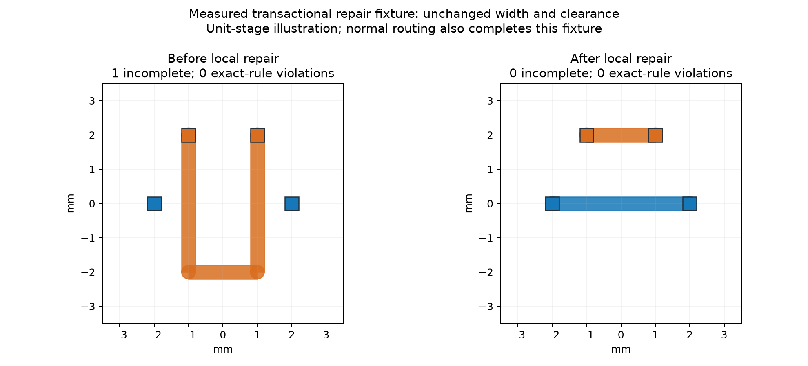
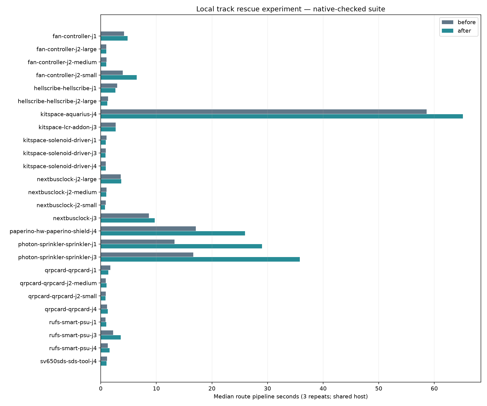
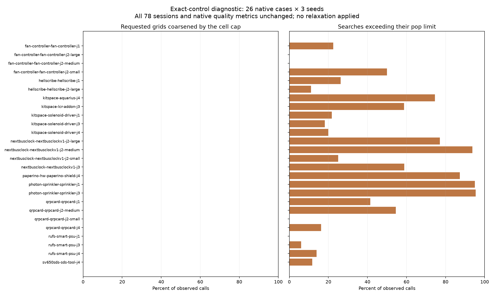

Current experiment: [default-off public local recovery](public-recovery.md), with measured public-setting evidence under [public-checks/](public-checks/). Earlier documents below describe historical research snapshots and rejected approaches.

Latest: [gradual endpoint-region scheduler and cooperative budgets](schedule-checks.md). Research-only recorded-path replay; production routing is unchanged and original-board recovery remains pending.

The bounded local track rescue experiment did not improve any frozen native task. This change retains its exact patch, controls, measurements, diagnostic tools and plots; the final production source is restored to the control. No speedup or native DRC fix is claimed.

The measured control is `69cf598`; the default-off candidate is `4821f12`. Only the isolated candidate settings add `localRescue: true`. The 26-case suite, three seeds, checker, runtime, source identities and input DSNs are checked by `summarize-native.py`. All 78 paired SES outputs and native quality/via/length measurements match. Both versions pass 39/78 attempts and 13/26 cases on all repeats, with 120 opens and 27 native errors. Those native thermal findings remain unresolved. No additional native error or open occurs compared with the control.

The sum of per-case median pipeline times is 150.037796 → 205.286092 seconds (+36.82%); total pipeline time is 449.546991 → 602.711843 seconds. Overall attempt median is 1.299345 → 1.346766 seconds and nearest-rank p95 is 18.385913 → 36.872084 seconds. Timings are descriptive measurements on shared host `hyper-ms-lin`, cores 12–19, Bun 1.4.0. Own heavy jobs run sequentially at effective niceness 19; light reporting overlaps. Three observations per case provide only a limited tail estimate: per-case p95 is their maximum.

The candidate runs after normal routing and optimisation. For each remaining connection, it grows an endpoint bounding box by 4, 8 and 16 routing pitches, removes up to 24 whole free router tracks of neighbouring nets contained in the region, then tries two hard-only reroute passes. File copper, held items, ignored nets and existing vias stay protected. A trial is kept only if its newly inserted copper is track-only and contained in the region, its target joins, every pre-existing pad/pour terminal join survives, total incompletes strictly decrease and exact-rule DRC does not worsen. Failed trials rewind the shared journal and restore track order. Widths, vias, clearance rules and lattice pitch are unchanged. This is only the first, no-rule-change lever; margin reduction, neck-down, permitted smaller vias and finer-grid legalisation are not implemented.

The small fixture image shows an actual measured unit-stage repair: one incomplete becomes zero, with zero exact-rule violations and unchanged width. Normal routing already completes that fixture, so it is not a full-pipeline stall reproducer or evidence of native completion improvement. Its failed-trial test checks copper, journal statistics and live-lattice connectivity restoration. Other tests cover disabled routing policy, held/file copper, ignored nets, abort, deadline and item caps.





`native-tables.md` contains per-case median/p95 seconds, passed runs, opens, native errors, vias and lengths. `native-measurements.json` retains per-attempt settings, hashes, reports and controls. The analyzer rejects mismatched committed source and preserves existing output on a repeated invocation; `analyzer-validation.json` records those negative controls.

Reproduction requires an installed standalone benchmark checkout and separate own source checkouts at the two measured commits. Do not run against or modify shared reference runtime sources. Exact native/large-input commands are in `reproduce.sh`; provide `BASELINE_SOURCE`, `CANDIDATE_SOURCE`, `BENCHMARK_CHECKOUT`, `DENSE_CASE`, and an unused `RUN_ROOT`. The committed L2/L3 inputs freeze the measured synthetic boards. The dense native helper accepts the separately supplied dense six-layer case directory. CPU profiles use `bun --cpu-prof --cpu-prof-dir DIR profile-route.ts SOURCE NATIVE_WORK_DIRECTORY 1`; the helper uses the native Paperino seed-2 settings and records per-connection rescue logs. Profiles are diagnostics, not additional native checks.

The larger-input checks use two passes and a 120-second whole-route budget, three runs per version. L2 has 29 incompletes and zero added router violations in every run; its SES output is unchanged. L3 reaches the budget with 154 incompletes and zero added router violations in all six runs; no rescue log occurs, so this budget does not exercise rescue on L3. These engine counters are not native KiCad results. Dense native checks are separate from the frozen 26-case suite and retain their actual incomplete/time-budget outcomes. All six dense raw SES hashes differ; the existing acceptance session normalizer produces one identical hash (dense-session-order.json), while native counts, vias and length match.

| Input / check | Before median / p95 s | After median / p95 s | Incomplete or native opens before → after | Added router violations or native errors before → after | Vias median before → after | Length mm median before → after |
|---|---:|---:|---|---|---|---|
| l2.dsn, engine only | 20.464 / 21.099 | 35.035 / 36.221 | 29 → 29 | 0 → 0 | 42 → 42 | 734.966 → 734.966 |
| l3-cycle18.dsn, engine only | 120.059 / 120.077 | 120.052 / 120.057 | 154 → 154 | 0 → 0 | 91 → 91 | 1624.333 → 1624.333 |
| dense6, native (opens/errors summed over 3) | 121.045 / 121.106 | 121.045 / 121.098 | 549 → 549 | 0 → 0 | 315 → 315 | 2300.008 → 2300.008 |

before: median 15.979817s; 45338 CPU samples; all native seed-2 SES match=True; logged kept repairs=0

after: median 25.728140s; 80987 CPU samples; all native seed-2 SES match=True; logged kept repairs=0

Across three profiles/version, sampled self counts include withinRim 7106→10380, aStar 3163→10129 and collect 5853→8457. This records more search/geometry sampling in the rejected candidate; it is not a heap or GC measurement.


CPU profiles use separate alternating processes and identical native seed-2 settings. Their complete top-self-function counts, hashes, reports, copper statistics and rescue logs are in `extra-measurements.json`; raw profiles remain in agent scratch. Sample attribution can shift with inlining and is not an allocation/GC measurement. The profiles describe the rejected experiment and establish no routing gain.

The exact measured candidate and the restored source both pass typecheck, layer checks and the full unit suite; summaries and log hashes are in `validation.json`. The final `src`, `spec`, `tools` and `test` trees match control `69cf598`, and the retained patch applies to that source. There is no fresh slow-acceptance result: this candidate was rejected at the native completion/performance gate before adoption, and prior slow failures remain. Fixture rendering initially failed while cloning function-valued layout data, and custom dense setup initially omitted the harness import path; both were corrected before those measurements. No failed routing attempt was dropped or overwritten.

Next work should investigate a distinct legal search/lattice lever on genuine residual native connections. This unit-stage fixture is not the requested full-pipeline stall regression. Dense and L3 budgets also need sufficient room to reach post-pass rescue before drawing conclusions about rescue on those inputs. Do not lower any physical rule, infer board minima from class defaults, or adopt this patch on the strength of the unit illustration.

Required commands `bun run typecheck && bun run check:layers && bun run test` passed on the exact candidate (868 tests / 398481 assertions, 237.20s; 66 layered files / 0 violations) and restored source (859 tests / 398454 assertions, 245.46s; 65 layered files / 0 violations). Three TypeScript route helpers and the dense session-normalization helper also pass strict standalone typechecking; Python AST and shell syntax checks pass.

Cycle 18 adds a control-only search-grid census, not a new rescue candidate. The diagnostic tree instruments `routeConnection`, `gridRegion`, and the two existing A* return sites. All physical rules, search budgets, grid choices and copper decisions remain unchanged. No production files are changed in this PR's final tree. `grid-source-audit.json` checks all 1,482 tracked src/spec files against `69cf598`; only the injected counters differ. Five copied ignored acceptance CSV reports are explicitly listed and are not runtime source. The disposable diagnostic snapshot is used only to satisfy the benchmark source-identity requirement.

The fresh native sweep covers all 26 cases and three seeds on the same host/cores as the prior cycle-17 control. All 78 SES hashes, input/settings/manifest hashes, native outcomes, vias and lengths match the control. Both have 39/78 passing attempts, 13/26 cases passing all three seeds, 120 opens and 27 native errors. Existing thermal errors remain unresolved. `grid-tables.md` includes per-case before/diagnostic median and p95 times (p95 is max of three); timing includes instrumentation overhead and shared-host variation, so this is not a performance improvement measurement. The prior control is historical, not a fresh alternating timing control.

There are 14,802 observed searches, 153,112,152 pops and 9,234 pop-limit exits (62.38%). None of the 14,802 requested regions is coarsened by the 220,000-cell cap. These counters cover searches invoked inside `routeConnection`; they do not imply every search site or larger board behaves the same. This rules out cap-induced coarsening in these observed calls, not a need for finer local geometry. Increasing a requested grid divisor alone does not address the already frequent pop-limit exits.



Independent seed-1 replays reproduce the exact native session on Paperino J4, Rufs J3 and Photon J3. All nine final engine residual keys match the census. `residual-grid-tables.md` contains their counts. Paperino's six residuals have 62–100 searches each, 56–84 pop-limit exits, but also 6–13 graph-goal hits each and zero successful insertions. Rufs' single residual has 294 searches, 18 pop-limit exits and 44 graph-goal hits; Photon's two have 609 searches, 591 pop-limit exits and 15 graph-goal hits in total. A graph goal does not establish successful exact legalisation/insertion. These results justify investigating rejection stages alongside any locally increased search budget; they do not establish that either change will close a connection. The replays are engine diagnostics, not additional native benchmark attempts or a minimized regression fixture.

Reproduce with an installed benchmark checkout, own control source and the prior control evidence:

```bash
CONTROL_SOURCE=/path/to/own/control-source \
BENCHMARK_CHECKOUT=/path/to/own/benchmark-checkout \
PRIOR_CONTROL=/path/to/cycle17-paired/before \
RUN_ROOT=/path/to/unused/census-run \
bash docs/pr-assets/agent-fab-router-perf-local-rescue/reproduce-grid-census.sh
```

The script records the diagnostic source in a disposable local Git repository, runs the unchanged full native checker under a 5,400-second outer timeout, verifies all paired results before writing its report, plots the counters, and replays the three real stalls. Matplotlib must be available for the plot. `grid-helper-validation.json` records overwrite guards, report preservation, rejection of an instrumented tree as control, and wrong-source rejection before report writes. The diagnostic source passes typecheck. No dense/ladder or slow-acceptance rerun is claimed for this diagnostic-only addition; their prior cap limitations still apply. No relaxed rules, smaller copper or new routing setting is adopted. P1's opt-in legal relaxation and small full-pipeline regression fixture remain unfinished.

An initial benchmark setup attempt stopped before routing because the disposable source lacked Git metadata; its log is retained in scratch. Initial source-audit setup used quoted Git paths and then encountered copied ignored report CSVs; null-delimited paths and explicit artifact accounting fixed both before evidence publication. No routing attempt was omitted or overwritten. Full unit checks follow the native sweep; the final residual replay briefly overlapped the start of unit tests. No timing claim is based on those diagnostic replays.

Cycle-18 final required checks PASS: typecheck; layers 65 files / 0 violations; 859 tests / 0 failures / 398454 assertions, 223.00 seconds. Log hashes and diagnostic source identity are in `grid-checks.json`.
