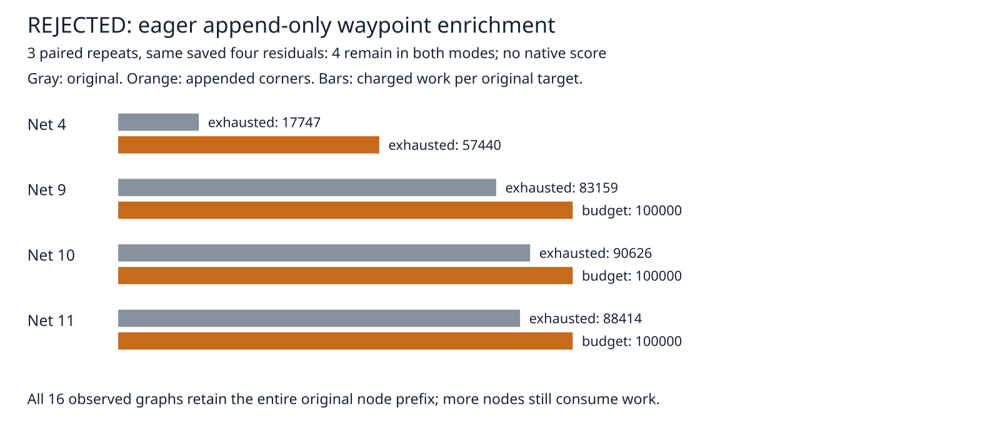

# Reject eager append-only waypoint enrichment

The preceding full native comparison rejected replacing original obstacle-corner offsets. This distinct isolated experiment preserves the complete original generation block, then appends actual-kind/sheet corners using the same deduplication set, 512-node cap and charged generation callback. All original nodes retain capacity priority. Exact rules, widths, scheduler, transaction, original-terminal checks, regions, anchors, shared target work/deadline and production sources are unchanged.

**Rejected:** appending these nodes before search consumes more work without closing this saved stall. This is neither a deferred second search nor a native safety policy. Preserving the original graph's nodes does not preserve the original search's exploration order or budget coverage. No production adoption, consumer pin change, default promotion or speedup is claimed.

Same saved seed-1 paperino session, host and cores 12–19; three paired repeats, sequential without overlapping our own heavy jobs. Each repeat processes all four original residual targets on one live layout, through the real `recoverPointComponent` and its shared 100000-work/15-second cooperative limit per target. Time remains observational on a shared host.

| Measure per repeat | Original graph | Eager append-only graph |
|---|---:|---:|
| Engine residuals, before → after | 4 → 4 | 4 → 4 |
| Charged work, four targets | 279946 | 357440 |
| Targets stopping at work limit | 0 | 3 |
| Added tracks / vias / length LU | 0 / 0 / 0 | 0 / 0 / 0 |
| Exact violations at every target and final rewind | 0 | 0 |
| Median / p95 summed coordinator seconds | 0.963134 / 0.978746 | 1.211605 / 1.213870 |
| Mutated final sessions | 0 | 0 |

p95 of three observations is their maximum. [Per-target status/work](cases.md), [summary](summary.json). All structural traces, ledger charges and session hashes agree across three repeats after removing elapsed seconds. Rejected attempts preserve their input session; final journal rewind restores the initial session and exact count. These are saved-session engine diagnostics, **not native opens, native errors or scored full-suite attempts**.



A separate scratch observer executes each generator through node generation, then skips search. On all 16 fixed target/sheet/region graphs (four targets × margins 0/4/8/16), the candidate retains the complete original node array as an identical prefix and appends at least one node, never exceeding 512. Original arrays also match the historical independently enumerated census hashes. This observer uses unbounded generation accounting and does not assert that the production coordinator reaches all 16 graphs. It creates no copper and leaves the session/exact count unchanged. Raw arrays and generation charges are in `prefix.json.gz`.

`report.py` checks paired inputs, three-repeat parity, exact residual/status/work counts, summed shared ledgers, caps, unchanged copper/session and 16 node prefixes. Six deliberately corrupted archives must fail: missing repeat, false closure, false exact count, overbudget work, broken prefix and false ledger. This is archive consistency checking; source-input replay below executes the engine checks. `source-audit.json` binds every one of the 1488 tracked src/spec files and the isolated candidate hash; preparation rejects source drift. Only the isolated visibility generator changes. Production/test/rule files remain unchanged.

The candidate is rejected at this bounded diagnostic gate. No fresh native 26×3, dense/ladder or slow acceptance is claimed. The prior complete native replacement rejection (90→93 opens, 27→33 errors) remains a different revision and is not attributed to this one. A future production proposal still needs all native/larger/slow gates and a thermal-aware safety solution. Do not repeat this eager append policy or raise its work limit from this result. A distinct approach should avoid spending the original search budget on enrichment before it is needed, while preserving the single shared ledger; this archive does not establish that such an approach can close the stall.

## Reproduce

From the engine worktree, using the unchanged saved inputs from cycle42 (regeneration commands in [candidate coverage](../candidate-coverage/README.md)):

```bash
ASSET=docs/pr-assets/agent-fab-router-perf-local-rescue/append-kind-spacing
DRIVER=docs/pr-assets/agent-fab-router-perf-local-rescue/bounded-kind-spacing/run.ts
OUT=/home/hyper/bench/agents/codex-fabpcb-perf/scratch/repro52
NATIVE=/home/hyper/bench/agents/codex-fabpcb-perf/scratch/cycle42/native-after-run
mkdir -p "$OUT"
python3 "$ASSET/prepare.py" "$OUT/source"
for repeat in 1 2 3; do
  for mode in before after; do
    taskset -c 12-19 nice -n 10 timeout 1200 bun "$DRIVER" "$OUT/source/$mode" "$NATIVE" "$OUT/final-$mode-$repeat.json"
  done
done
taskset -c 12-19 nice -n 10 timeout 1200 bun "$ASSET/prefix.ts" "$OUT/source" "$NATIVE" "$OUT/prefix.json"
python3 - "$OUT" <<'PY'
import gzip,json,sys
from pathlib import Path
p=Path(sys.argv[1])
d={m:[json.loads((p/f'final-{m}-{i}.json').read_text()) for i in [1,2,3]] for m in ['before','after']}
(p/'results.json.gz').write_bytes(gzip.compress(json.dumps(d,separators=(',',':')).encode(),mtime=0))
(p/'prefix.json.gz').write_bytes(gzip.compress((p/'prefix.json').read_bytes(),mtime=0))
PY
python3 "$ASSET/report.py" "$OUT/results.json.gz" "$OUT/prefix.json.gz" "$OUT/report"
rsvg-convert -w 1600 "$OUT/report/work.svg" -o "$OUT/report/work.png"
cmp "$ASSET/work.png" "$OUT/report/work.png"
taskset -c 12-19 nice -n 10 timeout 1800 bash -c 'bun run typecheck && bun run check:layers && bun run test'
```

For report-only replay, pass the two committed gzip archives to `report.py`; no engine execution is required. The chart, per-target table and summary reproduce byte-for-byte. The separate initial exploratory candidate run is retained only in scratch; the six final repeated runs are the published data. Production checks are recorded in `checks.txt` and `checks.log.gz`; no candidate full-test success is claimed.
