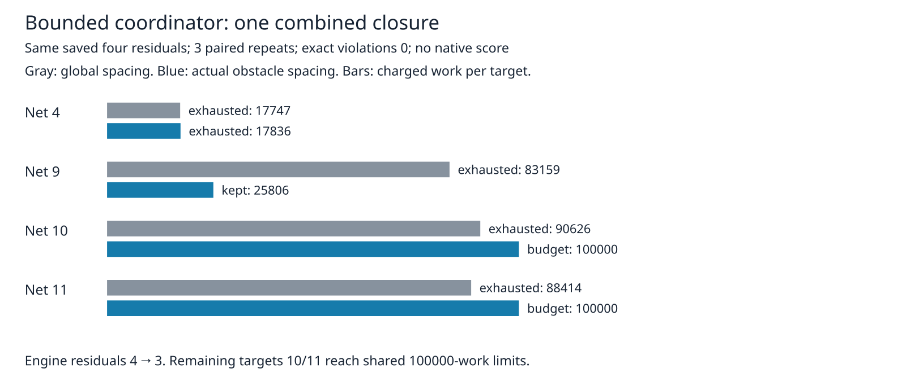

# Actual obstacle spacing under the production coordinator

This scratch-only experiment follows the isolated [kind/sheet path witnesses](../kind-spacing/README.md). It changes only obstacle-corner proposal offsets in an isolated source snapshot, using the actual track/obstacle kind spacing on each sheet. Exact clearance rules, widths, regions, accounting, deadlines, journal and transaction gates remain unchanged. No production implementation or consumer pin changes are included.

Unlike the earlier independent path witnesses, each mode/repeat processes all four original saved residual targets sequentially on ONE live layout. Later targets see any retained route. Each call uses the real `recoverPointComponent`, its default 512 nodes, margins0/4/8/16, eight alternative pairs, one shared100000-work ledger and15-second cooperative target deadline. Whole-region, retained-copper, original/prior terminal and exact-geometry gates execute through the actual scheduler/transaction. Each final layout is rewound to the imported session and exact0. A1200-second outer supervisor covers all six runs.

Same saved seed1 paperino residual fixture, same host/cores12–19, three paired repeats:

| Measure | Global maximum proposal spacing | Actual kind/sheet proposal spacing |
|---|---:|---:|
| Initial engine residuals per repeat | 4 | 4 |
| Final combined engine residuals per repeat | 4 | 3 |
| Exact violations, every target/final rewind | 0 | 0 |
| Charged work, four targets | 279946 | 243642 |
| Kept tracks per repeat | 0 | 1 |
| Imported/final barrels | 1/1 | 1/1 |
| Added track length, LU | 0 | 736645.913416973 |
| Median summed coordinator seconds | 1.372272 | 1.418672 |
| Maximum summed coordinator seconds, 3 repeats | 1.427024 | 1.463745 |

The net9 original-anchor attempt closes at margin8, using25806 work, rather than relying on margin64 or a replacement search algorithm. Net4 exhausts; nets10/11 reach their100000 shared-work limits on the combined layout. The three isolated legal paths from the previous diagnostic therefore do **not** become three combined closures here. All structural traces/work/session hashes agree across three repeats after removing elapsed seconds. See [target table](cases.md).



Times overlap the required test suite and shared host activity; no causal speed claim. These are engine residuals and exact predicates on imported saved copper, **not native opens or native DRC**. Native26×3, dense/ladder and slow acceptance have not been rerun; historical known27native errors remain unresolved. Production remains8e53e7d/defaultoff. This archive establishes a bounded combined witness, not adoption or a full-suite improvement.

The report checks ledger sums, paired inputs, repeat parity, limits, exact counts, rollback flags and expected combined outcomes. Four mutated archives (missing repeat, overbudget work, false exact count, false closure count) must fail. Archive verification alone is consistency checking; source-input replay executes the real predicates. The driver is a reusable saved-stall regression experiment; existing production budget/rollback controls remain unchanged.

## Reproduce

From the engine worktree, with the [cycle42 after-run inputs](../candidate-coverage/README.md) reconstructed locally:

```bash
ASSET=docs/pr-assets/agent-fab-router-perf-local-rescue/bounded-kind-spacing
OUT=/home/hyper/bench/agents/codex-fabpcb-perf/scratch/repro49
NATIVE=/home/hyper/bench/agents/codex-fabpcb-perf/scratch/cycle42/native-after-run
mkdir -p "$OUT"
python3 "$ASSET/prepare.py" "$OUT/source"
for repeat in 1 2 3; do
  for mode in before after; do
    taskset -c 12-19 nice -n 10 timeout 1200 bun "$ASSET/run.ts" "$OUT/source/$mode" "$NATIVE" "$OUT/final-$mode-$repeat.json"
  done
done
python3 - "$OUT" <<'PY'
import gzip,json,sys
from pathlib import Path
p=Path(sys.argv[1])
data={m:[json.loads((p/f'final-{m}-{i}.json').read_text()) for i in range(1,4)] for m in ['before','after']}
(p/'results.json.gz').write_bytes(gzip.compress(json.dumps(data,separators=(',',':')).encode(),mtime=0))
PY
python3 "$ASSET/report.py" "$OUT/results.json.gz" "$OUT/report"
rsvg-convert -w 1600 "$OUT/report/work.svg" -o "$OUT/report/work.png"
cmp "$ASSET/work.png" "$OUT/report/work.png"
python3 "$ASSET/verify.py"
taskset -c 12-19 nice -n 10 timeout 1800 bash -c 'bun run typecheck && bun run check:layers && bun run test'
```

Elapsed seconds will vary; compare structural traces after dropping `seconds`. Source audit binds all tracked src/spec files plus the four exact transformation replacements. Preparation fails if those replacements drift. No frozen cases/checker/scoring, real rule values or other agents' files were edited.

Next: turn the small candidate-offset delta into a separately checked experimental engine revision, add a compact self-contained regression, and run paired native26×3 plus supplied larger inputs and slow acceptance before proposing adoption. Preserve defaultoff and all accounting/transaction gates. Combined routing order remains a question; do not extrapolate the isolated three paths.
