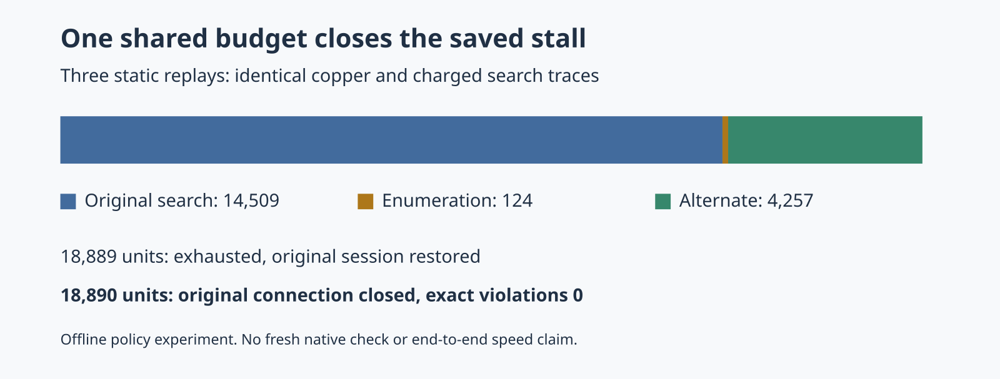

# Shared work and deadline policy for alternate point anchors

This offline follow-up fixes the earlier probe's per-pair budget multiplication before production integration. `recover.ts` tries the original point pair first, then enumerates live-component point pairs only after that search exhausts its regions. Every inspected pad/barrel and every Cartesian-product pair charges one work unit before inspection. A bounded ordered list retains at most eight compatible alternate pairs. Ordering is distance, from id, to id. Each alternate receives only the work remaining from the same 100000-unit target budget and the same absolute 15-second deadline. Limits may be reduced for controls but cannot exceed these caps.

The route's absolute deadline and cancellation signal take precedence. Every enumeration step checks them; every proposal/validation checkpoint retains the existing scheduler checks. A single-target remaining-item allowance of zero skips all work; one permits the insertion-only visibility proposal's one track. Every pair uses the existing transaction against the **original** terminals, with exact geometry, retained copper, terminal connectivity and full-copper region gates. Late/cancelled insertions rewind. There is no rule, width, via, grid, rip-up or default change.

This module is **not imported by production**. It is a point-only single-target prototype; it does not implement production ignored-net filtering, scheduling across targets, remaining route-item accounting, existing pour selection, or public hooks. A production caller must provide those policies. Endpoint/profile resolution, connectivity, lattice construction and exact checks are synchronous and uncharged, with cancellation checks surrounding them; these cooperative budgets do not provide hard wall-clock preemption. Point collection stores at most the charged item count, while candidate storage is capped at eight. General pour contacts remain unsupported. This cycle does not adopt a production improvement or change the consumer pin.

## Paired residual measurements

Same full retained-board fixture, settings, host and cores 12–19; **three fresh offline residual replays per policy**. The prior policy is the unchanged `point-component-probe/probe.ts`, run against the archived seed-1 residual each time. These are not fresh full-board routing runs or native checks.

| Per replay | Prior independent-pair probe | Shared-budget probe |
| --- | ---: | ---: |
| Original engine connections remaining | 1 → 0 | 1 → 0 |
| Exact engine violations after | 0 | 0 |
| Original search charged units | 14509 | 14509 |
| Alternate search charged units | 4257 | 4257 |
| Enumeration charged units | uncharged | 124 |
| Total charged units | 18766 | 18890 |
| Maximum configured search work | 100000 per pair | 100000 per target including enumeration |
| Search trials/proposals and final session bytes | identical | identical |

Final bounded output SHA-256 is `3386584cc61b7d7b0cab6ba4a5f7aa4be80a97b6228e59f29086dddcc3b79ad3`. All old copper is retained. `verify.py` checks every search result/region/proposal, all six paired replay sessions, and binds all bounded outputs to the **six previously checked native sessions** in the preceding cycle's archive. No native check was repeated. Historical native 1→0 opens/zero new errors therefore refers to those already checked bytes, not a new measured score. Vias and track length also match those outputs exactly (12 vias; 706.758319 mm after). No causal timing or end-to-end speed claim is made.



Eight control tests cover the exact 18890-unit success boundary; exhaustion during the original search, point collection, pair enumeration and alternate search; cancellation and local/route deadlines during enumeration; rollback after a successful insertion finishes late or cancelled; zero item allowance; ordinary successful-point charged-trace preservation; all eight exhausted alternate pairs sharing the same ledger; and invalid/over-cap limits. Four deliberate scratch-only mutations are rejected by the intended controls: per-pair work reset, per-pair deadline reset, free enumeration and uncancellable enumeration. The ordinary successful point still uses exactly 4257 units and does no enumeration. A local deadline control advances the clock after the first pair so a reset deadline would incorrectly retain the alternate; its mutation is rejected.

Required checks pass: typecheck, layer check (70 files / zero violations), and the complete 902-test suite (zero failures, 399475 assertions, 332.60 seconds), including the final eight new controls. Strict standalone typecheck passes for all three published TypeScript files. Validation results and reproducible raw paired sessions, control logs, mutation logs and comparison are committed alongside this document. Runtime source/types/tools/package remain byte-identical to `c9f946d`. No new 26×3, dense/ladder, slow acceptance or CPU profile was run for this unadopted prototype; the parent PR's production measurements and adverse timed observations remain authoritative. No router benchmark completed, so no history row is fabricated.

## Reproduce

From the repository with dependencies installed, use a new output directory:

```bash
ASSET=docs/pr-assets/agent-fab-router-perf-local-rescue/bounded-point-probe
PRIOR=docs/pr-assets/agent-fab-router-perf-local-rescue/point-component-probe
OUT=/home/hyper/bench/agents/codex-fabpcb-perf/scratch/repro41
mkdir -p "$OUT"
tar -xzf "$PRIOR/native-input-evidence.tar.gz" -C "$OUT"
for repeat in 1 2 3; do
  taskset -c 12-19 nice -n 10 timeout 120 bun "$PRIOR/probe.ts" "$OUT/native-input" "$OUT/before-$repeat" photon-sprinkler-sprinkler-j3 1
done
taskset -c 12-19 nice -n 10 timeout 90 bun "$ASSET/run.ts" "$OUT/replay"
python3 "$ASSET/verify.py" "$PWD" "$OUT"
taskset -c 12-19 nice -n 10 timeout 120 bun test "$ASSET/controls.test.ts"
taskset -c 12-19 nice -n 10 timeout 120 python3 "$ASSET/mutations.py" "$PWD" "$OUT/mutations"
python3 "$ASSET/plot.py" "$OUT/replay/results.json" "$OUT/budget.png"
./node_modules/.bin/tsc --noEmit --strict --noUncheckedIndexedAccess --exactOptionalPropertyTypes --verbatimModuleSyntax --moduleResolution bundler --module esnext --target es2022 --types bun --allowImportingTsExtensions --skipLibCheck "$ASSET/recover.ts" "$ASSET/run.ts" "$ASSET/controls.test.ts"
taskset -c 12-19 nice -n 10 timeout 1500 bash -c 'bun run typecheck && bun run check:layers && bun run test'
```

`evidence.tar.gz` contains the measured before-1/2/3 and final `replay` directories, not an alternative fixture or generated score. Original board fixture and inherited source license/provenance remain under `test/data/component-anchor-stall.*` and the preceding evidence directory. This directory's new scripts inherit the repository license.
