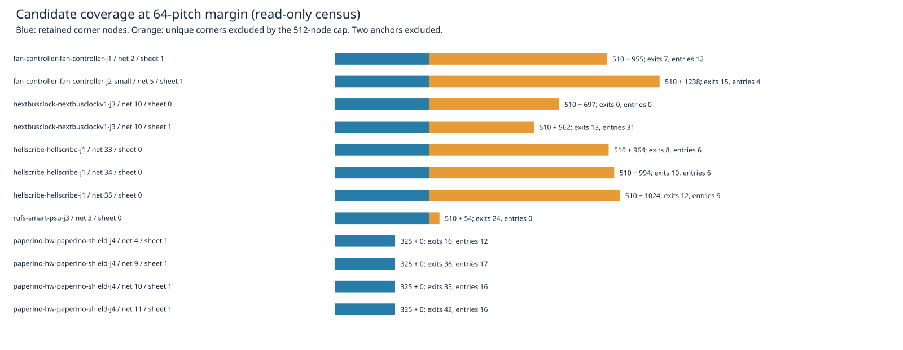

# Visibility candidate coverage on saved residuals

Read-only inspection of the same 11 point targets used in the preceding [region experiment](../expanded-regions/README.md). No routing implementation, rules, default, copper or consumer pin changes. This is a graph census, not a new native benchmark, closure attempt, performance result or proof that a different graph will route these targets.

Seven seed-1 native tasks with 1–10 opens qualify. One has no engine residual after session import and is retained as a skip. Six tasks yield 11 supported point targets, spanning 12 target/sheet combinations. Every combination is inspected at margins 0/4/8/16/32/64, whether or not the production shared budget would reach it. Production still uses its original four regions. Inputs are the completed cycle42 native candidate sweep, runtime `8e53e7d`, with session and input hashes in every row.

| Read-only census | Repeat 1 | Repeat 2 | Repeat 3 |
| --- | ---: | ---: | ---: |
| Target/sheet/region graphs | 72 | 72 | 72 |
| Graphs excluding unique corners at 512-node cap | 25 | 25 | 25 |
| Graphs without retained-corner outgoing edge from start | 13 | 13 | 13 |
| Graphs without retained-corner incoming edge to end | 19 | 19 | 19 |
| Direct legal endpoint edges | 0 | 0 | 0 |
| Mutated layouts / sessions | 0 / 0 | 0 / 0 | 0 / 0 |

All three full JSON outputs are byte-identical. Every imported input starts and ends with zero engine exact violations. These checks do not re-evaluate native findings or imply native DRC cleanliness; the existing 27 known native errors remain unresolved.



At margin64, eight of twelve graphs discard unique corners. Four graphs on one board retain all 325 available corners, with both legal exits and entries, so truncation cannot explain every stall. The power-supply target has zero retained-corner incoming edges at all six margins, including uncapped graphs at margins0–32. Its cap first excludes corners at margin64. This identifies a local attachment limitation within this graph; it does not establish an impossible physical route. The two-layer target has no exits or entries on sheet0 at margin64, but sheet1 has both. No via graph is evaluated here.

Corner coordinates and ordering follow production's pad, foreign track-segment, then barrel enumeration. Excluded counts are **unique** coordinates: production does not retain excluded keys and may charge repeated excluded coordinates again. Census attempted/duplicate counts therefore are not production work counts. Region containment includes the full track half-width. Endpoints remain the original point centers, and every directed edge is checked with production `legaliseTrail` and full-copper region containment. Exit checks run start→corner; entry checks run corner→end. Edge counts include retained corners only, omit the direct edge, and do not imply graph reachability, terminal closure or transaction acceptance.

A separate [verification driver](verify.ts) copies the production helper to scratch, replaces its relative imports with absolute paths, records the node array immediately after generation, and skips graph search. All 72 coordinate/order hashes and sizes match the independently enumerated census. No production source is written. This verifies candidate parity, not the independent census's endpoint-edge classification. [Verification](production-verification.json), [72-row table](cases.md), [raw census](results.json.gz), [summary](summary.json), [controls](validation.json), [runtime hashes](source-audit.json).

Missing rows, inconsistent accounting and a changed node-array hash are rejected by the respective report/production verification checks. The full router checks also pass: typecheck; 71 layer-checked files with zero violations; 912 tests, zero failures, 399733 assertions in 344.02 seconds ([checks](checks.txt), [full log](checks.log.gz)). No new regression fixture or production proposal is justified by this diagnostic alone. A next experiment can test deterministic candidate selection under the existing shared ledger; it must preserve original-terminal and full-geometry rollback gates, and a production proposal still requires fresh paired native/larger/slow measurements. Independent endpoint access work remains separate.

## Reproduce

Use the existing cycle42 native-after-run directory, or regenerate the native input with the unchanged benchmark and committed snapshot helper:

```bash
ENGINE=/home/hyper/bench/wt/fr-perf
BENCH=/home/hyper/bench/wt/fp-perf
ASSET="$ENGINE/docs/pr-assets/agent-fab-router-perf-local-rescue"
OUT=/home/hyper/bench/agents/codex-fabpcb-perf/scratch/repro44
mkdir -p "$OUT"
python3 "$ASSET/point-components/snapshot.py" "$ENGINE" "$OUT/snapshot"
cd "$BENCH"
taskset -c 12-19 nice -n 10 timeout 2400 python3 benchmarks/autorouter/benchmark.py --router fab-router --fab-router-source "$OUT/snapshot/after/entry" --out "$OUT/native-after"
cd "$ENGINE"
for repeat in 1 2 3; do
  taskset -c 12-19 nice -n 10 timeout 1200 bun "$ASSET/candidate-coverage/run.ts" "$OUT/native-after" "$OUT/census-$repeat.json"
done
cmp "$OUT/census-1.json" "$OUT/census-2.json"
cmp "$OUT/census-1.json" "$OUT/census-3.json"
taskset -c 12-19 nice -n 10 timeout 1200 bun "$ASSET/candidate-coverage/verify.ts" "$OUT/native-after" "$OUT/census-1.json" "$OUT"
python3 "$ASSET/candidate-coverage/report.py" "$OUT/census-1.json" "$OUT/report"
rsvg-convert -w 1600 "$OUT/report/coverage.svg" -o "$OUT/report/coverage.png"
taskset -c 12-19 nice -n 10 timeout 1800 bash -c 'bun run typecheck && bun run check:layers && bun run test'
```

Report-only reproduction needs just decompressed `results.json.gz`, Python's standard library and `rsvg-convert`; it does not require rerouting. Run the report with that JSON and a fresh output directory. Frozen cases, native checker and scoring are unchanged. No router benchmark was completed during this census cycle, so no native score or history row is fabricated.
