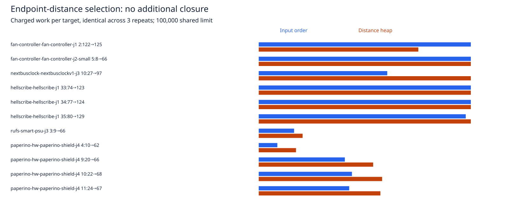

# Rejected bounded candidate-selection experiment

This offline experiment continues the [candidate census](../candidate-coverage/README.md). Production source, tests, defaults, rules and consumer pin are unchanged. A scratch transformation replaces input-order corner retention with a bounded max heap retaining the 510 unique corners with the smallest sum of distances to the original endpoints. Coordinate order breaks ties. Endpoint nodes remain indices 0 and 1. Every candidate attempt, heap comparison and extraction charges the same scheduler ledger before work. Heap storage and its retained-key set stay bounded; rejected coordinates may be inspected again. Graph edges, original-terminal transaction acceptance and full rollback checks are the production implementations.

The original four margins (0/4/8/16), 512 nodes, 100000 shared work units and 15-second cooperative target deadline are identical in both modes. Both include foreign copper corners. This tests original point anchors only, without component-alternative retries. Seven seed-1 native tasks with 1–10 opens are selected from the completed cycle42 sweep; one has no engine residual after session import and is explicitly skipped. Six tasks yield eleven point targets. Every target/mode/repeat reloads the original DSN/session. Three repeats alternate mode order on host `hyper-ms-lin`, cores 12–19, nice 10.

| Static engine probes | Input-order corners | Endpoint-distance heap |
| --- | ---: | ---: |
| Probes / additional closures | 33 / 0 | 33 / 0 |
| Exact violations / changed sessions | 0 / 0 | 0 / 0 |
| Charged work total | 2132427 | 2348871 |
| Budget / exhausted outcomes | 12 / 21 | 15 / 18 |
| Observed median / p95 seconds | 0.188853 / 0.630700 | 0.173755 / 0.477406 |
| Observed total seconds | 10.917866 | 7.757948 |

No closure gain and 10.1% more charged work: **rejected**. One target now exhausts its ledger at margin8 instead of reaching margin16. All work/result/proposal traces repeat identically. All geometry and session bytes remain unchanged, with zero engine exact violations. Different node order/contents change the graph and explored work, so the observed lower wall time is not evidence of a faster equivalent search. Unit tests/shared host activity overlap these probes. No speed improvement is claimed.



These are static engine recovery probes, not complete router runs or native DRC scores. No new full native/larger/slow sweeps were warranted for this rejected offline policy. Historical 48/78 passing, 90 opens and 27 known native errors remain the prior production measurement; this experiment does not resolve those errors or change that score. Via counts and copper length are unchanged because every session and all geometry are identical. The unexplained historical Dense supervisor143 remains unresolved.

[Per-target median/p95/work table](cases.md), [raw probes](results.json.gz), [summary](summary.json), [runtime hashes](source-audit.json), [selector verification](verification.json), [report rejection controls](validation.json). All 77 runtime/spec source hashes still match measured revision `8e53e7d`.

The independent verification instruments scratch helpers to stop before graph search. For all 72 previously enumerated region/sheet graphs and caps 2/3/16/512 (288 comparisons), it checks the heap output against an exhaustive unique-corner sort and verifies that a mid-generation budget exception propagates before search. This unbounded verification deliberately does not claim production work counts, reachability or transaction closure. The census includes larger margins to exercise selection; the paired search uses only production's four margins. Missing probe rows, changed session hashes and excess charged work are rejected by the report.

## Reproduce

Use a retained cycle42 native candidate sweep, or regenerate it with the unchanged snapshot and benchmark commands in the [census README](../candidate-coverage/README.md). This driver reads those outputs only.

```bash
ENGINE=/home/hyper/bench/wt/fr-perf
ASSET="$ENGINE/docs/pr-assets/agent-fab-router-perf-local-rescue/candidate-selection"
NATIVE=/home/hyper/bench/agents/codex-fabpcb-perf/scratch/cycle42/native-after-run
CENSUS=/home/hyper/bench/agents/codex-fabpcb-perf/scratch/cycle44/final.json
OUT=/home/hyper/bench/agents/codex-fabpcb-perf/scratch/repro45
mkdir -p "$OUT"
cd "$ENGINE"
taskset -c 12-19 nice -n 10 timeout 1200 bun "$ASSET/run.ts" "$NATIVE" "$OUT/probes"
python3 "$ASSET/report.py" "$OUT/probes/results.json" "$OUT"
rsvg-convert -w 1600 "$OUT/work.svg" -o "$OUT/work.png"
# Or decompress the committed candidate-coverage/results.json.gz into CENSUS.
taskset -c 12-19 nice -n 10 timeout 300 bun "$ASSET/verify.ts" "$NATIVE" "$CENSUS" "$OUT"
taskset -c 12-19 nice -n 10 timeout 1800 bash -c 'bun run typecheck && bun run check:layers && bun run test'
```

Report-only reproduction needs decompressed `results.json.gz`, Python's standard library and `rsvg-convert`. Production source is never rewritten; transformed helper files are confined to the requested scratch output. The next investigation should inspect connectivity within the uncapped failed graphs before proposing another candidate policy. Endpoint attachment work remains independently owned by the bugs agent.

Required router checks: Typecheck PASS; layers 71 files / 0 violations; 912 tests / 0 failures / 399733 assertions; 345.81 seconds. Supervisor exit 0.
See [full log](checks.log.gz). No production or test source edits.
