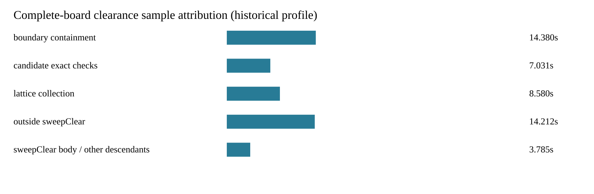

# Disjoint clearance profile attribution

Cycle63 analyzes the existing complete-board cycle56 CPU profile, without rerouting or changing production. Each sample's duration is assigned once: outside `sweepClear`, or to the nearest matching ancestor below it (`withinRim`, lattice `collect`, `hitBlocks`), or its remaining descendants/body. Parent traversal preserves separate call contexts; function names are qualified by source path. Groups sum exactly to all 47.987329 sampled seconds across 44,928 samples. Sample durations are observations, not invocation counts or CPU-cycle measurements.

| Group | Sampled seconds |
|---|---:|
| Boundary containment under sweepClear | 14.380208 |
| Lattice collection under sweepClear | 8.579872 |
| Candidate exact checks under sweepClear | 7.031097 |
| Other sweepClear samples | 3.784650 |
| Outside sweepClear | 14.211502 |

Collection inclusive samples attributed by immediate caller: sweepClear 8.579872s, barrelFits 0.396372s, connectivity 0.209580s, checkSpacing 0.015725s. These caller totals describe sampled stacks, not query frequency. Boundary time outside sweepClear is included in the outside group. The partition does not prove allocations, repeated shape conversion, or a particular geometric primitive causes the cost.

The next distinct experiment should instrument `hitBlocks` by obstacle category and convex shape kind, separating rim-edge checks from pad/track/hole checks, before selecting a shape-specialized algorithm. Do not repeat rejected boundary prefilters, callback inlining or key arithmetic. Boundary containment remains the largest clearance group, but prior micro improvements did not establish full-suite speed nonregression.

No new baseline/candidate exists in this cycle. Historical source/output parity, profiler overhead, native failures and the original replay command remain documented in [the source profile](../native-profile/README.md). The full native before/after timing evidence remains in [the latest comparison](../key-native/README.md). No new benchmark score/history row, engine improvement, DRC repair, consumer pin change or speed claim is made here.

Reproduce this analysis and its three corruption controls (duration mismatch, unknown sampled node, cyclic graph), using Python's standard library:

```sh
asset=docs/pr-assets/agent-fab-router-perf-local-rescue/clearance-profile
python3 "$asset/analyze.py" /tmp/clearance-profile
cmp "$asset/summary.json" /tmp/clearance-profile/summary.json
cmp "$asset/profile.svg" /tmp/clearance-profile/profile.svg
rsvg-convert -w 1600 /tmp/clearance-profile/profile.svg -o /tmp/clearance-profile/profile.png
bun run typecheck && bun run check:layers && bun run test
```

The summary pins the compressed source SHA-256. The analysis rejects duplicate node IDs, missing children, multiple parents, cycles, unknown sampled IDs, negative durations, and unequal sample/duration lengths. Output replay was byte-identical, and the PNG was visually inspected. No third-party Python packages required.



Required checks passed: typecheck, layer checks, 912 tests / zero failures / 399733 assertions (test runner 336.63s). Full output is retained in `checks.log.gz`.
