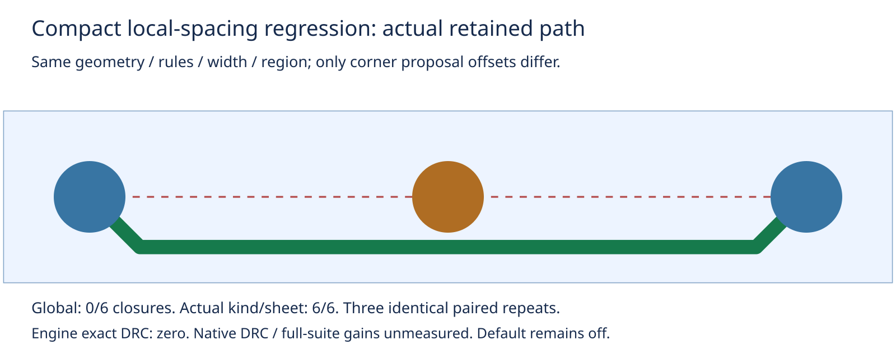

# Self-contained local-spacing regression

This synthetic fixture isolates the corner-offset delta from the saved-board combined witness in [bounded-kind-spacing](../bounded-kind-spacing/README.md). Production sources, default-off behavior, exact rules and consumer pin are unchanged. The experiment loads two isolated source snapshots created by the previous archive's exact four-replacement preparation script. It is a regression prerequisite, not a production implementation or native benchmark.

Two target pads flank one foreign pad, segment or barrel. The target width is 200 LU; actual sheet0 clearance is 100 LU. Either an unused kind or another sheet requires 3000 LU, inflating the global maximum while remaining irrelevant to these endpoints. Both modes use the same endpoint region, scheduler, shared ledger and exact transaction. A third group sets the actual clearance to 3000 LU: the same bounded graph stays open in both modes. Kind/sheet table and resolved profile values are asserted explicitly. Each fixture starts with one residual and exact0; no saved session, benchmark board or recorded path is needed.

Same host/cores12–19, three paired repeats; values below are **per repeat**:

| Measure | Global proposal offset | Actual kind/sheet proposal offset |
|---|---:|---:|
| Closures, six eligible targets | 0/6 | 6/6 |
| Closures, three high actual-clearance controls | 0/3 | 0/3 |
| Budget-limited trials restoring unchanged session | 9/9 | 9/9 |
| Exact violations at initial/result/rewind | 0 | 0 |
| Full rewind restoring session, retained objects and residual | 18/18 | 18/18 |

All 18 rows per mode are structurally identical across three repeats. Kept pad/barrel cases use38 expansions, track cases40; every deliberately budget-limited call consumes exactly10 and rolls back. Kept track width remains200. The report checks counts/order/status/limits/parity and rejects four malformed archives. Its checks are independent consistency checks; the driver executes real exact geometry, connectivity and journal checks.



Blue disks are target pads, brown disk the foreign pad, green copper the retained candidate path; dashed red is the blocked direct connection, pale rectangle the local region. The drawing uses the captured path vertices and known synthetic geometry (80% scale in SVG). These are separate synthetic fixtures, not six combined routes or native opens. No timing/speed claim. Native26×3, dense/ladder and slow acceptance have not been rerun; historical native caveats remain. This does not establish full-suite non-regression or justify adoption.

## Reproduce

From the engine worktree:

```bash
ASSET=docs/pr-assets/agent-fab-router-perf-local-rescue/compact-spacing
OUT=/home/hyper/bench/agents/codex-fabpcb-perf/scratch/repro50
python3 docs/pr-assets/agent-fab-router-perf-local-rescue/bounded-kind-spacing/prepare.py "$OUT/source"
for repeat in 1 2 3; do
  for mode in before after; do
    taskset -c 12-19 nice -n 10 timeout 120 bun "$ASSET/regression.ts" "$OUT/source/$mode" "$mode" > "$OUT/$mode-$repeat.json"
  done
done
python3 "$ASSET/report.py"
rsvg-convert -w 1600 "$ASSET/path.svg" -o "$OUT/path.png"
cmp "$ASSET/path.png" "$OUT/path.png"
taskset -c 12-19 nice -n 10 timeout 1800 bash -c 'bun run typecheck && bun run check:layers && bun run test'
```

Compare parsed output to the matching mode/repeat in `results.json.gz`. Preparation writes the complete tracked src/spec source hash audit and fails on replacement drift. `source-audit.json` binds this run. The standard checks cover unchanged production sources; this standalone diagnostic additionally exercises both snapshots. No new production test is claimed. Next: separately checked candidate revision and fresh paired full native26×3/larger/slow before production adoption, retaining defaultoff and all transaction/accounting gates.
