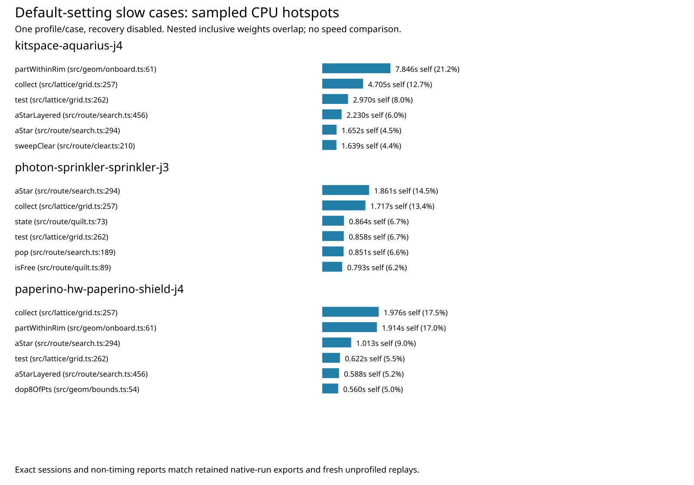

# Default-setting slow-case CPU profiles

Fresh diagnostic replays on hyper-ms-lin, cores 12–19, nice 10, sequential bounded processes. No production or test changes and no adopted optimization. No new native DRC checks or full-suite benchmark were run this cycle. Known native thermal errors and the adverse L3 tail remain unresolved; recovery remains disabled by default.

Selected the three slowest cases by median route time in the retained cycle86 control full 26×3 sweep. For each, replay seed 1 once unprofiled, then once with the CPU sampler, using the exact exported DSN and benchmark settings (100 maximum passes, optimizer enabled, recovery unset). The immutable source is cde23417 (full reference in audit.json); src/spec file hashes are also verified before reproduction. The source archive retains the exact staged source and contracts. Package engine license notices and each input's LICENSE/job.json retain provenance.

All six fresh sessions are byte-identical to their corresponding retained native-run sessions. Settings, diagnostics, statistics, and full engine reports match after removing only report.wallClockMs. Fresh engine-incomplete counts are 8, 2, 6; zero added violations means the engine's represented rules, **not** native DRC. Retained native Aquarius had 15 opens and six new thermal errors per repeat. The engine's eight incomplete connections are not a native score.

| Case | Retained native-sweep route median / p95, s (3 repeats) | Fresh unprofiled replay, s (1) | Fresh profiled replay, s (1; excluded from speed claims) | Engine incomplete / represented violations added |
|---|---:|---:|---:|---:|
| kitspace-aquarius-j4 | 37.170832 / 38.974178 | 42.273994 | 37.065765 | 8 / 0 |
| photon-sprinkler-sprinkler-j3 | 12.498769 / 13.654109 | 13.131539 | 12.793578 | 2 / 0 |
| paperino-hw-paperino-shield-j4 | 10.844573 / 12.941337 | 11.859914 | 11.268750 | 6 / 0 |


The historical column measures the full harness route scope; the fresh columns measure routeDsn directly. They are different timing scopes and repeat counts and must not be interpreted as before/after speed evidence. Profiled durations are excluded from speed claims. p95 of three retained measurements is the maximum (nearest rank). No repeated candidate measurement, causal speed claim, or output quality improvement is asserted.

The observed distribution differs materially from the earlier recovery-enabled, two-pass L3 stress profile: sweepClear accounts for 7.598/8.202, 2.860/2.902 and 2.744/2.838 sampled seconds of inclusive collect cost (92.6%, 98.5%, 96.7%). barrelFits accounts for only 0.451, 0.035 and 0.091 seconds. This supports prioritizing the **sweep-query call context** on these frozen default cases before another via-query optimization. It does not justify reviving unchanged rejected collector, predicate-lift, point, bounds, or direct rim-probe changes. A future bounded experiment could census identical consecutive sweep requests and their invalidation points before attempting a cache; no hit rate or speed benefit is assumed here.

Aquarius's largest self-sampled frame is partWithinRim (7.846 s), while sprinkler's is aStar (1.861 s) and shield's is collect (1.976 s). Self attribution includes JIT inlining effects; inclusive stacks overlap and cannot be summed. Neither sampled values nor a single profile determine exact function elapsed time. The complete profiles and all frame/edge tables are retained, not just favorable rows.



Reproduce from the repository root (requires installed Bun and repository dependencies):

```bash
ASSET="$PWD/docs/pr-assets/agent-fab-router-perf-local-rescue/default-slow-profile"
WORK=$(mktemp -d /tmp/default-profile-XXXXXX)
mkdir "$WORK/source"
tar -xzf "$ASSET/source.tar.gz" -C "$WORK/source"
ln -s "$PWD/node_modules" "$WORK/source/node_modules"
PYTHONDONTWRITEBYTECODE=1 python3 "$ASSET/reproduce.py" "$WORK/source" "$WORK/runs"
```

Each attempt has a 180-second process timeout plus five-second kill grace. Reproduction creates a new output directory. To verify newly generated runs, copy this asset folder into a new scratch directory, replace its `runs` directory with the new runs, and run `verify.py SCRATCH_COPY` (raw and gzip profiles both supported).

Verify and regenerate retained evidence:

```bash
PYTHONDONTWRITEBYTECODE=1 python3 "$ASSET/verify.py" > /tmp/default-profile-summary.json
cmp /tmp/default-profile-summary.json "$ASSET/summary.json"
PYTHONDONTWRITEBYTECODE=1 python3 "$ASSET/test_verify.py"
python3 "$ASSET/plot.py"
taskset -c 12-19 nice -n 10 timeout --kill-after=10 1800 bash -c 'bun run typecheck && bun run check:layers && bun run test'
```

The verifier checks every retained input hash, exact SES and non-timing report parity, sampled self-weight conservation and inclusive bounds. Independent corruption controls reject an altered session, report incomplete count, DSN, and mutated source (rejected before launching routing). The reused stack analyzer's existing synthetic recursion/malformed-tree controls also pass. See validation.log and checks.log.gz for validation; no checker, physical rules, or test expectations were changed.

Final root validation: typecheck PASS; 71 layer files / zero violations; 914 tests / zero failures / 649747 assertions, 311.73 seconds. Original input license CRLF bytes are preserved; the staged whitespace check passes with the per-command cr-at-eol setting.
