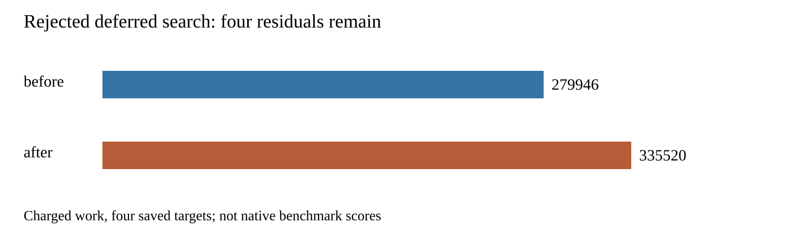

# Reject deferred obstacle-specific search under the remaining budget

This isolated candidate first runs every original coordinator search, including alternate anchors. Only after exhaustion does it search actual-kind/sheet-offset graphs, original anchor first, with the same remaining target ledger and deadline. It adds a scratch-only visibility module; the original generator is byte-identical. No rules, widths, regions, node caps, transaction checks or production defaults change. The preparation audit binds all tracked src/spec files and both candidate modules.

Same saved seed-1 paperino session, host and cores 12–19, three paired repeats, sequential without overlapping our own heavy jobs. Each repeat processes four original targets on one live layout. Original attempt arrays are identical prefixes of candidate attempt arrays, including graph work, anchors, regions and proposals. Every attempt shares its target's 100000-work/15-second cooperative limit. The report verifies that total work equals enumeration plus every scheduled search's expansions.

| Per-repeat measure | Original | Deferred |
|---|---:|---:|
| Engine residuals before → after | 4 → 4 | 4 → 4 |
| Charged work | 279946 | 335520 |
| Work-limited targets | 0 | 3 |
| Added tracks / vias / length LU | 0 / 0 / 0 | 0 / 0 / 0 |
| Exact violations at each target and rewind | 0 | 0 |
| Median / p95 summed coordinator seconds | 1.095797 / 1.163491 | 1.341291 / 1.523048 |

p95 of three observations is their maximum. Timing is observational on a shared host; no speed claim. All structural outputs match across repeats after removing seconds. Sessions remain unchanged and final journal rewind restores the initial exact-clean copper. This is a saved-session diagnostic, not a native benchmark. Native opens/errors are unmeasured here.



**Rejected:** preserving original search coverage leaves too little work for this second search to close the remaining targets. This does not establish that incremental reuse of the original settled search state would fail. Do not repeat this full deferred restart or increase the budget based on these results. Production remains unchanged; there is no adoption, native safety claim or consumer pin update. Full native 26×3, dense/ladder and slow acceptance were not rerun for the rejected candidate. Existing native thermal safety failures remain unresolved.

`report.py` checks repeat parity, original search prefixes, ledger sums, session/geometry/exact invariants and expected per-target work/status. `verify.py` rejects five corrupted archives. Source replay below invokes the real coordinator and transaction gates. Required production checks are archived separately; no full candidate test pass is claimed.

## Reproduce

From the engine worktree with the saved cycle42 inputs (regeneration described in `../candidate-coverage/README.md`):

```bash
ASSET=docs/pr-assets/agent-fab-router-perf-local-rescue/deferred-kind-spacing
OUT=/home/hyper/bench/agents/codex-fabpcb-perf/scratch/repro53
NATIVE=/home/hyper/bench/agents/codex-fabpcb-perf/scratch/cycle42/native-after-run
mkdir -p "$OUT"
python3 "$ASSET/prepare.py" "$OUT/source"
for repeat in 1 2 3; do
  for mode in before after; do
    taskset -c 12-19 nice -n 10 timeout 1200 bun docs/pr-assets/agent-fab-router-perf-local-rescue/bounded-kind-spacing/run.ts "$OUT/source/$mode" "$NATIVE" "$OUT/$mode-$repeat.json"
  done
done
python3 - "$OUT" <<'PY'
import gzip,json,sys
from pathlib import Path
p=Path(sys.argv[1])
d={m:[json.loads((p/f'{m}-{i}.json').read_text()) for i in [1,2,3]] for m in ['before','after']}
(p/'results.json.gz').write_bytes(gzip.compress(json.dumps(d,separators=(',',':')).encode(),mtime=0))
PY
python3 "$ASSET/report.py" "$OUT/results.json.gz" "$OUT/report"
python3 "$ASSET/verify.py"
rsvg-convert -w 1600 "$OUT/report/work.svg" -o "$OUT/report/work.png"
taskset -c 12-19 nice -n 10 timeout 1800 bash -c 'bun run typecheck && bun run check:layers && bun run test'
```

Report-only replay uses committed `results.json.gz`. Summary, table, SVG and PNG reproduce byte-for-byte. Engine elapsed times naturally vary on source replay.
