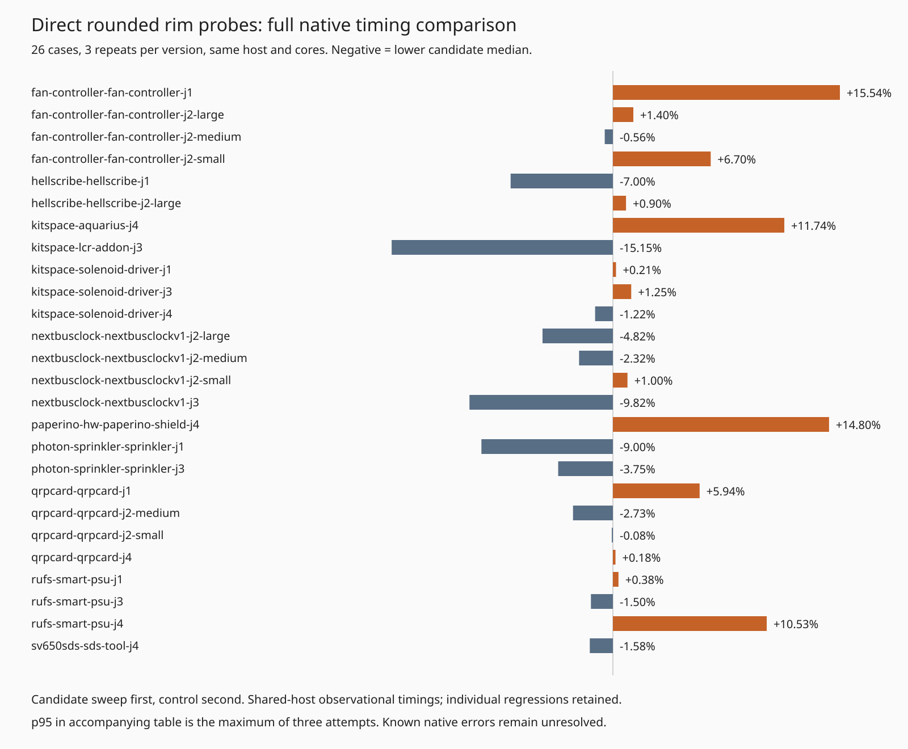
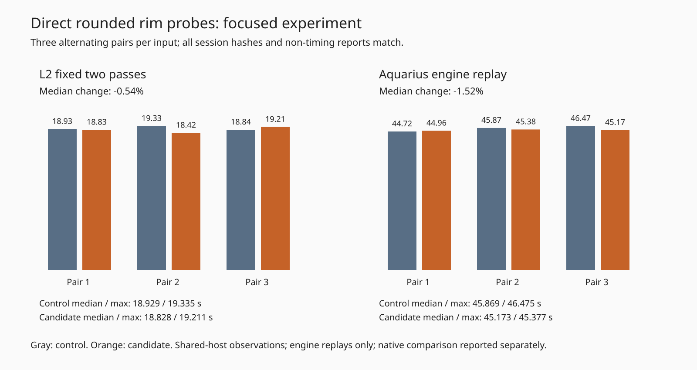

# Direct rounded rim probes — rejected experiment

Read positive-radius disks, capsules and rounded shapes' first core point directly during rim containment, avoiding temporary core/point-array construction. Zero-radius shapes keep all core probes; empty rounded cores remain unconstraining. The sole candidate source delta is `src/geom/onboard.ts`; no production change is adopted. Complete immutable staged source/test/support hashes are in the archive. Control production matches evidence base `f0842f97` (its source is also identical to `1e65df94`).

**Rejected after the full native timing gate.** Focused replay medians improved slightly, but the full sweep has higher total route time, sweep wall time, sum of case medians and sum of case p95. Overall median/p95 improved; those favorable aggregates do not override the adverse totals. Shared-host sequential sweeps do not establish a causal slowdown or a robust gain. Do not revive this exact patch on the strength of the focused replay alone.

Motivation: retained cycle83 L3 profiles put about 5.3 sampled CPU seconds in `coreOf` and 5.8 in the candidate `partWithinRim`; JIT attribution and nested work limit that evidence. No new CPU profile or allocation-count measurement was made here.

Both full sweeps use the frozen 26 cases × 3 repeats, same host `hyper-ms-lin`, Bun 1.4.0, cores 12–19, requested nice 10, default recovery OFF, candidate sweep then control sweep, no own overlapping heavy benchmark jobs. All attempts completed. Native p95 is nearest-rank across 78 attempts; each per-case p95 is the maximum of three, a limited tail estimate.

| Full native metric (26 × 3 each) | Control | Rejected candidate |
|---|---:|---:|
| Passed / 78 | 39 | 39 |
| Valid cases / 26 | 13 | 13 |
| Opens | 120 | 120 |
| Known unresolved new native errors | 27 | 27 |
| Overall median route s | 1.069085 | 1.013724 |
| Overall p95 route s | 13.654109 | 12.717574 |
| Sum route s | 323.090324 | 330.165594 |
| Sweep wall s | 432.851728 | 442.221184 |
| Sum case medians s | 105.787994 | 109.773258 |
| Sum case p95 s | 113.318395 | 114.719126 |
| Sum vias | 2826 | 2826 |
| Sum length mm | 58809.321397 | 58809.321397 |

All 78 paired SES files, full engine reports/statistics except `wallClockMs`, input DSNs/manifests/settings, native findings/warning geometry, opens, fidelity, vias and length match. No DRC fix or completion gain is claimed: the 27 router-introduced native thermal errors remain unresolved. Recovery remains default off. Dense6, L3 and whole slow acceptance were not rerun for this rejected candidate. No consumer pin update is warranted.



| Case (3 repeats/version) | Control median / p95 s | Candidate median / p95 s | Median change | Passed both | Opens / native errors both |
|---|---:|---:|---:|---:|---:|
| fan-controller-fan-controller-j1 | 3.011689 / 3.148137 | 3.479771 / 3.905114 | +15.54% | 0/3 | 15 / 0 |
| fan-controller-fan-controller-j2-large | 0.841386 / 0.847268 | 0.853159 / 0.886989 | +1.40% | 3/3 | 0 / 0 |
| fan-controller-fan-controller-j2-medium | 0.728913 / 0.736959 | 0.724840 / 0.762399 | -0.56% | 3/3 | 0 / 0 |
| fan-controller-fan-controller-j2-small | 2.651210 / 2.762251 | 2.828740 / 2.858393 | +6.70% | 0/3 | 3 / 0 |
| hellscribe-hellscribe-j1 | 2.001556 / 2.186829 | 1.861389 / 1.879420 | -7.00% | 0/3 | 9 / 0 |
| hellscribe-hellscribe-j2-large | 0.973692 / 0.988960 | 0.982435 / 1.010195 | +0.90% | 0/3 | 3 / 0 |
| kitspace-aquarius-j4 | 37.170832 / 38.974178 | 41.533208 / 42.859354 | +11.74% | 0/3 | 45 / 18 |
| kitspace-lcr-addon-j3 | 2.223859 / 2.314315 | 1.887003 / 2.065575 | -15.15% | 3/3 | 0 / 0 |
| kitspace-solenoid-driver-j1 | 0.737959 / 0.737966 | 0.739522 / 1.017253 | +0.21% | 3/3 | 0 / 0 |
| kitspace-solenoid-driver-j3 | 0.716555 / 0.719273 | 0.725544 / 0.735748 | +1.25% | 3/3 | 0 / 0 |
| kitspace-solenoid-driver-j4 | 0.725009 / 0.725517 | 0.716177 / 0.739821 | -1.22% | 3/3 | 0 / 0 |
| nextbusclock-nextbusclockv1-j2-large | 2.770675 / 2.784557 | 2.637154 / 3.021755 | -4.82% | 3/3 | 0 / 0 |
| nextbusclock-nextbusclockv1-j2-medium | 0.993352 / 1.028268 | 0.970350 / 0.995547 | -2.32% | 3/3 | 0 / 0 |
| nextbusclock-nextbusclockv1-j2-small | 0.716550 / 0.760007 | 0.723709 / 0.749196 | +1.00% | 3/3 | 0 / 0 |
| nextbusclock-nextbusclockv1-j3 | 7.315257 / 8.116919 | 6.596799 / 7.143564 | -9.82% | 0/3 | 9 / 0 |
| paperino-hw-paperino-shield-j4 | 10.844573 / 12.941337 | 12.449491 / 12.676460 | +14.80% | 0/3 | 18 / 0 |
| photon-sprinkler-sprinkler-j1 | 10.718947 / 11.253041 | 9.753920 / 9.851851 | -9.00% | 0/3 | 6 / 0 |
| photon-sprinkler-sprinkler-j3 | 12.498769 / 13.654109 | 12.030551 / 12.717574 | -3.75% | 0/3 | 6 / 0 |
| qrpcard-qrpcard-j1 | 1.222529 / 1.370729 | 1.295112 / 1.556589 | +5.94% | 3/3 | 0 / 0 |
| qrpcard-qrpcard-j2-medium | 0.878098 / 0.887334 | 0.854114 / 0.866518 | -2.73% | 3/3 | 0 / 0 |
| qrpcard-qrpcard-j2-small | 0.722848 / 0.871081 | 0.722305 / 0.730878 | -0.08% | 0/3 | 0 / 6 |
| qrpcard-qrpcard-j4 | 0.986756 / 1.008781 | 0.988496 / 1.003898 | +0.18% | 0/3 | 0 / 3 |
| rufs-smart-psu-j1 | 0.724471 / 0.728985 | 0.727238 / 0.733392 | +0.38% | 3/3 | 0 / 0 |
| rufs-smart-psu-j3 | 1.634880 / 1.766183 | 1.610278 / 1.820218 | -1.50% | 0/3 | 3 / 0 |
| rufs-smart-psu-j4 | 1.119505 / 1.126526 | 1.237407 / 1.261063 | +10.53% | 0/3 | 3 / 0 |
| sv650sds-sds-tool-j4 | 0.858122 / 0.878882 | 0.844546 / 0.870363 | -1.58% | 3/3 | 0 / 0 |

Focused engine replays used localRecovery:true identically, three alternating pairs (candidate/control, control/candidate, candidate/control), sequential core12–19/nice10 requests, fixed two passes on L2. These are not native scores. All six L2 sessions are byte-identical; all six Aquarius SES hashes match retained full-session bytes; all settings/statistics/non-timing reports and recovery logs match after narrowly removing elapsed seconds from parsed recovery-result records.

| Focused replay (3 attempts/version) | Control median / max s | Candidate median / max s |
|---|---:|---:|
| L2 | 18.929419 / 19.334677 | 18.828084 / 19.210590 |
| Aquarius | 45.868944 / 46.474749 | 45.172974 / 45.376824 |

Per-attempt engine quality, both versions: L2 21 incomplete / zero added represented-rule violations / 51 vias / 1094.342601 mm; Aquarius 8 / zero / 130 / 1731.113127 mm. No timeout or aborted attempt. The chart retains every measurement.



Candidate typecheck, layer check and existing 42,048-decision differential test pass. The final unchanged production checkout receives required typecheck/layers/full tests separately; their exact output is in `checks.log.gz` and `validation.json`. Candidate full unit suite is not run after rejection. No expectations or physical rules were changed.

Setup disclosure: both native sweeps finished with exit 0, then the original supervisor's comparison failed because it required an explicit `localRecovery:false` report field. Default settings leave that optional field unset; pipeline activation requires `=== true`. The corrected comparator accepts absent/false and compares both settings exactly. Its original failure log is retained. All 156 attempts are retained, including adverse results. Standalone comparison does not validate live-editor latency.

Reproduce from the repository root with its dependencies and the benchmark checkout's private native runtime already installed. Use fresh output directories:

```bash
ASSET="$PWD/docs/pr-assets/agent-fab-router-perf-local-rescue/direct-rim-probe"
EXTRACT=/home/hyper/bench/agents/codex-fabpcb-perf/scratch/direct-probe-evidence
mkdir "$EXTRACT"
tar -xJf "$ASSET/evidence.tar.xz" -C "$EXTRACT"
python3 "$EXTRACT/verify.py"
python3 "$EXTRACT/test_verify.py"
python3 "$EXTRACT/check-native.py"
python3 "$ASSET/verify-native-details.py" "$EXTRACT"
python3 "$EXTRACT/test-native.py"
python3 "$EXTRACT/reproduce.py" "$PWD" /home/hyper/bench/agents/codex-fabpcb-perf/scratch/direct-probe-focused-repro
python3 "$EXTRACT/reproduce-native.py" "$PWD" /home/hyper/bench/wt/fp-perf /home/hyper/bench/agents/codex-fabpcb-perf/scratch/direct-probe-native-repro
taskset -c 12-19 nice -n 10 timeout --kill-after=10 1800 bash -c 'bun run typecheck && bun run check:layers && bun run test'
```

Engine license notices are adjacent in `engine-LICENSE` and `engine-COPYING`; input license notices are in the archive and `input-LICENSE`. The archive contains both full sources, exact modified source, original invocation scripts, all focused sessions/raw results/logs, full native records/work/checks (visualization PNG/SVG/HTML excluded), input licenses and validators. Native processes have 3000-second sweep limits and the frozen harness has per-attempt safety stops; focused attempts have 900s L2/300s Aquarius process limits. Native validators reject altered open counts and session bytes; focused validators reject session/report changes and a changed recovery net even with duplicate metadata kept consistent. Archive extraction and independent verification are checked before publication. `native-report.py` in the archive records this machine's original asset destination; committed charts/tables carry the complete derived values. No native inputs, scoring or checker changed.
