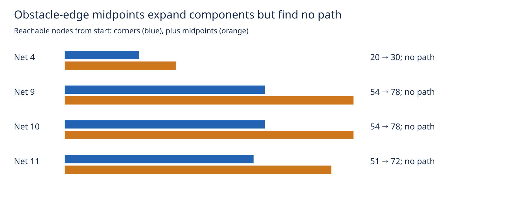

# Bounded obstacle-edge midpoint diagnostic

This read-only experiment tests whether adding edge midpoints bridges the disconnected corner-only graphs established in [the preceding diagnostic](../reachability/README.md). It does not change production routing. Runtime remains `8e53e7d`, the public recovery option remains default off, and the consumer pin is unchanged.

The same four saved seed-1 residual targets, single common sheet, margin64 region, original anchors, full track width and real rule profile are used in both modes. Corners mode retains all 327 nodes. Midpoints mode preserves those exact nodes first, then appends unique side midpoints of the same expanded obstacle bounding boxes, in obstacle order, up to 512 total nodes. Midpoints use rounded integer coordinates. Later candidates are excluded by the cap; this is not exhaustive midpoint coverage. No smaller margins, alternative anchors, vias, rip-up, widths or clearance changes are tested.

A breadth-first traversal checks directed candidate edges with production `legaliseTrail` and full-new-copper region containment. Already discovered destinations are skipped; each search allows at most 100000 edge checks. Every search exhausts its reachable queue before that limit. This edge-only diagnostic counter is **not** production's shared work ledger: generation, profile, lattice and geometry setup are not charged; there is no per-target cooperative deadline. An outer 1200-second timeout supervises the whole repeated diagnostic. This policy is not ready for production adoption.

Three complete paired repeats on host cores 12–19 are byte-identical within each mode. Inputs and the first 327 nodes match the previous archived exhaustive graphs; corners mode reproduces their exact forward reachable sets. All layout/session bytes are unchanged and engine exact violations remain zero. The midpoint policy enlarges each reachable component but finds **zero paths**. No insertion, original-terminal acceptance, rollback transaction or native DRC is attempted because no proposal exists. No native score, speed improvement, closure gain, or general physical impossibility is inferred. Existing 27 known native errors remain unresolved.

| Net | Nodes before → after | Reachable nodes before → after | Edge checks before → after | Paths (3 repeats) |
|---|---:|---:|---:|---:|
| 4 | 327 → 512 | 20 → 30 | 6165 → 14499 | 0/3 → 0/3 |
| 9 | 327 → 512 | 54 → 78 | 15018 → 34355 | 0/3 → 0/3 |
| 10 | 327 → 512 | 54 → 78 | 15010 → 34341 | 0/3 → 0/3 |
| 11 | 327 → 512 | 51 → 72 | 14198 → 31850 | 0/3 → 0/3 |



Reject this bounded corner-first midpoint policy for these targets. More search budget cannot connect these particular fully traversed graphs. Excluded candidates, other attachment choices and other candidate families remain untested. The next useful step should inspect geometry at the separated components, rather than repeat this policy with the same candidates. Independent pour/endcap work remains separate.

The report validator checks repeat parity, prior input/node/forward-set parity, node hashes, node limits and edge limits, and independently replays discovery ordering from the stored successful discovery edges to verify charged edge counts. It rejects missing runs, changed nodes, false reachability and changed work counts. The adjacency archive contains discovery edges, **not** every legal edge: it must not be interpreted as an exhaustive adjacency matrix. Replaying the graph classification itself requires the source DSN/session inputs.

## Reproduce

From the engine worktree (native input reconstruction is documented in [the preceding candidate census](../candidate-coverage/README.md)):

```bash
ASSET=docs/pr-assets/agent-fab-router-perf-local-rescue/edge-midpoints
NATIVE=/home/hyper/bench/agents/codex-fabpcb-perf/scratch/cycle42/native-after-run
OUT=/home/hyper/bench/agents/codex-fabpcb-perf/scratch/repro47
mkdir -p "$OUT"
for repeat in 1 2 3; do
  for mode in corners midpoints; do
    taskset -c 12-19 nice -n 10 timeout 1200 bun "$ASSET/run.ts" "$NATIVE" "$OUT/$mode-$repeat.json" "$mode"
  done
done
python3 - "$OUT" "$OUT/results.json.gz" <<'PY'
import gzip,json,sys
from pathlib import Path
rows=[json.loads(p.read_text()) for p in sorted(Path(sys.argv[1]).glob('*-*.json'))]
Path(sys.argv[2]).write_bytes(gzip.compress(json.dumps(rows,separators=(',',':')).encode(),mtime=0))
PY
python3 "$ASSET/report.py" "$OUT/results.json.gz" "$OUT/report"
rsvg-convert -w 1600 "$OUT/report/midpoints.svg" -o "$OUT/report/midpoints.png"
cmp "$ASSET/results.json.gz" "$OUT/results.json.gz"
cmp "$ASSET/midpoints.png" "$OUT/report/midpoints.png"
taskset -c 12-19 nice -n 10 timeout 1800 bash -c 'bun run typecheck && bun run check:layers && bun run test'
```

Run `python3 "$ASSET/verify.py"` from the engine worktree to verify runtime and artifact hashes.

Report-only replay uses the committed compressed results, Python standard library, preceding committed reachability archive and `rsvg-convert`. Source audit binds all 77 runtime/spec files to the preceding diagnostic. No router benchmark completed, so no native history row is duplicated. Required check results are recorded in `checks.txt` and `checks.log.gz`.
