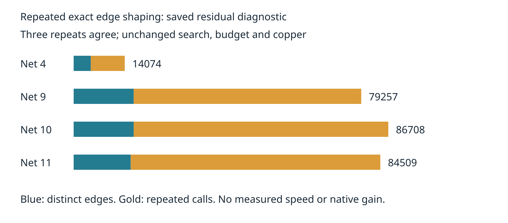

# Repeated exact shaping before incremental recovery

The rejected deferred restart repeated graph search under the remaining shared budget. This observer measures a prerequisite for reusing checked edges: identical directed endpoints on the same sheet, within one target invocation, must return identical `legaliseTrail` results across original regions and alternate anchors. It records every returned shaping result, including failures, without skipping calls or changing charging, search order, region checks or transaction gates. Only an isolated visibility module is instrumented. The production router is unchanged and recovery remains default off.

Three saved-session repeats on the same host and cores 12–19 agree exactly after removing elapsed seconds. All coordinator outputs match the three previously archived uninstrumented original controls. Four residuals remain four, charged work stays 279946, added tracks/vias/length stay zero, every target remains exact-clean, and journal rewind restores the original session. See `table.md` for per-target measurements.

| Per-repeat diagnostic | Original control | Observer |
|---|---:|---:|
| Engine residuals before → after | 4 → 4 | 4 → 4 |
| Charged work | 279946 | 279946 |
| Shaping calls | unobserved | 264548 |
| Distinct directed edges, summed per target | unobserved | 53547 |
| Repeated shaping calls | unobserved | 211001 (79.76%) |
| Conflicting results for repeated keys | unobserved | 0 |
| Added tracks / vias / length LU | 0 / 0 / 0 | 0 / 0 / 0 |
| Exact violations | 0 | 0 |



This establishes repeated work on this saved session only. It does not prove cache validity after copper mutations, across profiles, targets or layouts. Directed edges cannot be treated as symmetric. Region containment must still be checked for every current trial; shaping and containment are separate. A future cache must retain the existing charge/deadline checks and prevent mutable path aliasing. Reusing checked edges alone does not expand the permitted search budget or prove incremental graph closure. No cache, relaxed rule, speed gain, native gain or production change is adopted here. Native safety remains unresolved; full native 26×3, dense/ladder and slow acceptance were not rerun for this observer. Timing is deliberately not compared: observation allocates traces and overlaps required checks.

`report.py` verifies complete edge counts against coordinator proposals, all repeated result equality, three-repeat parity, unchanged control traces and session/geometry invariants. `verify.py` rejects missing records, conflicting results, changed work and changed session hashes, including mutations repeated across all three runs. `source-audit.json` binds all tracked src/spec files and the one instrumented module. Raw result strings are preserved, not just hashes.

## Reproduce

From the engine worktree, using the saved inputs documented in `../candidate-coverage/README.md`:

```bash
ASSET=docs/pr-assets/agent-fab-router-perf-local-rescue/edge-reuse
OUT=/home/hyper/bench/agents/codex-fabpcb-perf/scratch/repro54
NATIVE=/home/hyper/bench/agents/codex-fabpcb-perf/scratch/cycle42/native-after-run
mkdir -p "$OUT"
python3 "$ASSET/prepare.py" "$OUT/source"
for repeat in 1 2 3; do
  taskset -c 12-19 nice -n 10 timeout 1200 bun "$ASSET/run.ts" "$OUT/source" "$NATIVE" "$OUT/run-$repeat.json"
done
python3 - "$OUT" <<'PY'
import gzip,json,sys
from pathlib import Path
p=Path(sys.argv[1])
d=[json.loads((p/f'run-{i}.json').read_text()) for i in [1,2,3]]
(p/'results.json.gz').write_bytes(gzip.compress(json.dumps(d,separators=(',',':')).encode(),mtime=0))
PY
python3 "$ASSET/report.py" "$OUT/results.json.gz" "$OUT/report"
python3 "$ASSET/verify.py"
rsvg-convert -w 1600 "$OUT/report/edges.svg" -o "$OUT/report/edges.png"
taskset -c 12-19 nice -n 10 timeout 1800 bash -c 'bun run typecheck && bun run check:layers && bun run test'
```

Report-only replay uses committed `results.json.gz` and the sibling deferred-search original controls. No scored benchmark run completed, so no native result row is fabricated in the shared history log.
