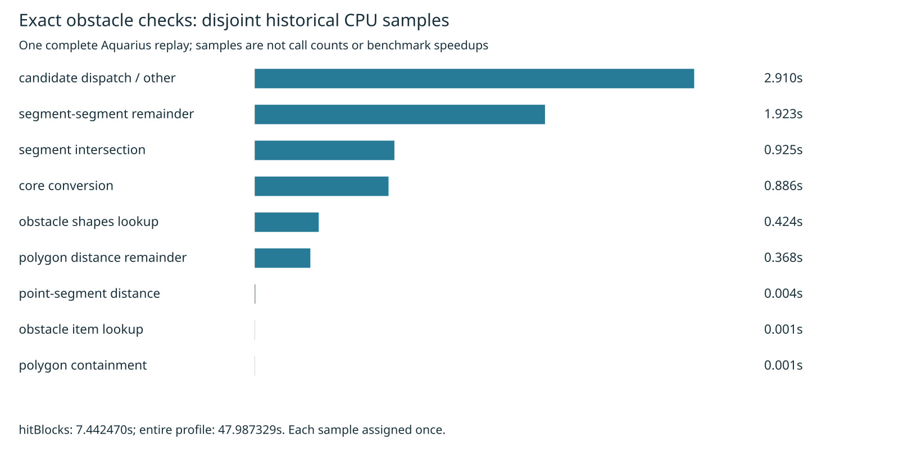

# Exact obstacle-check profile partition

Cycle67 analyzes the existing complete Aquarius J4 CPU profile from cycle56. No routing is rerun and no production, settings, rules, consumer pin or test expectation changes. This is diagnostic evidence, with no new before/after speed measurement. The most recent full native comparison remains [cycle66](../pour-slot-native/README.md); its mixed timing result stays parked.

The analyzer follows parent links from each sampled leaf. Inside `hitBlocks`, the nearest recognized geometric operation or lookup receives the sample; remaining samples go to an explicit dispatch/other group. Function names are qualified by source path. Each sample is assigned exactly once, preserving separate call contexts. Inclusive frame time is never added to descendant time.

All 44,928 samples / 47.987329 sampled seconds are accounted for: 7.442470 seconds under `hitBlocks`, 40.544859 outside. Of the obstacle-check samples, 7.031097 seconds have `sweepClear` as their nearest clearance caller and 0.411373 have `barrelFits`. This independently agrees with the earlier [clearance partition](../clearance-profile/summary.json). Recovery ancestors account for 1.802123 seconds; 5.640347 are outside recovery. Full caller/phase partitions and leaf self samples are retained in `summary.json`.

| Disjoint hitBlocks group | Sampled seconds | Share of hitBlocks |
|---|---:|---:|
| candidate dispatch / other | 2.910441 | 39.11% |
| segment-segment remainder | 1.922521 | 25.83% |
| segment intersection | 0.925096 | 12.43% |
| core conversion | 0.886189 | 11.91% |
| obstacle shapes lookup | 0.423843 | 5.69% |
| polygon distance remainder | 0.368350 | 4.95% |
| point-segment distance | 0.003980 | 0.05% |
| obstacle item lookup | 0.001094 | 0.01% |
| polygon containment | 0.000956 | 0.01% |

These are sampled stack observations, not invocation counts, measured allocations, CPU-cycle accounting or an expected speedup. JIT inlining can attribute primitive work to its caller: the tiny point-segment leaf total does not show that point-segment arithmetic is cheap. Segment-segment remainder excludes samples assigned to intersection and point-segment descendants. The dispatch group includes `some`, `closerConvex`, `dist2Pts`, `hitBlocks` and unrecognized descendants; it does not measure dispatch overhead alone. Shape lookup includes its descendants.

The earlier core-view diagnostic (PR25) and capsule dispatch experiment (PR29) were inspected. The latter already measures source-level core avoidance and adverse fallback costs; repeating that guard or inferring heap savings from this profile would add no evidence. A distinct next hypothesis is a threshold-aware segment clearance predicate: after checking intersection, return as soon as one endpoint-to-segment squared distance satisfies the existing strict/touching threshold, rather than evaluating all four distances and their minimum. This is a proposal only. First capture actual call/early-exit distributions and prove equivalence for touching, zero-length segments, reversed endpoints, coordinate bounds, NaN/Infinity behavior and radius-addition order. Preserve the public distance API; measure fallback overhead and complete-board output parity before full native timing. This profile does not prove how often an early exit would occur or whether it saves time.

Reproduce in an unused directory (Python standard library only):

```sh
asset=docs/pr-assets/agent-fab-router-perf-local-rescue/exact-profile
python3 "$asset/analyze.py" /tmp/exact-profile-replay
cmp "$asset/summary.json" /tmp/exact-profile-replay/summary.json
cmp "$asset/table.md" /tmp/exact-profile-replay/table.md
cmp "$asset/profile.svg" /tmp/exact-profile-replay/profile.svg
rsvg-convert -w 1600 /tmp/exact-profile-replay/profile.svg -o /tmp/exact-profile-replay/profile.png
taskset -c 12-19 nice -n 10 timeout 900 bash -c 'bun run typecheck && bun run check:layers && bun run test'
```

The summary pins the compressed source SHA-256. Seven malformed-profile controls reject duration count mismatch, unknown sample, cyclic graph, duplicate node, negative/nonfinite duration and unknown child. Hand-counted synthetic stacks verify nearest-ancestor attribution, qualified names, caller and recovery scope. Independent replay reproduced summary/table/SVG byte for byte. PNG was visually inspected. No new scored run completed, so no history row is fabricated. The known 27 thermal errors remain unresolved; native checking, full 26×3, dense6, ladder and slow acceptance were not rerun for this analysis. Any future adoption requires all those applicable gates.



Required production checks passed: typecheck, layer checks (71 files, zero violations), 912 tests / zero failures / 399733 assertions (346.49 seconds in the test runner). Supervisor exit 0. Full output is retained in `checks.log.gz`.
