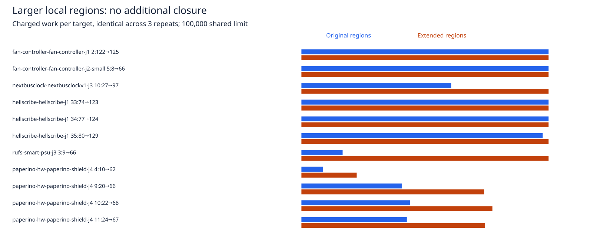

# Larger local regions: rejected offline experiment

Appending 32- and 64-pitch regions to the existing 0/4/8/16 schedule closes no additional point connection in this sample. Charged work increases by 33.4%. Production code, the default-off setting, widths, clearances and the shared work/time limits remain unchanged.

The input is the completed enabled candidate sweep from the preceding cycle (runtime `8e53e7d`). Select every seed-1 task with 1–10 **native** opens, import its saved session into its exported engine input, and independently probe each remaining supported point pair. Seven tasks qualify. One has no engine residual after import despite one native open; it is explicitly retained as a skip. The other six yield 11 point targets. This is not a fresh native evaluation, a complete routing sweep, or a replay of component-alternative enumeration. Engine residual counts differ from native opens. No native completion or safety improvement is inferred.

Both modes use the same original point pair, full-width visibility graph, 512-node cap, copper-corner enrichment, exact transaction gate, 100000 shared expansions and 15-second cooperative limit. Each target starts from a fresh session import. Three repeats per mode/target alternate execution order on the same host and cores 12–19. The only changed plan fields are margins and the attempt count needed to visit them. Each expanded schedule retains the original four regions first; it cannot bypass exhausted work to reach a larger box.

| Static residual measurement | Original four regions | Six regions |
| --- | ---: | ---: |
| Targets / repeats each | 11 / 3 | 11 / 3 |
| Probes / additional closures | 33 / 0 | 33 / 0 |
| Exact violations after probe | 0 | 0 |
| Byte-identical before/after sessions | 33/33 | 33/33 |
| Work, sum across repeats | 2132427 | 2843718 |
| Budget / exhaustive stops | 12 / 21 | 21 / 12 |
| Observed median / p95 seconds | 0.184322 / 0.768982 | 0.425496 / 0.690746 |
| Observed total seconds | 11.698559 | 14.037379 |

Timings overlap unit tests and shared host load; they are descriptive, with no causal performance claim. Aggregate p95 uses nearest rank. [Per-target median/p95 and work](cases.md), [summary](summary.json), [raw traces](results.json.gz), [source hashes](source-audit.json).



Four targets consume their budget before the new regions; six reach margin64, and one reaches margin32 before exhausting work. The new regions therefore are actually exercised on seven targets, rather than merely configured. All result/proposal traces and charged work repeat exactly. Every probe leaves pads, pours, fences, tracks and barrels unchanged. The report rejects missing repeats, changed sessions, exact errors and over-budget traces ([controls](validation.json)). These are diagnostic controls, not router regression coverage.

Larger boxes alone are not a useful production increment on these residuals. Next investigate candidate graph coverage or local attachment geometry under the existing ledger, rather than increasing the global budget. Independent endpoint-access work remains separate.

The historical Dense6 supervisor anomaly was also inspected without rerouting. All six records contain successful, non-timeout steps. Its driver ends after the sixth flushed print and has no explicit termination path there. The cause of supervisor143 remains unknown; this audit does not establish a clean historical exit ([static audit](dense-static-audit.json)).

## Reproduce

Requires the existing native benchmark runtime and dependencies. The native input directory may be reused from the preceding cycle; to regenerate it, use the committed snapshot helper and unchanged benchmark:

```bash
ENGINE=/home/hyper/bench/wt/fr-perf
BENCH=/home/hyper/bench/wt/fp-perf
ASSET="$ENGINE/docs/pr-assets/agent-fab-router-perf-local-rescue"
OUT=/home/hyper/bench/agents/codex-fabpcb-perf/scratch/repro43
python3 "$ASSET/point-components/snapshot.py" "$ENGINE" "$OUT"
cd "$BENCH"
taskset -c 12-19 nice -n 10 timeout 2400 python3 benchmarks/autorouter/benchmark.py --router fab-router --fab-router-source "$OUT/after/entry" --out "$OUT/native-after"
cd "$ENGINE"
taskset -c 12-19 nice -n 10 timeout 1800 bun "$ASSET/expanded-regions/run.ts" "$OUT/native-after" "$OUT/probe"
python3 "$ASSET/expanded-regions/report.py" "$OUT/probe/results.json" "$OUT/probe"
rsvg-convert -w 1600 "$OUT/probe/work.svg" -o "$OUT/probe/work.png"
taskset -c 12-19 nice -n 10 timeout 1800 bash -c 'bun run typecheck && bun run check:layers && bun run test'
```

For report-only reproduction, decompress `results.json.gz` into a fresh directory and pass its path and that directory to `report.py`. No native scores or historical findings are regenerated by that operation.

Required repository checks pass: typecheck; layer boundaries, 71 files / zero violations; 912 tests / zero failures / 399733 assertions (333.18 seconds). [Captured checks](checks.txt), [full log](checks.log.gz). Runtime, tests, frozen cases, rules and scoring are unchanged.
