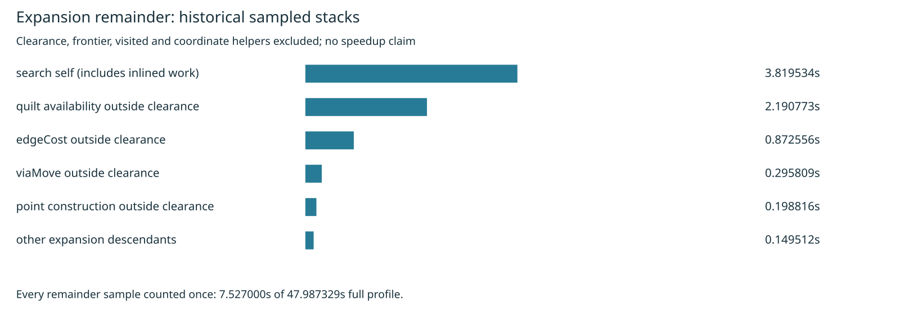

# Expansion remainder diagnosis

Cycle74 splits the cycle56 complete Aquarius J4 profile's previously unclassified 7.527000 seconds. Production source, settings, rules and consumer pin are unchanged. This is a historical profile analysis, with no new routing benchmark or speed improvement claim. The latest complete 26-case × 3-repeat comparison remains [the parked heap experiment](../heap-ordered-native/README.md).

The analyzer first validates the full profile with the prior search analyzer. For each sampled stack it finds the nearest source-qualified search ancestor, excludes clearance and the previously recognized heap, visited, coordinate and growth helpers, then assigns the remainder once. Quilt `isFree` descendants take precedence; otherwise the callback closest to search separates edge cost, via moves and point construction. Anonymous callbacks and unknown work remain explicit. All source-qualified frame stacks and caller splits are retained in `summary.json`; profile line numbers are converted from zero-based to one-based only in the displayed stack labels.

| Expansion remainder group | Sampled seconds | Remainder share |
|---|---:|---:|
| search self (includes inlined work) | 3.819534 | 50.74% |
| quilt availability outside clearance | 2.190773 | 29.11% |
| edgeCost outside clearance | 0.872556 | 11.59% |
| viaMove outside clearance | 0.295809 | 3.93% |
| point construction outside clearance | 0.198816 | 2.64% |
| other expansion descendants | 0.149512 | 1.99% |

Search self includes inlined work and cannot be interpreted as pure loop overhead. Quilt availability excludes its clearance descendants; it does not measure cache-hit cost, key cost or allocation separately. No invocation counts, cache hit rate, memory-write count, expected savings or new native DRC result can be inferred. The 7.527000 seconds reconcile exactly with the prior partition, within 42.503012 search seconds and 47.987329 total sampled seconds.

Independent root-down traversal reproduces the exact selected node set and sampled weight. Both analyzers agree on the parent totals. Seven malformed-profile controls are rejected, and hand-counted synthetic stacks exercise nested clearance, qualified names, callback grouping and helper exclusion. Generated summary/table/SVG replay byte for byte; Python AST validation passes. The verifier also checks current search/quilt/passes SHA-256 against the historical profile source inventory. PNG inspected visually.

Next: instrument unchanged quilt availability in a complete-board replay to distinguish cache hits/misses, key construction and callbacks before proposing a distinct optimization. Preserve coordinates, cached blocked/free states and invalidation semantics. Audit earlier rejected cache/key work first; do not repeat an unchanged candidate or predict savings from this sample share. Any engine adoption requires output parity, alternating timing, fresh full native 26×3, dense6/L2/L3, enabled slow acceptance and required gates.

Reproduce from the repository root into unused directories:

```sh
asset=docs/pr-assets/agent-fab-router-perf-local-rescue/expansion-profile
PYTHONDONTWRITEBYTECODE=1 python3 "$asset/verify.py" /tmp/expansion-profile-verified
PYTHONDONTWRITEBYTECODE=1 python3 "$asset/analyze.py" /tmp/expansion-profile-replay
cmp "$asset/summary.json" /tmp/expansion-profile-replay/summary.json
cmp "$asset/table.md" /tmp/expansion-profile-replay/table.md
cmp "$asset/profile.svg" /tmp/expansion-profile-replay/profile.svg
rsvg-convert -w 1600 /tmp/expansion-profile-replay/profile.svg -o /tmp/expansion-profile-replay/profile.png
taskset -c 12-19 nice -n 10 timeout 900 bash -c 'bun run typecheck && bun run check:layers && bun run test'
```

No scored benchmark ran this cycle, so no results-history row is fabricated. The known 27 native thermal errors remain unresolved. Native/stress/slow runs were not repeated for a diagnostic-only change.



Required checks: typecheck PASS; 71 layer-checked files / zero violations; 912 tests / zero failures / 399733 assertions (367.50 seconds). Supervisor exit 0. Full log retained in `checks.log.gz`.
