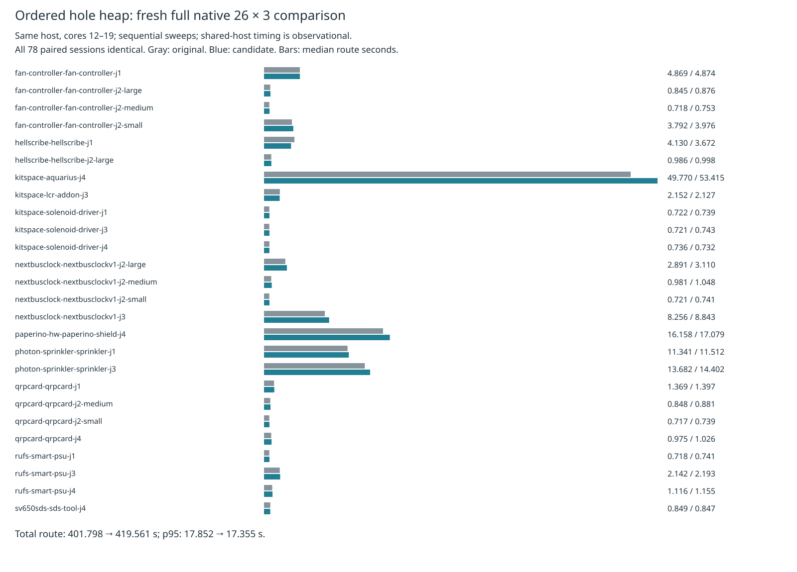

# Ordered hole heap: fresh full native comparison

This comparison measures the isolated candidate from
[the heap experiment](../heap-ordered-hole/README.md). Only
`src/route/search.ts` differs: heap pop uses a saved parent and moves children
into its position while retaining the original ordered comparisons. Production
source, defaults and consumer pin remain unchanged. The wrapper enables existing
local recovery identically in both isolated sources.

Both sweeps use the same frozen 26 cases × 3 repeats on the benchmark host, cores
12–19, nice 10. The original runs first, followed by the exact isolated candidate.
Required checks finish before measured routing begins. No attempt is discarded or
rerun. Shared-host sequential timings are observations and do not isolate a
causal allocation or runtime-compilation effect.

**Parked after the full-suite speed gate.** Total route time rises 4.42%
(401.797863 → 419.561453 seconds), aggregate median rises 9.80%, and summed
case p95 rises 3.85%. Aggregate p95 falls 2.78%, but 22 case medians and 19
case p95 values worsen. Shared-host timing does not establish a causal slowdown
or a reliable gain. Dense input, ladder L2/L3 and enabled slow acceptance were
not rerun for this parked candidate. No production adoption or pin bump.

Both sweeps complete 78 attempts with preserved controls, supervisor exit 0 and
no interruption. Both have 48/78 passed, 16/26 valid cases, 90 opens, 27 known
native errors, 2,826 summed vias and 60,450.378202 mm summed copper length.
All paired sessions are identical and no native error/warning geometry or
fidelity regression is found. The archive additionally checks all final engine
statistics. Both required test gates pass 912 tests / 399,733 assertions,
typecheck and layer checks (71 files, zero violations).

[Aggregate metrics](aggregate-table.md) and [all case metrics](table.md) retain
route median, nearest-rank p95, total time, native quality, vias and copper length.
The per-case p95 is the maximum of three repeats; aggregate p95 is order statistic
75 of 78. Copper metrics sum all repeats. Sweep wall time uses benchmark controls;
supervisor wall time additionally includes final report generation.

| Full native metric (26 cases × 3 repeats) | Original | Ordered hole |
|---|---:|---:|
| Passed / 78 | 48 | 48 |
| Valid cases / 26 | 16 | 16 |
| Opens | 90 | 90 |
| New native errors (known, unresolved) | 27 | 27 |
| Median route seconds | 1.046895 | 1.149466 |
| p95 route seconds | 17.851633 | 17.355380 |
| Sum route seconds | 401.797863 | 419.561453 |
| Sweep wall seconds | 510.945033 | 531.720296 |
| Sum case medians seconds | 132.203653 | 138.617866 |
| Sum case p95 seconds | 141.097122 | 146.527044 |
| Sum vias | 2826 | 2826 |
| Sum length mm | 60450.378202 | 60450.378202 |



Raw evidence includes all checks, step records, inputs, sessions, settings,
manifests and engine reports, plus complete benchmark controls/results/summaries,
logs, source inventories, supervisor exits, licenses and input provenance. The
archive verifier reconstructs the comparison and rejects four corruption controls.
The prerequisite separately checks finite and exceptional heap parity, a
child-first mutation and nine source/record corruptions. Existing native thermal
errors remain unresolved: identical errors would establish no added regression,
not a DRC-clean board.

Exact reproduction from the repository root with the benchmark checkout's private
runtime and unused output directories:

```sh
p=docs/pr-assets/agent-fab-router-perf-local-rescue/heap-ordered-hole
n=docs/pr-assets/agent-fab-router-perf-local-rescue/heap-ordered-native
s=/home/hyper/bench/agents/codex-fabpcb-perf/scratch/ordered-hole-native-repro
python3 "$p/prepare.py" "$s/work"
python3 "$p/mutation.py" "$s"
python3 "$p/run.py" "$s"
for mode in original candidate; do
  python3 "$p/native-run.py" "$s/work" "$HOME/bench/wt/fp-perf" "$mode"
done
python3 "$n/compare.py" "$s/work/native-original" "$s/work/native-candidate" "$s/work/comparison.json"
python3 "$n/report.py" "$s/work/comparison.json" "$s/report"
python3 "$n/aggregate.py" "$s/report"
rsvg-convert -w 1600 "$s/report/timings.svg" -o "$s/report/timings.png"
```

Each sweep invokes the following from the benchmark worktree:

```sh
taskset -c 12-19 nice -n 10 timeout 3000 python3 benchmarks/autorouter/benchmark.py --router fab-router --fab-router-source SOURCE/entry --out OUTPUT
```

Frozen inputs, checker, scoring, per-case settings and shared runtime are unchanged.
Adoption requires convincing speed results and dense input, ladder L2/L3 and
enabled slow acceptance checks. No consumer pin bump is justified by this archive
alone.

Replay the committed archive without routing or native tools:

```sh
n=docs/pr-assets/agent-fab-router-perf-local-rescue/heap-ordered-native
PYTHONDONTWRITEBYTECODE=1 python3 "$n/verify.py"
python3 "$n/report.py" "$n/comparison.json" /tmp/ordered-hole-native-report
python3 "$n/aggregate.py" /tmp/ordered-hole-native-report
```
