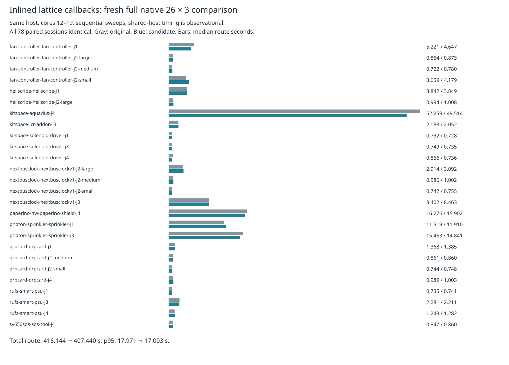

# Inlined lattice callbacks: full native mixed result

The complete single-board replay in `../lattice-inline/` suggested a saving. This fresh full 26-case × three-repeat paired native gate shows mixed timing: total route time decreases 2.09%, overall p95 decreases 5.39%, and summed case medians decrease 2.29%, but overall attempt median increases 3.66%. Seventeen of 26 case medians and 15 case p95s increase. **Not adopted:** this does not establish speed nonregression across the benchmark. No unchanged retry or result selection was performed. Shared-host sequential timings are observational; the differences do not establish callback-allocation or JIT causality.

The candidate inlines the original per-query `test` and `push` bodies in bucket and shelf loops. Filter order, comparisons, reference construction, stamps, live state and sorting are unchanged. Source preparation is pinned to `66d50ed`; only `src/lattice/grid.ts` differs across all tracked implementation/specification/test/tool/wrapper files. Existing production source, tests, defaults and consumer pin remain unchanged. The earlier native-workload profile/census provides motivation: 42,711,408 queries per complete replay, with lattice collect/test prominent in the profile; counts alone do not prove closure overhead.

Both versions enable existing local recovery through byte-identical wrappers. Same host, cores 12–19, nice 10; sequential original then candidate sweeps, 3,000-second outer timeout and unchanged 3,600-second per-attempt cap. No overlapping own heavy work. Both sweeps finish/check all 78 attempts with supervisor exit zero and complete/preserved controls. All paired input DSNs, settings, manifests, effective settings, session bytes and final statistics agree. No native error/warning-geometry/multiplicity or design-fidelity regression. Known 27 native thermal errors remain unresolved; this is no clean-native claim.

| Metric (26 cases × 3 repeats each) | Original | Candidate |
|---|---:|---:|
| Passed / valid cases 3/3 | 48 / 16 | 48 / 16 |
| Opens / native errors relative to input | 90 / 27 | 90 / 27 |
| Candidate-introduced native findings | — | 0 |
| Overall median route s | 1.051333 | 1.089800 |
| Overall p95 route s | 17.971245 | 17.002644 |
| Total route s | 416.144441 | 407.439693 |
| Sum case medians s | 137.298496 | 134.158015 |
| Sum case p95 s | 147.101510 | 144.063334 |
| Measured sweep wall s | 528.036282 | 521.942976 |
| Outer command wall s | 538.129759 | 532.234466 |
| Vias / track length mm, sums | 2826 / 60450.378202 | 2826 / 60450.378202 |
| Identical paired session bytes | — | 78 / 78 |

Per-case results are in [table.md](table.md), including failed boards. Overall p95 is nearest-rank over 78 attempts; each case p95 is the maximum of its three repeats. Dense6, ladder L2/L3 and enabled slow acceptance are skipped after the mixed primary speed result; those are not completed gates. No consumer pin bump is warranted.



Raw evidence is retained losslessly in `raw-attempts.json.gz`: all 156 checks, records, DSNs, sessions, settings, manifests and router reports with file SHA256s. Separate result/control/summary archives and supervisor logs bind the runs. `full-source-audit.json.gz` covers every tracked implementation/spec/test/tool/wrapper file; independent preparation replay matches them byte for byte. `input-provenance.json.gz` retains frozen case licenses and metadata. `verify.py` reconstructs outputs, cross-checks raw native checks against results, compares final stats and replays the comparison exactly. Four deliberate corruptions must be rejected. The chart is visually inspected.

Reproduce from this repository root with a prepared native benchmark checkout and unused output directories:

```sh
asset=docs/pr-assets/agent-fab-router-perf-local-rescue/inline-native
work=/tmp/lattice-inline-native-reproduction
bench=/path/to/fab_pcb
mkdir "$work"
python3 "$asset/prepare.py" "$work/source"
python3 "$asset/run.py" "$work" "$bench"
python3 "$asset/compare.py" "$work/native-original" "$work/native-candidate" "$work/comparison.json"
python3 "$asset/report.py" "$work/comparison.json" "$work/report"
rsvg-convert -w 1600 "$work/report/timings.svg" -o "$work/report/timings.png"
python3 "$asset/checks.py" "$work" "$PWD"
python3 "$asset/package.py" "$work" /tmp/lattice-inline-native-package
python3 "$asset/verify.py"
```

The final command verifies committed evidence; comparison/report commands operate on fresh measurements. Required candidate and production checks are recorded in the archived logs and stage exit statuses. No existing tests, DRC rules, frozen inputs, checker, scoring or shared runtime are changed.

Final required checks PASS for both sources: typecheck, layer checks (71 files / zero violations), 912 tests / zero failures / 399,733 assertions. Candidate tests: 333.68 s; production: 342.36 s. Both benchmark supervisors and the sequential check supervisor exit zero.
