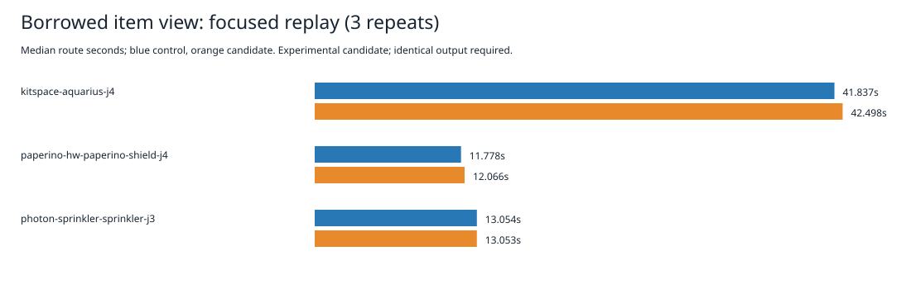

# Borrowed indexed item wrapper experiment

Rejected at the focused timing gate. Production sources, settings, geometry rules and consumer pin are unchanged.

The isolated candidate prepares a frozen category/item wrapper at insertion and reads it from clearance hit checks. The existing itemOf method still returns independent mutable wrappers; private shape-cache state is not exposed. Freeze is shallow and layout geometry retains existing object identity/mutability. Rebuild preserves views, remove/reinsert replaces them. This avoids repeated wrapper creation but does not by itself demonstrate a routing speed gain.

Same host hyper-ms-lin, cores 12–19, nice 10; three sequential alternating pairs per case, fresh processes, 180-second limits plus five-second kill grace. p95 is the maximum of three. Shared host load is uncontrolled. Timings cover engine replay, excluding conversion/native checking.

| Case | Control median / p95 (s) | Candidate median / p95 (s) |
|---|---:|---:|
| kitspace-aquarius-j4 | 41.837 / 45.062 | 42.498 / 42.781 |
| paperino-hw-paperino-shield-j4 | 11.778 / 11.841 | 12.066 / 12.134 |
| photon-sprinkler-sprinkler-j3 | 13.054 / 13.557 | 13.053 / 13.917 |


Sum of nine route durations: 201.189245s → 203.315738s (+1.06%). Aquarius median +1.58%, shield +2.45%; sprinkler median effectively unchanged, p95 +2.66%. No causal allocation/freezing/GC cost or universal speed claim is made.

All eighteen sessions are byte-identical to retained default references. Complete settings/results/reports match after removing only report.wallClockMs. Engine residuals remain 8/2/6 for Aquarius/sprinkler/shield and represented additions remain zero. These are not native scores. Known native thermal failures remain unresolved; recovery stays default off. No full native 26×3, dense6, ladder or whole slow acceptance follows focused rejection.

The probe passes 22,663 comparisons: 2,663 lifecycle/wrapper assertions and 20,000 full sweep-clearance comparisons. It checks stable frozen wrappers, original mutable-wrapper isolation, cache privacy, rebuild/remove/replacement and old-wrapper validity. Bounded synthetic coverage only; see method.md. Candidate typecheck and three unchanged targeted files pass: 26 tests, 39,827 assertions, 8.90s; full candidate suite not run after timing rejection. Initial typecheck lacked the dependency symlink and failed before routing; adding the existing dependency link fixed setup without package installation.

Reproduce from repository root:

```bash
python3 docs/pr-assets/agent-fab-router-perf-local-rescue/item-view/reproduce.py /tmp/item-view-replay
python3 docs/pr-assets/agent-fab-router-perf-local-rescue/item-view/verify.py
python3 docs/pr-assets/agent-fab-router-perf-local-rescue/item-view/test_verify.py
bun run typecheck && bun run check:layers && bun run test
```

Use --prepare-only to reconstruct all source/spec hashes and run the probe without timed routing. The adjacent immutable source archive and inputs are licensed and retained under default-slow-profile. All attempts, full reports, sessions, logs and elapsed values are in attempts.tar.xz. source-audit.json pins every measured source/spec file in each variant. root-audit.json checks the production tree against the measured control. No checker, rule, or test expectation changed.



To repeat the isolated typecheck and targeted tests separately, first use reproduce.py with --prepare-only, then run `bash docs/pr-assets/agent-fab-router-perf-local-rescue/item-view/check-candidate.sh /tmp/item-view-replay` from the root. The helper copies the unchanged three test files and links existing dependencies; run it before timing, never during a replay. No dependency installation is performed.

Final unchanged production checks pass: typecheck; 71 layer files with zero violations; 914 tests, zero failures, 649,747 assertions in 309.26s. No source/test/rule/checker expectation changed.

The documented check-candidate.sh also passes against the independently reconstructed candidate: typecheck and the same 26 tests/39,827 assertions (7.41s). This separate verification is outside all timing comparisons.
