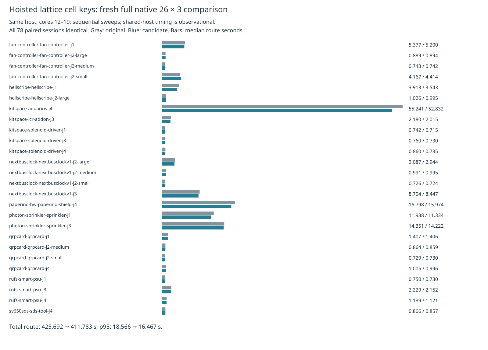

# Hoisted lattice cell keys: mixed full native timing

The complete-board profile and census identify lattice collection and 85,374,181 cell lookups per replay as a hotspot. This distinct candidate hoists the x-dependent multiplication out of the inner cell loop, retaining exactly the original arithmetic grouping, traversal, stamps, overlap comparisons, live state, filter calls, fresh references and sort. It changes only `src/lattice/grid.ts`. The earlier callback-inlining and boundary-prefilter candidates are not included.

Fresh full 26-case × three-repeat native sweeps on the same host show lower aggregate time: total route -3.27%, overall median -0.15%, p95 -11.30%, and summed case medians -3.66%. However, four case medians and five case p95s increase. The fan-controller small-edit case rises from 4.1669 to 4.4144 s median and 4.2421 to 4.7275 s p95. **Not adopted:** this does not establish speed nonregression across cases. Shared-host sequential timings are observational and do not establish an arithmetic/JIT cause. No rerun, discarded attempt or unchanged retry was used.

All 78 paired sessions and final statistics are identical. Both sources have 48/78 passes, 16/26 valid cases, 90 opens and 27 known native thermal errors; these errors remain unresolved. No added native error/warning geometry, multiplicity or design-fidelity regression. This is not a clean-native result. Source preparation pins `5c187d3`; independent preparation reproduces all 1,550 tracked implementation/spec/test/tool/wrapper files. Production source, tests, defaults and consumer pin remain unchanged.

Both sweeps enable existing recovery through identical wrappers, use cores 12–19, nice 10, a 3,000-second outer limit and unchanged 3,600-second per-attempt limit. Original then candidate run sequentially with no overlapping own heavy work. Both complete all 78 checks with preserved controls and supervisor exit zero.

| Metric (26 cases × 3 repeats each) | Original | Candidate |
|---|---:|---:|
| Passed / valid cases 3/3 | 48 / 16 | 48 / 16 |
| Opens / native errors relative to input | 90 / 27 | 90 / 27 |
| Candidate-introduced native findings | — | 0 |
| Overall median route s | 1.077179 | 1.075566 |
| Overall p95 route s | 18.565958 | 16.467248 |
| Total route s | 425.692051 | 411.783301 |
| Sum case medians s | 141.483016 | 136.306130 |
| Sum case p95 s | 150.050111 | 143.981550 |
| Measured sweep wall s | 540.945609 | 523.436707 |
| Outer command wall s | 551.088628 | 533.134429 |
| Vias / summed track length mm | 2826 / 60450.378202 | 2826 / 60450.378202 |
| Identical paired sessions | — | 78 / 78 |

Per-case timing, passed, opens and errors are in [table.md](table.md). Overall p95 is nearest-rank over 78 attempts; case p95 is the maximum of its three repeats. Dense6, ladder L2/L3 and enabled slow acceptance are skipped after the mixed primary speed result, and are not completed gates. There is no consumer pin bump.



Both sources pass typecheck, layer checks (71 files, zero violations), and all 912 tests / 399,733 assertions. Candidate and original check commands take 337.01 and 331.64 seconds including typecheck/layer checks; both exit zero. Tests and rules are unchanged. The complete-board prerequisite and full candidate bytes are in [../lattice-key/](../lattice-key/README.md).

All 156 raw checks, records, DSNs, sessions, settings, manifests and router reports are retained losslessly in `raw-attempts.json.gz`, including hashes. Separate controls, results, summaries, source hashes, licenses/provenance and supervisor logs bind the measurement. `verify.py` reconstructs the comparison from the archive, cross-checks native checks/results, stats, sessions and finding geometry; four corruptions must be rejected. `preparation-replay.json` records independent source preparation parity.

Exact reproduction from the repository root, using an unused work directory and prepared native benchmark checkout:

```sh
asset=docs/pr-assets/agent-fab-router-perf-local-rescue/key-native
work=/tmp/lattice-key-native-reproduction
bench=/home/hyper/bench/wt/fp-perf
mkdir -p "$work"
python3 "$asset/prepare.py" "$work/source"
# Run these checks sequentially before timing:
python3 docs/pr-assets/agent-fab-router-perf-local-rescue/lattice-key/checks.py "$work/source"
python3 "$asset/run.py" "$work" "$bench"
python3 "$asset/compare.py" "$work/native-original" "$work/native-candidate" "$work/comparison.json"
# Independently verify the committed measurement without rerouting:
PYTHONDONTWRITEBYTECODE=1 python3 "$asset/verify.py"
python3 "$asset/report.py" "$asset/comparison.json" /tmp/lattice-key-native-report
rsvg-convert -w 1600 /tmp/lattice-key-native-report/timings.svg -o /tmp/lattice-key-native-timing.png
```

`run.py` executes exactly `taskset -c 12-19 nice -n 10 timeout 3000 python3 benchmarks/autorouter/benchmark.py --router fab-router --fab-router-source "$work/source/MODE/entry" --out "$work/native-MODE"` from the benchmark checkout for each source. Frozen inputs, checker, scoring and shared runtime are unchanged. Existing profile/census artifacts motivate the hypothesis but do not prove arithmetic overhead.
