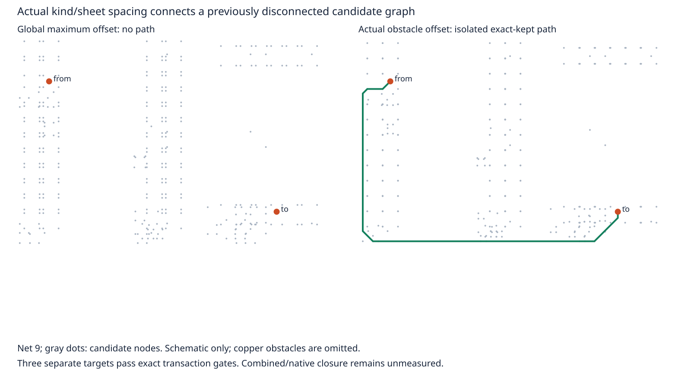

# Actual kind/sheet candidate-spacing witnesses

The previous uncapped corner and bounded midpoint graphs were disconnected. This diagnostic isolates one cause: candidate generation expands every obstacle by the maximum spacing across all kinds and usable sheets. On these saved residuals that maximum is 5000 LU, while every sampled foreign pad/track/barrel requires 2000 LU against the routed track on the common sheet. Including the unchanged 1250 LU half-width and one-LU outward slack gives offsets 6251 versus 3251 LU. These are proposal offsets only; production exact predicates always enforce actual spacing. Board minima are never inferred or lowered.

Same four saved seed-1 paperino residuals, original anchors, sheet1, margin64 region, obstacle order, full width2500 LU and 327 uncapped corner nodes per graph. The alternative substitutes `layout.spacing.get(profile.trackKind, obstacle.kind, sheet)` for the global maximum only in obstacle-corner generation. No midpoint candidates, vias, neck-down, grid changes or new rules. Each breadth-first search exhausts its queue below100000 directed edge checks. Generation/setup are uncharged and no cooperative target deadline is implemented: **this is not the production work ledger or a production proposal**. There is a1200-second outer supervisor per diagnostic.

Three complete paired repeats are byte-identical per mode on the same host/cores12–19. See [cases.md](cases.md): global offsets find0/4 paths; actual offsets find3/4 paths. Each successful path is reconstructed in a SEPARATE fresh input layout and passes the actual `tryRecoveryTransaction` retained-copper, whole-region, exact-DRC, prior-terminal and original-terminal gates. Each isolated layout goes from4 to3 engine residual connections, exact violations stay0, and the journal is then rewound with session equality checked. Source layout geometry/session remain identical throughout.

**The three routes are independent alternatives, not combined routing.** They may compete for space. No native DRC, full26×3, larger-board, slow acceptance, timing improvement or native-score gain is claimed. Production remains8e53e7d/defaultoff; consumer pin and known27native errors remain unchanged. Next: test this candidate family in the bounded production coordinator, preserving shared accounting/deadlines/rollback, then measure combined/native outcomes before adoption.



Gray points are candidate nodes, not copper. This schematic intentionally omits obstacles and is not a board render or native clearance proof. Source-input replay invokes production exact checks; the report validator alone checks archive consistency, discovery-order/work replay, baseline parity, endpoint/region/width assertions and four mutation controls. Discovery edges are NOT a complete adjacency matrix. Source audit binds77runtime/spec files to the previous diagnostic.

## Exact reproduction

Run from the engine worktree. Input reconstruction/provenance: [candidate census](../candidate-coverage/README.md). The archived cycle42 after-run input includes each original DSN, routed SES and effective settings.

```bash
ASSET=docs/pr-assets/agent-fab-router-perf-local-rescue/kind-spacing
NATIVE=/home/hyper/bench/agents/codex-fabpcb-perf/scratch/cycle42/native-after-run
OUT=/home/hyper/bench/agents/codex-fabpcb-perf/scratch/repro48
mkdir -p "$OUT"
for repeat in 1 2 3; do
  for mode in corners kind-spacing; do
    taskset -c 12-19 nice -n 10 timeout 1200 bun "$ASSET/run.ts" "$NATIVE" "$OUT/final-$mode-$repeat.json" "$mode"
  done
done
python3 - "$OUT" "$OUT/results.json.gz" <<'PY'
import gzip,json,sys
from pathlib import Path
rows=[json.loads(p.read_text()) for p in sorted(Path(sys.argv[1]).glob('final-*.json'))]
Path(sys.argv[2]).write_bytes(gzip.compress(json.dumps(rows,separators=(',',':')).encode(),mtime=0))
PY
cmp "$ASSET/results.json.gz" "$OUT/results.json.gz"
python3 "$ASSET/report.py" "$OUT/results.json.gz" "$OUT/report"
rsvg-convert -w1600 "$OUT/report/witness.svg" -o "$OUT/report/witness.png"
cmp "$ASSET/witness.png" "$OUT/report/witness.png"
python3 "$ASSET/verify.py"
taskset -c 12-19 nice -n 10 timeout 1800 bash -c 'bun run typecheck && bun run check:layers && bun run test'
```

Report-only replay needs Python standard library, the preceding midpoint archive and rsvg-convert. Required checks are recorded in checks.txt/checks.log.gz. No scored router benchmark completed, so no native history row is fabricated.
