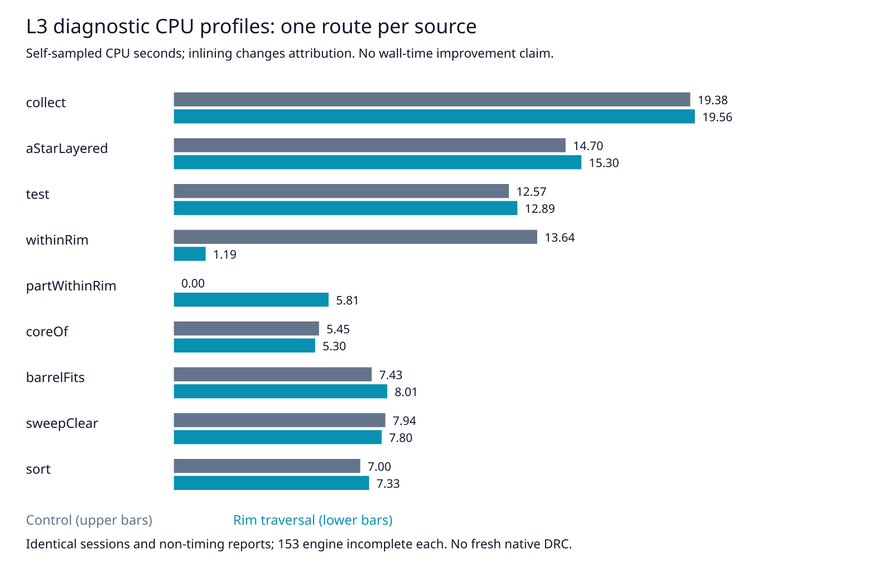

# L3 diagnostic CPU profiles

Evidence only: no engine, rule, budget, default, test expectation or scoring changes. This follows the adverse L3 tail retained in `../l3-replication`. One candidate-first then control profile, sequential on the same host, cores 12–19, nice 10, two passes, 600-second engine budget and 900-second process timeout. Both finish and match the prior unprofiled sessions byte for byte, settings, statistics and complete reports except wall time. Each has 153 engine-incomplete connections, zero added represented-rule violations, 93 vias and 1688.604896 mm length. No fresh native DRC or full-suite run; existing native thermal errors remain unresolved.

| Self-sampled CPU seconds (one profile/source) | Control | Rim traversal |
|---|---:|---:|
| lattice collect | 19.383 | 19.555 |
| layered search | 14.703 | 15.297 |
| lattice test | 12.575 | 12.894 |
| withinRim | 13.638 | 1.189 |
| partWithinRim | 0 | 5.808 |
| coreOf | 5.449 | 5.303 |

These are self-samples, not inclusive function costs or route-time benchmarks. JIT inlining can move attribution between functions. One profile per version does not explain the adverse tail or establish a causal speed comparison. Profile wall times are excluded from benchmark comparisons. Lattice collect/test and layered search remain prominent; the rejected collector in PR17 must not be revived unchanged (L2 slowdown and slow-acceptance completion regressions). No optimization adopted this cycle.

The prior **unprofiled** counterbalanced timing evidence is unchanged, three repeats/version:

| L3 metric | Control | Rim traversal |
|---|---:|---:|
| Median route s | 161.492339 | 161.235169 |
| p95 (max of 3) s | 163.181164 | 174.119710 |
| Sum route s | 485.737126 | 491.498890 |



Reproduce with installed dependencies, Bun, Python, git, tar, timeout, taskset and nice:

```bash
ENGINE=/home/hyper/bench/wt/fr-perf
ASSET="$ENGINE/docs/pr-assets/agent-fab-router-perf-local-rescue/l3-profile"
RUN=/home/hyper/bench/agents/codex-fabpcb-perf/scratch/l3-profile-repro
python3 "$ASSET/reproduce.py" "$ENGINE" /home/hyper/bench/boards/ladder/l3-cycle18.dsn "$RUN"
python3 "$ASSET/analyze.py" "$RUN"
python3 "$ASSET/analyze.py" "$ASSET"
python3 "$ASSET/plot.py"
cd "$ENGINE"
taskset -c 12-19 nice -n 10 timeout --kill-after=10 1800 bash -c 'bun run typecheck && bun run check:layers && bun run test'
```

`reproduce.py` uses immutable source revisions a3a2d38d and 49bfc72a; source file hashes were checked against the prior complete source audit. Input payload/provenance remains in the preceding evidence packages. Full raw profiles, outputs and logs are retained; `analyze.py` independently checks sessions/reports against prior attempts and recomputes top 40 self-sample rows. `original-invocation.py` retains the exact original invocation using those audited snapshots. `manifest.json` covers every other file in this directory.

Validation: typecheck PASS; 71 layer files / zero violations; 914 tests / zero failures / 649747 assertions (305.34 seconds). Independent session and report corruption controls both rejected. No own heavy jobs overlapped these sequential profiles or tests.
