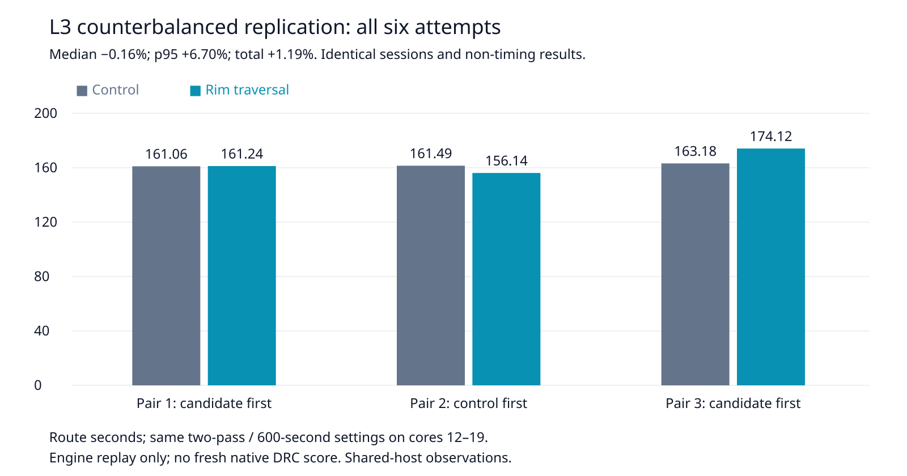

# L3 counterbalanced replication

This evidence-only increment follows up the prior single L3 pair's 8.20% slowdown. No engine, rule, test expectation, budget or default changes. Control `49bfc72a` and rim implementation `a3a2d38ddea104e4dff4fec8551d27260710a718` match the measured source snapshots byte for byte (`source-audit.json`).

Three fresh alternating pairs on the same host, cores 12–19, nice 10, sequential without overlapping own heavy jobs. Order: candidate/control, control/candidate, candidate/control. Each route uses two passes, a 600-second engine budget and 900-second process timeout; enabled recovery, seed 1 and all other settings match. All six attempts complete with identical SES bytes, settings, statistics and full reports except `wallClockMs`. Each retains 153 engine-incomplete connections, 93 vias, 1688.604896 mm track length and zero added represented-rule violations. This is an engine replay, **not a fresh native DRC check or frozen-suite score**.

| Metric (3 repeats each) | Control | Rim traversal |
|---|---:|---:|
| Median route seconds | 161.492339 | 161.235169 |
| p95 (max of 3) seconds | 163.181164 | 174.119710 |
| Sum route seconds | 485.737126 | 491.498890 |
| Engine incomplete per attempt | 153 | 153 |
| Added represented-rule violations | 0 | 0 |
| Vias per attempt | 93 | 93 |
| Track length mm per attempt | 1688.604896 | 1688.604896 |

Median −0.16%, p95 +6.70%, total +1.19%. This does not establish an L3 speed gain or resolve the adverse tail. Timing variability is retained; no causal claim about host load is made. The earlier adverse pair remains in `../rim-composition/ladder-summary.json`. The prior full native pair (26×3 each) is unchanged: 48/78 pass, 90 opens and 27 known unresolved native thermal errors each. Neither that benchmark nor the whole slow acceptance suite was rerun in this cycle.



## Reproduce

Requires installed engine dependencies, Python 3, Bun, git, tar, taskset, nice, timeout and rsvg-convert. The compressed input is byte-identical to `/home/hyper/bench/boards/ladder/l3-cycle18.dsn`; the prior package also retains its board payload/provenance under `../rim-composition`.

```bash
ENGINE=/home/hyper/bench/wt/fr-perf
ASSET="$ENGINE/docs/pr-assets/agent-fab-router-perf-local-rescue/l3-replication"
RUN=/home/hyper/bench/agents/codex-fabpcb-perf/scratch/l3-replication-repro
python3 "$ASSET/reproduce.py" "$ENGINE" /home/hyper/bench/boards/ladder/l3-cycle18.dsn "$RUN"
python3 "$ASSET/verify.py" "$RUN"
python3 "$ASSET/plot.py" "$RUN"
cd "$ENGINE"
taskset -c 12-19 nice -n 10 timeout --kill-after=10 1800 bash -c 'bun run typecheck && bun run check:layers && bun run test'
```

`run.py` records the exact original invocation using the existing byte-audited cycle81 snapshots. `reproduce.py` constructs equivalent snapshots directly from immutable Git revisions. `verify.py` rejects missing/reordered attempts, changed session hashes, changed settings/statistics/reports, and timeouts/abortions; it removes only the two explicit wall-time fields. `plot.py` renders all six timings. Raw sessions, results and logs are retained without filtering.

Validation: typecheck PASS; 71 layer files / zero violations; 914 tests / 649747 assertions / zero failures (309.99 seconds). Session and report corruption controls are both rejected. Full check log retained.
