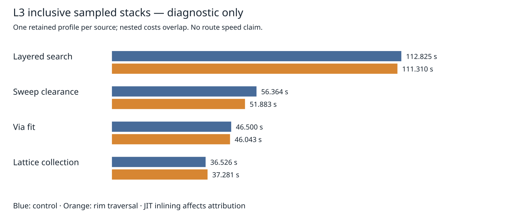

# L3 caller-stack attribution

Analysis of the **existing** cycle83 profiles, not new routing attempts. No production changes or new native checks. The L3 adverse p95 tail remains unresolved. The prior output-parity verifier is rerun alongside this analysis.

Inclusive sample weights count a normalized function/file/line once per sampled stack. Immediate caller edges are also deduplicated per stack. Recursive frames therefore cannot exceed total sample weight. Nested inclusive costs overlap and must not be summed. JIT inlining, sampling and differing stacks prevent interpreting these as exact function elapsed costs or causal speed differences.

| Inclusive sampled seconds, one historical profile/source | Control | Rim traversal |
|---|---:|---:|
| layered search | 112.825 | 111.310 |
| sweep clearance | 56.364 | 51.883 |
| via fit | 46.500 | 46.043 |
| sweep clearance → lattice collect | 24.496 | 24.871 |
| via fit → lattice collect | 11.937 | 12.295 |

Collection from sweep and via checks is the main observed collection caller cost. This narrows future investigations to those query contexts; it does not justify reviving the rejected collector experiment unchanged. No optimization is adopted here.

The previous **unprofiled** same-host, same-input, three-repeat comparison remains:

| L3 route metric | Control | Rim traversal |
|---|---:|---:|
| median s | 161.492339 | 161.235169 |
| p95 (max of 3) s | 163.181164 | 174.119710 |
| sum s | 485.737126 | 491.498890 |

Both versions produced identical sessions/settings/statistics/reports except wall time; each has 153 engine-incomplete connections, zero added represented-rule violations, 93 vias, 1688.604896 mm length. These are historical engine-only results, not fresh native DRC. Known native thermal errors remain unresolved.



Recompute from the repository root:

```bash
ASSET=docs/pr-assets/agent-fab-router-perf-local-rescue
python3 "$ASSET/l3-profile/analyze.py" "$ASSET/l3-profile"
python3 "$ASSET/l3-stack/test_analyze.py"
python3 "$ASSET/l3-stack/analyze.py" > "$ASSET/l3-stack/summary.json"
python3 "$ASSET/l3-stack/plot.py"
taskset -c 12-19 nice -n 10 timeout --kill-after=10 1800 bash -c 'bun run typecheck && bun run check:layers && bun run test'
```

Raw compressed profiles and the immutable-source routing reproduction commands are retained in `../l3-profile`. Synthetic checks cover recursive attribution, self-weight conservation and malformed trees/samples/deltas. `summary.json` retains all frames and edges rather than truncating to top rows. No fresh benchmark means no additional benchmark history rows.

Cycle84 validation: typecheck PASS; 71 layer files / zero violations; 914 tests / zero failures / 649747 assertions (320.66 seconds). Original parity verifier and both real-profile weight-conservation/bounds checks PASS.
