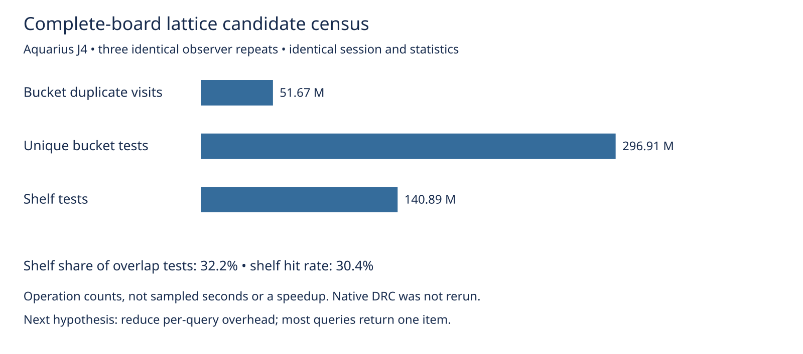

# Complete-board lattice operation census

This diagnostic measures the lattice work on the complete Aquarius J4 production input selected by the earlier native-workload profile. It follows rejection of the boundary prefilter in the sibling `ring-native` evidence. No engine optimization, rule change, default change, or consumer pin change is proposed.

Three sequential observer replays run on the same host, cores 12–19, nice 10, each with a 240-second timeout and no overlapping heavy jobs from this agent. The observer only increments counters in a scratch source copy of `src/lattice/grid.ts`. The original query tests, generation stamps, result construction, filters, sort and traversal order remain intact. The tracked source/spec/test hash audit permits exactly that one changed file; the complete instrumented file is archived. Counters aggregate all lattices and all phases of the production route, including recovery and final checks; they do not isolate normal routing alone.

Every replay must match the independent archived native input/settings/session/final statistics and full report except elapsed time. Recovery structures, work, choices and outcomes match the independent earlier uninstrumented replay after removing only nested elapsed seconds. All counters must agree across three repeats. Eight deliberate corruptions exercise independent parity, arithmetic and repeatability gates. The observer adds overhead, so its times are raw provenance and are not a performance comparison.

Engine residuals remain eight and engine exact violations remain zero. Historical native results for this input remain 15 opens and six new thermal errors. Native DRC is not rerun here. No fresh full-suite, dense, ladder or slow acceptance measurement is claimed. This diagnostic produces no scored benchmark/history row.



The generated `summary.json` and `table.md` contain exact counts. The principal follow-up hypothesis is reducing per-query overhead while preserving exact query results and live mutation behavior: `collect` currently creates both `test` and `push` closures on every query with a populated sheet. The frequency of small results motivates measuring that separately; it does not prove allocations are expensive or that removing closures improves native timing. Shelf scans are only part of overlap tests, so an index replacement also needs measurements. No new optimization is adopted based on counts alone.

Reproduce from the engine repository root, using an unused work directory:

```sh
asset=docs/pr-assets/agent-fab-router-perf-local-rescue/lattice-census
work=/tmp/lattice-census-reproduction
python3 "$asset/prepare.py" "$work"
for repeat in 1 2 3; do
  taskset -c 12-19 nice -n 10 timeout 240 bun "$asset/run.ts" \
    "$work/source" "$work/input" "$work/replay$repeat"
done
python3 "$asset/package.py" "$work" /tmp/lattice-census-records.json.gz
# Archived evidence replay, independently of running the engine:
python3 "$asset/verify.py" /tmp/lattice-census-summary.json
PYTHONDONTWRITEBYTECODE=1 python3 "$asset/controls.py"
python3 "$asset/plot.py" /tmp/lattice-census-summary.json /tmp/lattice-census.svg
rsvg-convert -w 1600 /tmp/lattice-census.svg -o /tmp/lattice-census.png
taskset -c 12-19 nice -n 10 timeout 1800 bash -c 'bun run typecheck && bun run check:layers && bun run test'
```

`package.py` independently validates new outputs and prints their counters; archived verification reads the committed evidence. Input licensing, provenance, reference DSN/session and independent reference result remain in `../native-profile/`. The initial preparation failed on an untracked acceptance artifact before running the engine; the final preparation audits tracked files only. Raw stdout/stderr and required check logs are retained losslessly. No completed routing attempt was discarded or rerun.

Final validation: observer typecheck/layer checks PASS; unchanged production typecheck/layers (71 files, zero violations) and all 912 tests PASS, zero failures, 399,733 assertions, 347.68 seconds. Check supervisor exits zero. Chart, table, summary and record package reproduce byte-for-byte.
