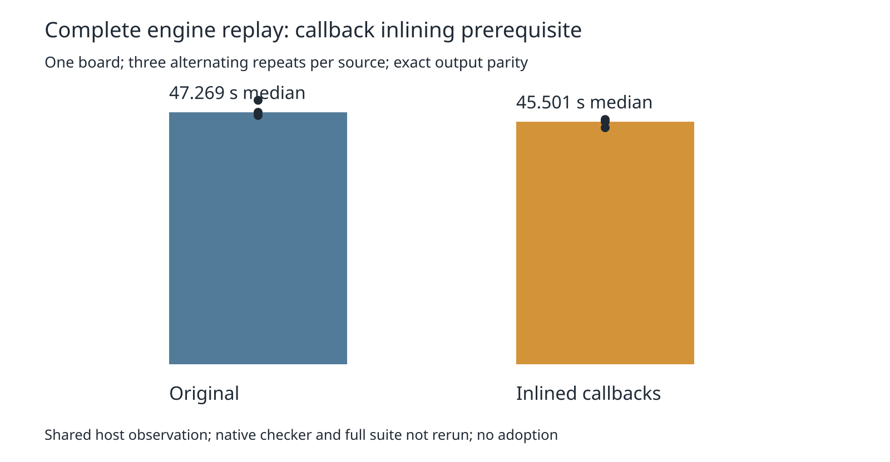

# Complete-workload callback inlining prerequisite

The previous lattice census found 42.7 million queries on this complete exported board. This isolated experiment removes the per-query `test` and `push` callbacks from `collect`, duplicating their unchanged bodies in the bucket and oversize-shelf loops. This tests a specific overhead hypothesis; the census did not establish callback allocation or JIT cost. Query order, live slot/generation reads, filter call order, fresh returned references, overlap comparisons and deterministic sorting stay unchanged. Only `src/lattice/grid.ts` differs among 1,536 tracked source/spec/test modules. The full candidate file and both source hashes are retained.

Three complete paired replays alternate source order on the same host, cores 12–19, nice 10, 240-second per-replay timeout. No other heavy job from this agent overlaps. All six emitted sessions match the independent archived native-workload control byte-for-byte; effective settings, input hash, final statistics and full reports excluding elapsed time agree. Recovery decisions, work and outcomes also match after removing only nested `seconds`. Five deliberate corruptions must fail verification. Raw outputs and logs are preserved, with no attempt discarded or rerun.

The median is 47.269180 → 45.500846 seconds (3.74% lower) and the maximum 49.518475 → 45.921416 seconds. This shared-host, single-board result warrants a fresh full native comparison; it establishes neither full-suite speed nor causality. Three samples do not support a useful tail estimate, so maximum is reported rather than a p95 claim. The production engine, default and consumer pin remain unchanged. No fresh native check, full 26×3, dense, ladder or slow acceptance gate is claimed here. Historical native 15 opens and six thermal errors on this board remain unresolved; the engine still reports eight residuals and zero exact violations. Diagnostic history rows deliberately leave native score fields empty.



Exact reproduction from the repository root, with an unused work directory:

```sh
asset=docs/pr-assets/agent-fab-router-perf-local-rescue/lattice-inline
work=/tmp/lattice-inline-reproduction
python3 "$asset/prepare.py" "$work"
python3 "$asset/run.py" "$work"
PYTHONDONTWRITEBYTECODE=1 python3 "$asset/package.py" "$work" /tmp/lattice-inline-package
# Independently verify the committed measurement, including corruption controls:
PYTHONDONTWRITEBYTECODE=1 python3 "$asset/verify.py" /tmp/lattice-inline-summary.json
python3 "$asset/report.py" "$asset"
rsvg-convert -w 1600 "$asset/timing.svg" -o /tmp/lattice-inline-timing.png
# Candidate and production checks, sequentially:
(cd "$work/candidate" && taskset -c 12-19 nice -n 10 timeout 1800 bash -c 'bun run typecheck && bun run check:layers && bun run test')
taskset -c 12-19 nice -n 10 timeout 1800 bash -c 'bun run typecheck && bun run check:layers && bun run test'
```

Input licensing, native source metadata, reference DSN/session and result are retained in `../native-profile/`; the driver is `../point-components/profile.ts`. Preparation pins source revision `66d50ed`, independent of later evidence commits. `run.py` retains every completed record and aborts on a failed supervisor. The initial chart script required an unavailable plotting package; it was replaced with dependency-free SVG generation, without rerunning measurements or installing packages.

Next gate: fresh paired full 26×3 native timing/quality, dense6 and ladder L2/L3, enabled slow acceptance, before adopting the candidate. Existing native thermal findings remain owned by the independent correctness work.

Final required checks: candidate and unchanged production both PASS typecheck and layer checks (71 files, zero violations), 912 tests, zero failures, 399,733 assertions. Candidate suite 330.81 seconds; production 339.69 seconds. Both supervisors exit zero. Three source corruption controls also reject altered baseline hashes, extra changed modules and altered candidate bytes. Preparation replay matches the audit and candidate gzip byte-for-byte.
