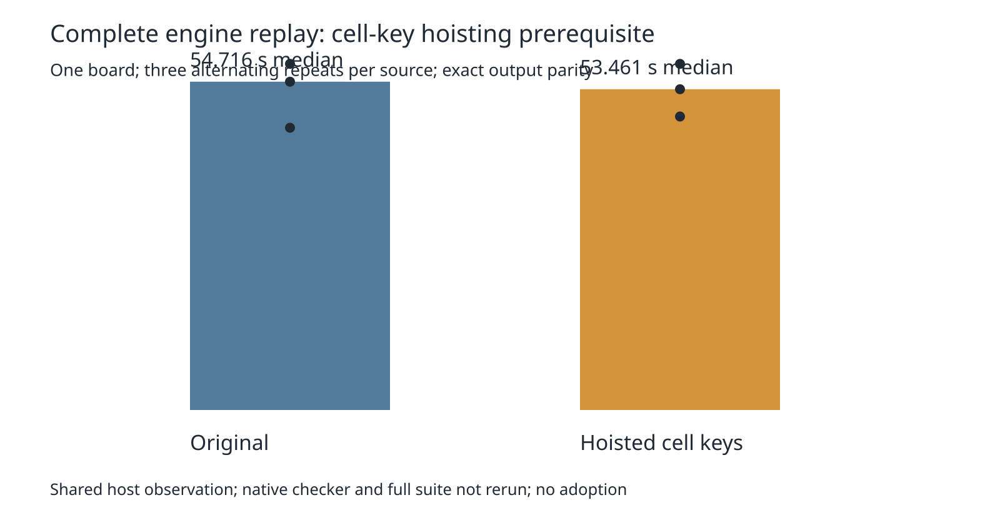

# Cell-key arithmetic: complete-workload prerequisite

The complete-board lattice census measured 85,374,181 cell lookups. This distinct experiment hoists `(cx + KEY_OFFSET) * KEY_STRIDE` outside the inner `cy` loop in `collect`. The addition retains exactly the original arithmetic grouping. Bucket order, overlap comparisons, stamps, live state, filters, fresh references and sorting remain unchanged. This tests redundant arithmetic at the lookup site; the census does not prove interpreter or JIT cost. Preparation pins revision `5c187d3`, and only `src/lattice/grid.ts` differs among 1,536 tracked source/spec/test files. The full candidate and hash audit are archived.

Three paired complete engine replays alternate order on the same host, cores 12–19, nice 10, 240-second per-replay timeout, with no overlapping own heavy work. All six sessions match the independent native-workload session byte for byte. Input, settings, final statistics and full reports except elapsed time match; recovery decisions and work match after removing only nested seconds. Five record corruptions and three source corruptions are rejected. Independent preparation reproduces the source audit and candidate gzip exactly.

Original times: 47.040331, 54.716398, 57.693749 seconds. Candidate: 48.914453, 53.461092, 57.686467 seconds. Median 54.716398 → 53.461092 seconds; maximum 57.693749 → 57.686467 seconds. Timing varies substantially on this shared host. This is one board, not evidence of a full-suite speed gain or useful tail estimate. No attempts were discarded or rerun. Both sources pass typecheck, layer checks (71 files, zero violations), and all 912 tests / 399,733 assertions. Check supervisors exit zero.



The fresh full native follow-up is in [../key-native/README.md](../key-native/README.md). Production source, default and consumer pin remain unchanged. This prerequisite did not run a native checker; historical native errors are not fixed by engine-session parity. Diagnostic history rows leave native score fields blank.

Exact reproduction from the repository root with an unused output directory:

```sh
asset=docs/pr-assets/agent-fab-router-perf-local-rescue/lattice-key
work=/tmp/lattice-key-reproduction
python3 "$asset/prepare.py" "$work"
python3 "$asset/run.py" "$work"
python3 "$asset/checks.py" "$work"
PYTHONDONTWRITEBYTECODE=1 python3 "$asset/package.py" "$work" /tmp/lattice-key-package
PYTHONDONTWRITEBYTECODE=1 python3 "$asset/source-controls.py" "$work"
PYTHONDONTWRITEBYTECODE=1 python3 "$asset/verify.py" /tmp/lattice-key-summary.json
python3 "$asset/report.py" "$asset"
rsvg-convert -w 1600 "$asset/timing.svg" -o /tmp/lattice-key-timing.png
```

The complete exported input, captured license and independent control are in `../native-profile/`. The production replay driver is `../point-components/profile.ts`. Maximum is reported instead of claiming p95 from three replays.
