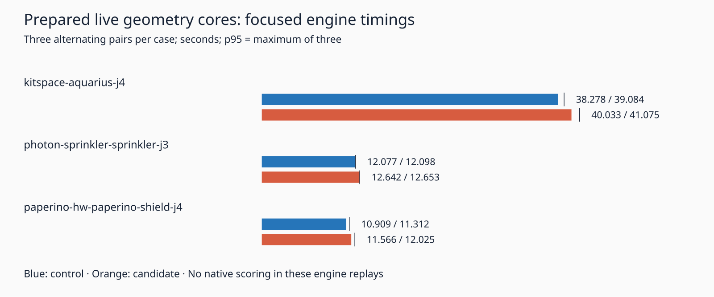

# Rejected prepared live-core experiment

This evidence package tests a distinct follow-up to the lattice provenance diagnostic. The isolated candidate prepares private convex-core wrappers when the lattice lazily generates copper shapes. Only the exact clearance comparator borrows those wrappers. Existing `coreOf` remains unchanged and returns fresh wrappers. No candidate engine change is adopted.

Prepared disk and capsule wrappers reread point references and radii at every comparison; capsule point-array length follows current endpoint equality. Hull and rounded wrappers reread their point arrays, and rounded wrappers reread radius. Boxes compare all four original coordinates with `Object.is` and rebuild the core on change. Thus reuse does not rely on the preceding diagnostic's lack of observed mutations. The borrowed wrapper never leaves the new module: its exported comparison returns a boolean. Records use weak keys. Shapes retained after lattice removal remain geometrically live; reinsertion produces freshly prepared shapes. Unregistered shapes use the original core conversion. This does not make changing indexed geometry without reinsertion valid for spatial bounds: the original lattice contract still applies.

Same machine, cores 12–19, nice 10, three sequential alternating pairs per case, 180-second attempt limits with five-second kill grace. Same seed-1 inputs/settings, normal recovery disabled. p95 is nearest rank, the maximum of only three observations. Shared host load is uncontrolled. Timings cover direct engine replay and exclude conversion and native checking.

| Case | Control median / p95 seconds | Candidate median / p95 seconds | Median change |
|---|---:|---:|---:|
| kitspace-aquarius-j4 | 38.278069 / 39.084099 | 40.033055 / 41.075209 | +4.58% |
| photon-sprinkler-sprinkler-j3 | 12.076539 / 12.098110 | 12.641577 / 12.653346 | +4.68% |
| paperino-hw-paperino-shield-j4 | 10.908613 / 11.311773 | 11.565793 / 12.025417 | +6.02% |

Sum of nine durations: 184.459685 → 192.599605 seconds (+4.41%). Every median and p95 regresses. The measurements do not isolate weak lookup, field updates, allocation or garbage collection as the cause. No speed improvement is shipped.

All 18 sessions match independent retained controls byte for byte. Complete settings/results/reports match after removing only `result.report.wallClockMs`. Engine residuals remain 8/2/6 for Aquarius/sprinkler/shield; represented additions remain zero. These are not native scores. No full native 26×3, dense6, ladder or whole slow-acceptance rerun follows this focused rejection. Existing native thermal errors remain unresolved; recovery remains default off. Production source, rules, defaults, checker, tests and consumer pin are unchanged.

The bounded differential probe passes 218,272 checks: comparisons for all five convex shape types, live coordinates/radii and replaced arrays/endpoints, point/segment/box degeneration, same-identity operands, mixed prepared/unprepared operands, independent mutable public wrappers, recursive pieces registration, and actual lattice cache/rebuild/removal/reinsertion. It is synthetic finite-coordinate coverage, not a universal proof. All 1,488 tracked root source/spec files match the measured control. Independent reconstruction checks every source/spec hash for both variants (1,489 candidate files). The verifier checks all retained sessions, complete reports, timings, schedule and summary, and rejects four semantic corruptions after manifest rehashing.

Candidate typecheck and the unchanged lattice, route-core and perf-invariance files pass: 26 tests, zero failures, 39,827 assertions, 7.96 seconds. Full candidate tests were not run after timing rejection. Initial candidate typecheck failed because a record property combined an optional declaration with explicit undefined; this was corrected before any routing. An initial root-audit helper mishandled quoted non-ASCII filenames; the final audit uses null-delimited tracked paths. Neither issue stopped or omitted a routing attempt. All 18 planned attempts completed without repeats.

Reproduce from the repository root with Bun, Python and rsvg-convert already installed:

```bash
python3 docs/pr-assets/agent-fab-router-perf-local-rescue/live-core/reproduce.py /tmp/live-core-replay
python3 docs/pr-assets/agent-fab-router-perf-local-rescue/live-core/verify.py
python3 docs/pr-assets/agent-fab-router-perf-local-rescue/live-core/test_verify.py
bash docs/pr-assets/agent-fab-router-perf-local-rescue/live-core/final-checks.sh
```

`--prepare-only` reconstructs both variants and runs the probe without routing. To typecheck and run existing targeted tests against that reconstruction, use installed root dependencies:

```bash
bash docs/pr-assets/agent-fab-router-perf-local-rescue/live-core/check-candidate.sh /tmp/live-core-replay
```

`prepare.py` plus `prepared-core.ts` define the exact candidate transformation; `source-audit.json` records the complete source hashes. The adjacent `default-slow-profile` contains the original source archive, unchanged input/settings, independent reference sessions, and source/input licenses. `attempts.tar.xz` retains every measured output and process log. `chart.svg` and `chart.png` show median bars and p95 ticks.



Final unchanged-root checks: typecheck PASS; layer checks PASS (71 files, zero violations); 914 tests, zero failures, 649,747 assertions, 308.53 seconds.
