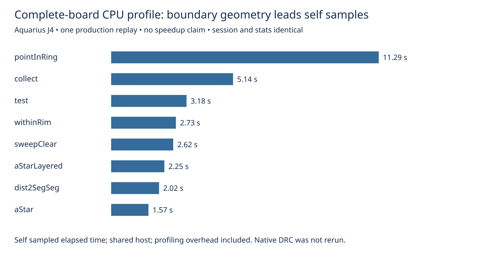

# Complete-board boundary-geometry profile

This diagnostic profiles the slowest individual attempt in the cycle55 existing-recovery native run: Aquarius J4, seed 1, 54.225221 route seconds. It is a complete production `routeDsn` replay, not the isolated saved-session recovery coordinator used in earlier experiments. No engine source, rules, consumer pin, or recovery default changes here.

One profiled replay on the same host, cores 12–19, nice 10, with no overlapping heavy jobs of this agent. Elapsed replay time is 47.988686 seconds including profiling overhead. Different shared-host loads and instrumentation prevent a speed comparison with the archived native timing. Native checking was not repeated, so there is no new router benchmark score or history row.

The exported input, effective settings, complete session bytes, all final engine statistics, and complete report excluding `wallClockMs` match the independently saved native-run control. Engine residuals remain eight and engine exact violations remain zero. The native control still has 15 opens and six new thermal errors; engine exact checks do not establish native safety.

| Self-sampled function | Sampled seconds |
|---|---:|
| pointInRing | 11.291 |
| lattice collect | 5.144 |
| lattice test | 3.181 |
| withinRim | 2.732 |
| sweepClear | 2.619 |

`withinRim` inclusive sampled time is 14.979 seconds; `recoverRemaining` is 4.777 seconds. Inclusive stacks overlap and must not be summed. These observations prioritize boundary containment over another speculative failed-edge cache. `pointInRing` currently checks every edge for every probe, and `withinRim` filters cutouts and constructs core probes each call. Any prepared-ring or boundary-query optimization must preserve exact boundary classification, mutable-rim behavior, cutouts, and deterministic sessions; this profile does not prove any proposed optimization is safe or faster.

All `pointInRing` self samples have `withinRim` as their immediate sampled caller. Of its 11.291 sampled seconds, 10.852 are outside the `recoverRemaining` stack and 0.439 are inside it. Thus this hotspot is predominantly in normal routing on this input, rather than the optional recovery graph. The verifier independently reconstructs these partitions from parent links.

The imported board boundary has 92 outline vertices and no cutouts. A boundary acceleration experiment should therefore exercise a many-edge outline, including exact boundary probes; a rectangular synthetic fixture alone would not represent this workload.



Verify archived parity, corruption controls, and chart:

```sh
asset=docs/pr-assets/agent-fab-router-perf-local-rescue/native-profile
python3 "$asset/verify.py" /tmp/native-profile-verified.json
PYTHONDONTWRITEBYTECODE=1 python3 "$asset/controls.py"
python3 "$asset/plot.py" /tmp/native-profile-verified.json /tmp/native-profile.svg
rsvg-convert -w 1600 /tmp/native-profile.svg -o /tmp/native-profile.png
```

Recreate the profiled engine run from the current branch (source hashes recorded in `source-hashes.json`; all production sources unchanged from cycle55):

```sh
asset=docs/pr-assets/agent-fab-router-perf-local-rescue/native-profile
mkdir -p /tmp/native-profile-work /tmp/native-profile-cpu
gzip -dc "$asset/board.dsn.gz" > /tmp/native-profile-work/board.dsn
gzip -dc "$asset/reference.json.gz" > /tmp/native-profile-work/router-summary.json
taskset -c 12-19 nice -n 10 timeout 240 bun --cpu-prof \
  --cpu-prof-dir /tmp/native-profile-cpu \
  docs/pr-assets/agent-fab-router-perf-local-rescue/point-components/profile.ts \
  "$PWD" /tmp/native-profile-work /tmp/native-profile-replay
bun run typecheck && bun run check:layers && bun run test
```

Replay output must be unused. `input-LICENSE` and `input-job.json` retain input attribution; original board and provenance are also archived in the sibling `native-spacing-rejection/native-evidence.tar.gz`. Raw CPU samples, replay, control, session and selected historical native record are compressed losslessly here. `summary.json` retains both self and inclusive observations. Five corruption controls test input/session hashes, settings, statistics and report gates.
