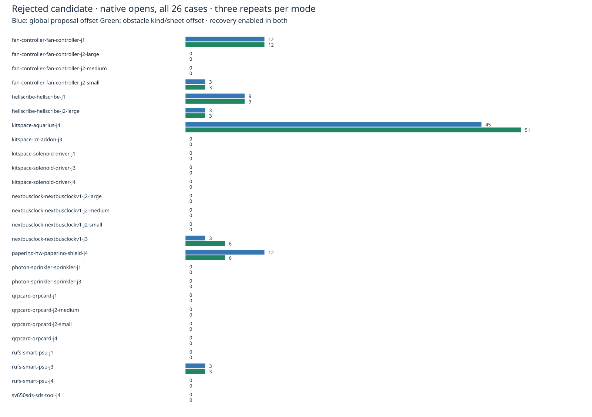
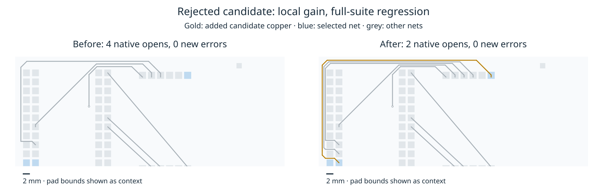

# Rejected obstacle-specific proposal offsets

**Do not adopt this revision.** A fresh complete native comparison rejects the four-replacement candidate tested in the prior saved-board and compact-spacing diagnostics. Production sources remain unchanged, recovery stays default off, and the consumer pin is unchanged. No engine improvement or speedup is claimed.

The candidate replaces global maximum spacing in visibility corner generation with the actual track/obstacle-kind spacing on the current sheet. Real clearance checks, widths, original-terminal acceptance, transaction rollback, region schedule, node cap, and shared work/deadline ledger are unchanged. Both native modes explicitly enable recovery through the same API shim.

Same host, cores 12–19, same frozen 26 cases, three repeats per case and mode. Sweeps run sequentially, without overlapping our own heavy jobs. Shared-host timing remains observational; failed attempts are included. p95 uses nearest-rank observation 75 of 78; per-case three-observation p95 is the maximum.

| Measure | Global proposal offset | Obstacle kind/sheet offset |
|---|---:|---:|
| Passed attempts /78 | 48 | 48 |
| Valid cases /26, three of three | 16 | 16 |
| Native opens | 90 | 93 |
| New native errors | 27 | 33 |
| Median / p95 route seconds | 1.121267 / 16.712702 | 1.137373 / 18.204223 |
| Total route seconds | 410.624294 | 411.166979 |
| Via count sum | 2826 | 2826 |
| Track length sum mm | 60450.378202 | 60736.359758 |

Six regressing attempts, two cases, all three seeds. No passed attempt becomes failed, no fidelity check regresses, and no warning geometry is added. Those facts do not excuse the additional opens/errors. 57/78 sessions are unchanged. See [all-case results](native-tables.md) and [raw paired comparison](native-comparison.json).

| Case | Engine residuals per repeat, before→after | Native opens per repeat | New native errors per repeat |
|---|---:|---:|---:|
| paperino-hw-paperino-shield-j4 | 4→2 | 4→2 | 0→0 |
| kitspace-aquarius-j4 | 8→7 | 15→17 | 6→8 |
| nextbusclock-nextbusclockv1-j3 | 1→2 | 1→2 | 0→0 |

Every listed engine result has zero exact violations and zero added violations. The additional native errors are `starved_thermal` at pads 19 and 22 of U1, ground zone on B.Cu. This is a concrete counterexample to using engine completion/exact geometry alone as a native safety gate. Separately, replacing candidate corners can lose a previously found route. This experiment does not establish the root cause of either geometric interaction; no case-specific exclusions or rule changes are proposed.





The second view uses native-refilled boards whose hashes match the checker. It shows the net/layer with the longest newly added centerline; pad rectangles are context. Other route segments also change between modes. It is not a claim that every prior optional route is retained, or that the whole suite improves. Gold is new candidate copper; all selected width values are 0.25 mm. The selected layer is B.Cu.

The initial isolated full test run had 902 passes and 10 assertion failures: the old exact completion count and exact work counts, including duplicated archived controls. Candidate-only assertion updates retain strict equality and move the work-exhaustion boundary from 18890 to 17031 (original search 14509→12990; alternate 4257→3917; enumeration 124 unchanged). The public stall assertion becomes exactly 2 residuals and 4 additional tracks, with zero violations. All 24 targeted tests then pass. Complete candidate and unchanged-production checks are recorded separately in `checks.json` and compressed logs; no production test is changed. The standalone compact regression is historical, not rerun here.

No dense/ladder/slow runs are spent on this natively rejected revision. Larger validation remains required for any distinct future candidate. Preserve original graph coverage, one target ledger/deadline and native safety; do not simply adopt the four replacements because the small fixtures improve. Do not repeat this unchanged full suite.

## Reproduce from the engine worktree

```bash
ENGINE=/home/hyper/bench/wt/fr-perf
BENCH=/home/hyper/bench/wt/fp-perf
ASSET="$ENGINE/docs/pr-assets/agent-fab-router-perf-local-rescue/native-spacing-rejection"
OUT=/home/hyper/bench/agents/codex-fabpcb-perf/scratch/repro51
mkdir -p "$OUT"
python3 "$ASSET/prepare.py" "$ENGINE" "$OUT/source"
# The candidate keeps exact assertions but changes their expected graph/work counts.
cd "$OUT/source/after"
taskset -c 12-19 nice -n 10 timeout 1800 bash -c 'bun run typecheck && bun run check:layers && bun run test'
cd "$ENGINE"
python3 "$ASSET/native.py" "$OUT" "$BENCH"
python3 "$ASSET/compare-native.py" "$OUT/native-before" "$OUT/native-after" "$OUT/comparison.json"
python3 "$ASSET/report.py" "$OUT/comparison.json" "$OUT/table.md"
python3 "$ASSET/plot.py" "$OUT/comparison.json" "$OUT/opens.svg"
rsvg-convert -w 1600 "$OUT/opens.svg" -o "$OUT/opens.png"
/usr/bin/python3 "$ASSET/extract-native.py" "$OUT/native-before" "$OUT/native-after" "$OUT/connection.json"
python3 "$ASSET/plot-native.py" "$OUT/connection.json" "$OUT/connection.png"
taskset -c 12-19 nice -n 10 timeout 1800 bash -c 'bun run typecheck && bun run check:layers && bun run test'
```

Preparation requires the measured base production/test content (source hashes in `source-audit.json.gz`) and fails if its four source replacements or public completion assertion drift. The recorded run initially copied only source/spec/tests/tools and missed two archived test dependencies; that first typecheck stopped. Adding the tracked docs dependencies fixed snapshot construction before the reported full run. Replay of the preparation script matches all 1488 source/spec files and four assertion files per mode byte-for-byte. Synthetic snapshot git identities are local metadata; source hashes bind the experiment.

`native-before/after-{results,controls,summary}.json.gz` contain complete raw metadata. `native-evidence.tar.gz` is a partial native archive: all three repeat records/checks/sessions/engine reports for the three cases above; seed 1 raw/refilled boards, native rules/DRC/exported input; original input/job/baseline/license provenance. Refills are absent for the non-zone case. This archive reproduces the measured connection image and exposes both regressions, but is not a full benchmark output tree and cannot satisfy the complete-run comparator's 78 per-attempt input checks. The original complete output trees remain in cycle 51 scratch.

To replay the archived image without routing:

```bash
mkdir -p "$OUT/archived"
tar -xzf "$ASSET/native-evidence.tar.gz" -C "$OUT/archived"
/usr/bin/python3 "$ASSET/extract-native.py" "$OUT/archived/before" "$OUT/archived/after" "$OUT/archived-connection.json"
python3 "$ASSET/plot-native.py" "$OUT/archived-connection.json" "$OUT/archived-connection.png"
cmp "$ASSET/connection.png" "$OUT/archived-connection.png"
```
