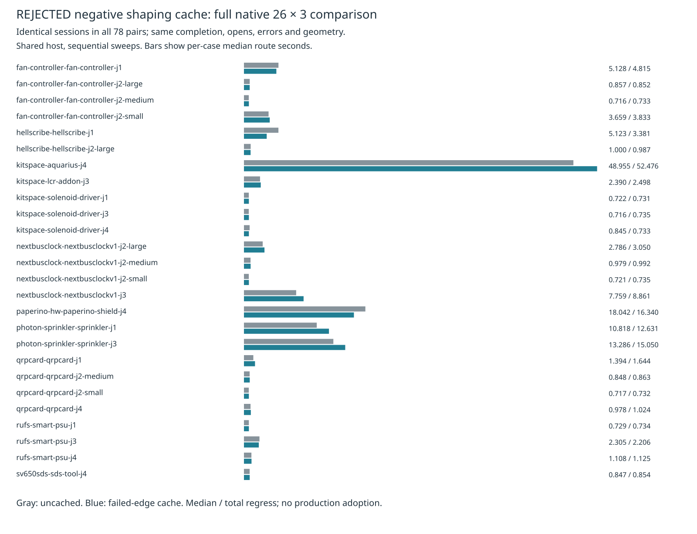

# Rejected target-wide failed-shaping cache

**Not adopted.** The complete 26 × 3 comparison preserves all session bytes and quality, but aggregate route median rises 5.5% and total route time rises 1.9%. The p95 and saved-stall gains are insufficient to establish a suite-wide speed improvement. Production source and the consumer pin remain unchanged. The candidate and its two regression tests exist only in the reproducible isolated patch.

The opt-in residual coordinator repeatedly checks the same directed edges while growing local regions and trying alternate anchors. A target-scoped negative cache skips only previously failed exact shaping checks. It retains the original edge charging, settled-node order, current-region containment checks, shared budget/deadline and original-terminal transaction gates. Successful paths are freshly checked and never cached. Keys include sheet and directed integer endpoints; layout, net and profile are fixed by the owning synchronous coordinator.

The cache is cleared **before** every proposal insertion, including insertions later rejected or rolled back. A target gets a new cache; entries never survive across targets, profiles or layouts. Failed proposals do not mutate copper. A hard 100000-entry cap bounds memory without changing search budgets. Recovery remains default off, and no rule or width is relaxed. This optimization does not resolve existing native thermal findings or improve closure by itself.

Two candidate-only regression tests compare cached/uncached region growth, exact budget boundaries, graph misses, successful copper, exact violations and full journal rewind, and check explicit invalidation after copper removal and absence of retained successful paths. Existing coordinator cancellation, original-terminal and strict shared-budget tests remain unchanged.

`source-audit.json.gz` binds every source/spec/test file in two immutable checked snapshots. `candidate.patch` is their entire source/test difference. Three paired saved-session runs agree with independently archived original controls after dropping elapsed seconds: four residuals remain four, charged work stays 279946, no copper is added, exact violations stay zero, and journal rewind restores the initial session. Raw CPU profiles are a separate one-run diagnostic per mode, not benchmark timing; `profile.py` replays self-sample summaries.

See `summary.json` and `table.md` for the fresh paired full native 26 × 3 results and per-case median/p95 times. Native timings include the required export/route/import pipeline. Recorded run wall seconds use the controls UTC start/end and exclude final report rendering. The machine is shared: sequential before/after sweeps avoid overlapping our own heavy jobs but do not isolate unrelated host load. With three observations per case, p95 uses nearest rank (the maximum); across all 78 observations it uses rank 75. Complete raw native metadata and all 78 paired raw session outputs are archived; complete run directories remain in the cycle scratch directory. Known native errors remain explicit in all tables.


| Same host/cores 12–19, three repeats | Uncached | Rejected cache |
|---|---:|---:|
| Native passed / 78; valid cases / 26 | 48; 16 | 48; 16 |
| Native opens / known new errors | 90 / 27 | 90 / 27 |
| Route median / p95 s, all 78 attempts | 1.107403 / 24.721967 | 1.168797 / 21.246549 |
| Sum of per-case median / p95 s | 133.429245 / 157.250784 | 138.616572 / 152.180094 |
| Total route s / recorded run wall s | 415.768547 / 528.369834 | 423.702619 / 537.041812 |
| Via sum / length sum mm | 2826 / 60450.378202 | 2826 / 60450.378202 |
| Saved four-target coordinator median / p95 s | 0.996505 / 1.052128 | 0.363419 / 0.456847 |

Candidate checks pass: typecheck, layers 71/zero, 914 tests/zero failures/399756 assertions (353.82 s). Initial candidate-test setup errors were corrected before this retained check. Restored production checks also pass: typecheck, layers 71/zero, 912 tests/zero failures/399733 assertions (342.31 s). Shared-host timing is observational; no causal speed gain is claimed.



## Exact reproduction

From the engine worktree on the benchmark host:

```bash
ASSET=docs/pr-assets/agent-fab-router-perf-local-rescue/negative-cache
OUT=/home/hyper/bench/agents/codex-fabpcb-perf/scratch/repro55
BENCH=/home/hyper/bench/wt/fp-perf
NATIVE=/home/hyper/bench/agents/codex-fabpcb-perf/scratch/cycle42/native-after-run
mkdir -p "$OUT"
python3 "$ASSET/prepare.py" "$PWD" "$OUT/source"
for repeat in 1 2 3; do
  for mode in before after; do
    taskset -c 12-19 nice -n 10 timeout 1200 bun "$ASSET/run-saved.ts" "$OUT/source/$mode" "$NATIVE" "$OUT/saved-$mode-$repeat.json"
  done
done
for mode in before after; do
  taskset -c 12-19 nice -n 10 timeout 3000 python3 "$BENCH/benchmarks/autorouter/benchmark.py" --router fab-router --fab-router-source "$OUT/source/$mode/entry" --out "$OUT/native-$mode"
done
python3 "$ASSET/compare-native.py" "$OUT/native-before" "$OUT/native-after" "$OUT/native-comparison.json"
python3 - "$OUT" <<'PY'
import gzip,json,sys
from pathlib import Path
p=Path(sys.argv[1]);d={m:[json.loads((p/f'saved-{m}-{i}.json').read_text())for i in [1,2,3]]for m in ['before','after']}
(p/'saved-results.json.gz').write_bytes(gzip.compress(json.dumps(d,separators=(',',':')).encode(),mtime=0))
PY
python3 "$ASSET/report.py" "$OUT/native-comparison.json" "$OUT/saved-results.json.gz" "$OUT/report"
rsvg-convert -w 1600 "$OUT/report/timings.svg" -o "$OUT/report/timings.png"
python3 "$ASSET/verify.py"
python3 "$ASSET/sessions.py"
python3 "$ASSET/profile.py" "$OUT/profile-summary.json"
taskset -c 12-19 nice -n 10 timeout 1800 bash -c 'bun run typecheck && bun run check:layers && bun run test'
```

CPU-profile replay generation (separate from the timed runs):

```bash
for mode in before after; do
  mkdir -p "$OUT/profile-$mode"
  taskset -c 12-19 nice -n 10 timeout 1200 bun --cpu-prof --cpu-prof-name=recovery.cpuprofile --cpu-prof-dir="$OUT/profile-$mode" "$ASSET/run-saved.ts" "$OUT/source/$mode" "$NATIVE" "$OUT/profile-$mode.json"
done
```

Larger validation was deliberately stopped after the aggregate native speed rejection. The reused larger-board driver wrote only one baseline L2 record before its own process group was terminated. `large-partial.json.gz`, `controlled-stop.json` and `validation-exits.json` preserve that partial execution; it has no paired result or 3/3 score. Dense native, L3 and slow acceptance were not run. No historical larger/acceptance result is presented as a new result for this revision. All those gates remain required for any distinct future candidate.

`verify.py` rejects corruption replicated across all six saved-session runs; it checks independently archived original controls as well as repeat parity. Native comparator checks all 78 input/settings identities, successful step exits, complete/preserved controls, native findings and warning geometry. `report.py` additionally requires all 78 sessions and quality/geometry aggregates to match.
