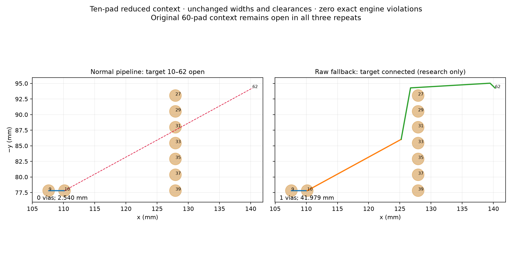

# Normal-pipeline raw-path experiment, cycle 24

The normal router can legally close the ten-pad endpoint fixture when it retries
its original raw trail after pulled-trail legalisation fails. The original
60-pad context still leaves the same target connection open. This is a research
patch generated into a disposable checkout, not an adopted production repair.
Public production and settings remain unchanged. No native safety or general
speed improvement is claimed.

Unlike the preceding uniform-cost finer-search witness, this experiment uses
the actual normal pipeline, costs, lattice, budgets, via stages and scheduling.
The observer logs rejected pulled trails, then checks the original raw trail
and independently shaped pulled legs against the same live layout. These
queries do not insert geometry or change the original insertion decision.
Control and observer final sessions match byte-for-byte in both contexts.
Each reduced run has 67 rejected pulled trails, of which three have a legal raw
counterpart and legal independently shaped legs. Each original-context run has
60 rejections and no legal raw or independently shaped counterpart. Repeated
trials are not independent connections or retained routes.

The disposable fallback changes one decision: after pulled legalisation fails,
try `legaliseTrail` on the original centreline, with the same profile, ignored
items, and neck policy. The existing insertion and enclosing rollback code
remain in effect. This is not a post-pass local recovery setting. It does not
relax any clearance, width, via size or angle rule. All three final reduced
runs join the target terminals, preserve the existing short branch and retained
copper, and have zero exact engine violations. The original context has exactly
the same final session as control in all repeats. Therefore this patch is not
promoted as a general stall recovery.

[Full measured table](normal-shaping/table.md), [per-attempt results and geometry](normal-shaping/results.json).
All rows use the same input, settings, seed 1, machine, cores 12–19 and three
repeats. Target opens exclude ignored nets; global stats retain ignored-net
incompletes and must not be treated as target counts. Reduced total track length
changes from 2.540000 to 41.979067 mm, vias from zero to one. Original total
length/vias remain 2.540000 mm/zero. Sessions and geometry are deterministic
within every row. Times include observer work and shared-host interference;
full tests overlapped some diagnostic measurements. They are descriptive, not
an isolated speed comparison. p95 is the maximum of three.

Initial exploratory 18 runs are retained separately in
`normal-shaping/exploratory-results.json`; final 18 runs add full geometry and
stats. No routing attempts were discarded. Raw-patch rejection logs occur only
after both legalisation choices fail, so their smaller counts are not an
isolated census of the original pulled-path decisions.



The figure uses actual pad disks and final track centrelines from the measured
first repeat, not a copper-width rendering. Different line colors identify
tracks; a via connects the two longer legs. There is no native DRC check of
these altered diagnostic contexts. The existing native thermal failures remain
unfixed. Full unchanged-production native verification is separate.

Reproduce from the repository root with unused destination paths:

```sh
assets=docs/pr-assets/agent-fab-router-perf-local-rescue
python3 "$assets/observe-normal-shaping.py" "$PWD" /tmp/normal-observer-new
python3 "$assets/try-normal-raw.py" "$PWD" /tmp/normal-raw-new
mkdir /tmp/normal-results-new
for context in reduced original; do
  for mode in control observed raw; do
    source="$PWD"
    if [ "$mode" = observed ]; then source=/tmp/normal-observer-new; fi
    if [ "$mode" = raw ]; then source=/tmp/normal-raw-new; fi
    taskset -c 12-19 nice -n 10 timeout 180 bun "$assets/run-normal-shaping.ts" \
      "$source" "/tmp/normal-results-new/$context-$mode.json" "$context" \
      > "/tmp/normal-results-new/$context-$mode.txt" 2>&1
  done
done
python3 "$assets/summarise-normal-shaping.py" /tmp/normal-results-new /tmp/normal-summary-new.json
taskset -c 12-19 nice -n 10 timeout 900 bash -c \
  'bun run typecheck && bun run check:layers && bun run test'
(cd /tmp/normal-raw-new && taskset -c 12-19 nice -n 10 timeout 900 bash -c \
  'bun run typecheck && bun run check:layers && bun run test')
```

Generators refuse existing destinations and unexpected production source.
The observer generator validates the baseline insertion file before writing.
The output runner refuses existing result files and verifies the fixture hash,
zero exact DRC, intact retained geometry, no abort/timeout, and preservation of
the short branch. Existing fixture regression still permits future legal normal
closure. No production regression expectation is weakened.

Before promoting any general recovery, add default-off integration with local
regions and per-connection rollback/terminal guards; measure full 26×3, dense6,
ladder L2/L3 and slow acceptance with native rule minima. The current original-
context negative result does not justify promotion or a downstream pin bump.

Validation: unchanged production passes typecheck, layer checks (65 files,
zero violations), and 860 tests / 398486 assertions. The disposable fallback
passes typecheck and layer checks but has **859 passing tests and one failed
fingerprint test** (`issue026-j2`); no expectation was updated. Three fresh
runs per version reproduce the recorded old hash and the new deterministic
hash. Both have two incomplete connections and zero added exact engine
violations. Vias change 34→33; total track length 478.867030→460.773639 mm.
This is a deliberate geometry change that fails the existing invariance gate,
not a fully passing candidate. No native DRC check was performed for that input.
The failing full-suite output is retained in `normal-shaping/raw-checks.txt`
(observer chatter omitted with its full raw-log hash recorded). Fingerprint
reports are retained as `fingerprint-control.json` and `fingerprint-raw.json`.

Reproduce the additional three-repeat fingerprint diagnosis:

```sh
for mode in control raw; do
  source="$PWD"
  if [ "$mode" = raw ]; then source=/tmp/normal-raw-new; fi
  taskset -c 12-19 nice -n 10 timeout 180 bun \
    docs/pr-assets/agent-fab-router-perf-local-rescue/check-raw-fingerprint.ts \
    "$source" "/tmp/normal-results-new/fingerprint-$mode.json"
done
```

Full **unchanged-production** native verification, same 26 cases × 3 repeats and machine/cores, against the prior cycle control. All 78 sessions, quality outcomes, via counts and lengths match exactly. Production source hashes, inputs, settings, runtime, checker and order match.

| Native metric | Prior control | Current unchanged production |
| --- | ---: | ---: |
| Passed / valid 3-of-3 cases | 39/78 / 13/26 | 39/78 / 13/26 |
| Opens | 120 | 120 |
| New native errors | 27 | 27 |
| Attempt median / p95 seconds | 1.118 / 20.078 | 1.106 / 16.966 |
| Total route seconds | 372.761 | 382.816 |

Existing thermal errors remain unresolved: **not native DRC clean**. No speed gain is claimed. [All per-case median/p95, quality, via and length results](https://github.com/fabPlane/fab_router/blob/agent/fab-router-perf-local-rescue/docs/pr-assets/agent-fab-router-perf-local-rescue/normal-shaping/native-tables.md).

Native reproduction is the unchanged-production command in the PR body; comparison helper: `python3 docs/pr-assets/agent-fab-router-perf-local-rescue/compare-normal-native.py BEFORE AFTER SOURCE UNUSED_OUTPUT`.
