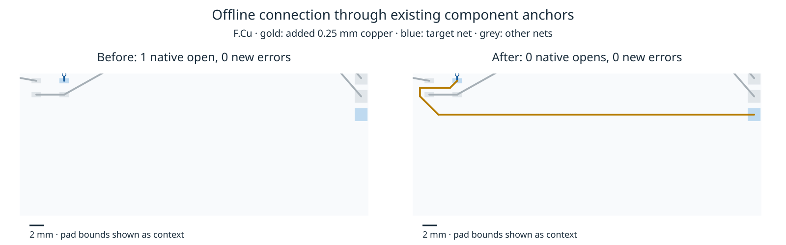

# Offline alternate point anchors close a real native residual

The supplied power-width board's remaining original connection is pad 29 → pad 46. Its two live copper components contain 4 and 11 point anchors respectively. Sorting compatible pad/barrel pairs by distance then ids tries the original pair first; its four region attempts remain open. The next pair, pads 8 → 19, closes the **original** target with the existing visibility proposal and transaction. It succeeds at the 8-pitch margin after 0/4-pitch failures. No spacing, width, via, lattice, rip-up or normal routing change is involved.

This is an **offline diagnostic**, not an adopted engine feature or a full routing benchmark. Production runtime/settings remain byte-identical to `c9f946d`; existing public recovery remains default off and does not enumerate these pairs. Each offline pair currently gets its own 100000-work/15-second budget. Integrating that policy would multiply the production per-target budget, so the probe is deliberately not imported by production. A future implementation needs charged/cancellable enumeration, one shared per-target budget across all candidates and regions, item limits, existing route deadline/cancellation, original-target acceptance and every rollback gate. Exact geometry/connectivity checks remain synchronous and cooperative.

## Paired native observation

Same full retained board/copper/rules, same Linux host, cores 12–19, three residual replays (seed 1/2/3 saved end-to-end outputs) and three fresh imports/refills/checks per mode. Replays produce identical before/after session bytes across seeds. Native checks alternate before/after order. These are **static residual diagnostics**, never substituted for frozen benchmark attempts or suite scores.

| Per repeat | Before | After offline alternate anchor |
| --- | ---: | ---: |
| Original engine connections remaining | 1 | 0 |
| Exact engine violations | 0 | 0 |
| Native opens | 1 | 0 |
| New native errors | 0 | 0 |
| Native acceptance | false | true |
| Vias | 12 | 12 |
| Track length (mm) | 653.352514 | 706.758319 |
| Lost native pad-terminal pairs | 0 | 0 |

The added path has six native segments, all GND/F.Cu/0.25 mm, adding 53.405805 mm. Every old native copper item remains exactly, including multiplicity. All previous pad-terminal connections survive and new pairs join. Exported sidecars are byte-identical; native design-integrity checks pass, power-width checks pass and no new error/warning geometry or multiplicity is introduced. The native checker reports manufacturing clean for these checked outputs; this is not a general production guarantee.

Original-pair visibility charged 14509 work units; the successful alternate charged 4257 more, closing at its third region. Proposal timings are retained as diagnostic workload times only, not end-to-end route performance or a speed claim. The alternate is geometrically longer than the original airline; shortest anchor distance is not sufficient to select an accessible route.



Blue shows target-net copper, grey other copper and gold the new measured path. Pad bounds provide context; the renderer does not generate copper. The full original DSN/session remain in the regression fixture, rather than a simplified obstacle geometry.

## Tests and evidence

`test/recovery-component-anchor.test.ts` replays the successful real-layout transaction three times, verifying original-target closure, live anchor-component membership, exact zero violations, full retained copper, unchanged width/vias and deterministic sessions. A second test checks failed public recovery restores session bytes and preserves copper, while allowing a future legal public closure. It does not require production to remain stalled.

`native-geometry-audit.json` independently checks all three native pairs, actual added segment geometry, terminal partitions, exact sidecars, native output hashes and finding multiplicity. `verify.py` binds all three portable replays to the **same six already freshly checked session bytes**; it is not another native-check run. Source hashes bind unchanged runtime/type/tool/package files to the existing engine pin. Native raw reports/boards/logs and original exported inputs are in separate small archives. `provenance.json` and the inherited GPL-3.0 `LICENSE` accompany the fixture.

No new enabled/default-off 26×3 sweep, dense/ladder comparison, slow acceptance or CPU profile was run for this unadopted diagnostic. Earlier full-suite tables and adverse timed observations in the parent PR remain authoritative for the production engine. No consumer pin/default or frozen input/checker/scoring changes were made. Native diagnostics are not new scored router attempts, so no benchmark history row is fabricated.

## Reproduce

From the router repository, with its dependencies and prepared native benchmark runtime available; use fresh output directories:

```bash
ASSET=docs/pr-assets/agent-fab-router-perf-local-rescue/point-component-probe
REPLAY=/home/hyper/bench/agents/codex-fabpcb-perf/scratch/repro40
BENCH=/home/hyper/bench/wt/fp-perf/benchmarks/autorouter
mkdir -p "$REPLAY"
for name in native-input probe native-probe final1 final2 final3; do
  tar -xzf "$ASSET/$name-evidence.tar.gz" -C "$REPLAY"
done
python3 "$ASSET/verify.py" "$REPLAY"
taskset -c 12-19 nice -n 10 timeout 90 /usr/bin/python3 "$ASSET/audit-native.py" "$REPLAY" "$BENCH"
taskset -c 12-19 nice -n 10 timeout 120 bun "$ASSET/probe.ts" "$REPLAY/native-input" "$REPLAY/fresh-probe" photon-sprinkler-sprinkler-j3 1
taskset -c 12-19 nice -n 10 timeout 180 bun test test/recovery-component-anchor.test.ts
taskset -c 12-19 nice -n 10 timeout 1200 bash -c 'bun run typecheck && bun run check:layers && bun run test'
taskset -c 12-19 nice -n 10 timeout 60 /usr/bin/python3 "$ASSET/extract-native.py" "$REPLAY" "$REPLAY/fresh-connection.json"
python3 "$ASSET/plot-native.py" "$REPLAY/fresh-connection.json" "$REPLAY/fresh-connection.png"
```

For **six fresh** native checks, create another unused directory, copy `fresh-probe` to its `probe` child, then invoke `native-probe.py` with that directory and `$BENCH` under `taskset -c 12-19 nice -n 10 timeout 900 python3`. The driver only imports supplied sessions and checks them; it does not run or repair the production router. The earlier six reports are retained independently.

The first image draft asserted a 0.50 mm caption, which the geometry assertion rejected before image generation. It was corrected to measured 0.25 mm before publication. Native geometry and checks were never changed.

Validation: full existing suite **892 passed / 0 failed / 399191 assertions** (327.82 seconds), plus the new two-test fixture file **2 passed / 0 failed / 96 assertions** in a separate run. The full sweep began before the new file was added. Final typecheck and 70-file layer check pass with the new file present; published driver strict standalone typecheck passes.
