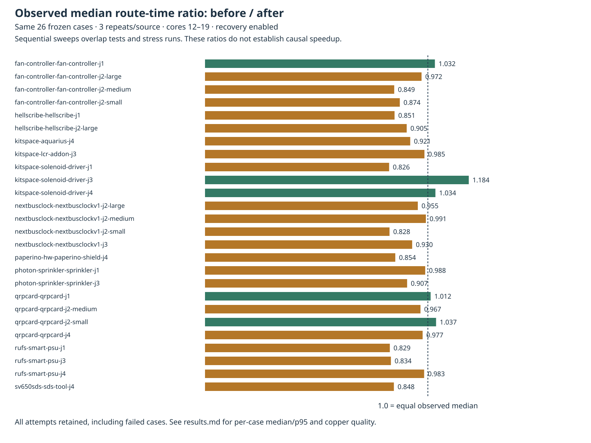

# Bounded recovery through existing point components

The opt-in production post-pass now tries alternate existing pad/barrel anchors after the original point pair exhausts its four local regions. Original terminals remain the transaction's acceptance target. Compatible live-component pairs are ordered by distance, from id and to id; at most eight alternatives are retained. Each pair has the same four growing boxes. Every inspected pad/barrel and candidate pair charges work before inspection. The original search, enumeration and alternatives share one 100000-unit ledger and one absolute 15-second deadline per target. Ordinary successful point searches do no enumeration. Existing pour-component selection is preserved.

The caller supplies the existing live lattice and journal, ignored-net filtering, remaining route item/target capacity and public hooks. Cancellation and the route deadline take precedence; a late or cancelled insertion rewinds. The insertion-only proposal adds at most one engine Track per kept target (a polyline can become several native segments). Exact geometry, all retained copper, original-terminal connectivity, previous terminal connections and the complete new-copper region still gate acceptance. Widths, spacing, vias, grid and rules are unchanged. `localRecovery` remains **off by default**. Endpoint/profile resolution, connectivity and exact checks are synchronous and uncharged; the work/time limits are cooperative checkpoints, not hard wall-clock preemption. Direct pour contacts and pour-to-pour search remain unsupported.

## Fresh full native measurements

[Every case, median/p95, total time, opens, errors, vias and length](results.md), [full comparison](native-comparison.json), [source identity](source-audit.json).

Same 26 frozen cases × three repeats per source, machine, native 10.0.6 checker and cores 12–19. Both modes enable the actual public option. Before is `4b577bb`, whose 98 captured runtime/type/tool/package files are byte-identical to prior consumer pin `c9f946d`. After is engine `8e53e7d` (99 captured files). Source fingerprints bind the snapshots to those revisions. The measured snapshot directories shared the own worktree's Git metadata; the fingerprints establish their source identity independently. The public snapshot helper instead creates synthetic local commits containing each exact archived source and API shim, and records its original revision/hashes explicitly. Descriptive settings documentation was edited after freezing and is excluded from the runtime audit.

| Enabled policy | Passed /78 | Valid /26 | Opens | Known new native errors | Median / p95 s | Total s | Vias | Length sum mm |
| --- | ---: | ---: | ---: | ---: | ---: | ---: | ---: | ---: |
| Original point search | 42 | 14 | 96 | 27 | 1.329552 / 19.184059 | 458.374824 | 2826 | 60129.943370 |
| Bounded point alternatives | 48 | 16 | 90 | 27 | 1.386415 / 21.092039 | 484.539243 | 2826 | 60450.378202 |

Only the two sprinkler tasks change, each from 0/3 to 3/3 passes and one native open to zero per repeat. All six changed outputs preserve every prior native track segment and via; each adds six 0.25 mm native segments, 53.405805 mm and no vias. The other 72 session files are identical. Structured error multiplicity, warning geometry, fidelity and completion comparisons find zero regressions. The 27 known errors remain; the suite is not DRC clean.

Measured aggregate time is 5.7% higher. Sequential sweeps overlap tests, acceptance and stress jobs on the same cores. **No causal speed improvement is claimed.** All failed attempts remain in the timing table and chart.




## Controls and profile

Final required checks: typecheck, layer boundaries (71 files / zero violations), 912 tests / zero failures / 399733 assertions, 399.01 s. The 24 targeted tests pass 472 assertions. The four-test full-board fixture is 2 pass / 2 fail on the baseline and 4 pass / 0 fail on the candidate. The new public controls exercise alternate-anchor closure with one-item accounting and original-terminal callbacks, default-off, zero items, ignored nets, the route deadline and cancellation from the attempt hook. Existing pour controls remain passing.

The eight bounded-helper controls cover original/enumeration/alternate exhaustion, exact success at 18890 work units versus rollback at 18889, enumeration cancellation and deadlines, successful insertion returned late/cancelled, zero item allowance, ordinary successful charged traces, eight exhausted alternatives sharing one ledger, and invalid limits. The real target uses 14509 original search units + 124 enumeration units + 4257 alternate units. The first alternate pair, 8→19, joins the original terminals 29→46 at margin 8.

The [single profiled production replay](profile-summary.json) routes the whole exported power-width input, rather than only its residual. Its session and full statistics match the freshly checked seed-1 output exactly ([byte binding](profile-byte-audit.json)). Wall time is 17.335077 s; recovery appears in 152.160 ms of inclusive sampled stack time. Largest sampled self times are lattice `collect` (2270.749 ms), normal `aStar` (2176.396 ms), `sweepClear` (1342.932 ms) and `withinRim` (1300.282 ms). Inclusive stack times overlap and are not additive. This is one profile, not a paired timing experiment. The compressed CPU profile and replay logs are retained; no extra native run or score is inferred from them.

Adapter package checks: typecheck and 97 unit tests pass, one optional runtime skip, zero failures. Pin changes and their final verification are recorded in the consumer PR.

## Larger and acceptance outcomes

All 18 direct larger-board sessions and full engine statistics match across three paired repeats per input; exact total/added violations stay zero, with no timeout. L2 remains21 opens/51 vias/1094.342601 mm, L3 remains153/93/1688.604896 mm, and the supplied Dense6 DSN remains190/266/2032.379268 mm. Larger driver exit0. The separately exported prepared Dense6 native input has181 opens/315 vias/2317.561458 mm and zero new errors in all six evaluations; sessions and warning geometry are unchanged. Its supervisor returned143 after all six records were written; every recorded case step exited zero without timeout. See `dense-supervisor.json`; a clean Dense supervisor exit is not claimed.

The two enabled slow sweeps finish63 cases each with51 pass/12 fail/14 advisory/zero stubs, zero new adverse comparison rows, and actual supervisor exits0. Four engine pending counts improve (see `results.md`); these are not extra native scores. Standard default-off acceptance finishes51/63 with12 failed expectations and exits1. All expectations remain unchanged.

Private queue placeholders reused the enabled slow stdout filenames and truncated earlier text. Complete per-case JSON remains intact. Compressed raw partial streams and explicitly derived readable summaries are retained, with `scheduling-observations.json`; no case result is reconstructed or omitted.

## Reproduce

Dependencies and the standalone native benchmark runtime must already be installed. Choose a new output directory. `snapshot.py` archives the two committed engine sources and creates a small local API shim forcing only `localRecovery: true`; all frozen per-case settings and rules remain intact. Both measured sources use that shim.

```bash
ENGINE=/home/hyper/bench/wt/fr-perf
BENCH=/home/hyper/bench/wt/fp-perf
ASSET="$ENGINE/docs/pr-assets/agent-fab-router-perf-local-rescue/point-components"
OUT=/home/hyper/bench/agents/codex-fabpcb-perf/scratch/repro42
python3 "$ASSET/snapshot.py" "$ENGINE" "$OUT"
cd "$ENGINE"
taskset -c 12-19 nice -n 10 timeout 1800 bash -c 'bun run typecheck && bun run check:layers && bun run test'
cd "$BENCH"
for MODE in before after; do
  taskset -c 12-19 nice -n 10 timeout 2400 python3 benchmarks/autorouter/benchmark.py --router fab-router --fab-router-source "$OUT/$MODE/entry" --out "$OUT/native-$MODE"
done
python3 "$ASSET/compare-native.py" "$OUT/native-before" "$OUT/native-after" "$OUT/native-comparison.json"
python3 "$ASSET/report.py" "$OUT/native-comparison.json" "$OUT/native-results.md"
python3 "$ASSET/plot-timing.py" "$OUT/native-comparison.json" "$OUT/timing.png"

taskset -c 12-19 nice -n 10 timeout 6500 bun "$ASSET/large.ts" "$OUT/before" "$OUT/after" "$OUT/large.json" /home/hyper/bench/boards/ladder/l2-cycle18.dsn /home/hyper/bench/boards/ladder/l3-cycle18.dsn /home/hyper/bench/boards/dense/dense6-bga324.dsn
python3 "$ASSET/compare-large.py" "$OUT/large.json" "$OUT/large-comparison.json"
taskset -c 12-19 nice -n 10 timeout 5400 python3 "$ASSET/dense-native.py" "$BENCH/benchmarks/autorouter" "$OUT/before/entry" "$OUT/after/entry" /home/hyper/bench/boards/dense/fab_pcb-case-dense6-bga324-j1 "$OUT/dense-native"
python3 "$ASSET/compare-dense.py" "$OUT/dense-native" "$OUT/before/entry" "$OUT/after/entry" "$OUT/dense-comparison.json"
for MODE in before after; do
  taskset -c 12-19 nice -n 10 timeout 5400 bun "$ASSET/slow.ts" "$OUT/$MODE" "$OUT/slow-$MODE.json"
done
python3 "$ASSET/compare-slow.py" "$OUT/slow-before.json" "$OUT/slow-after.json" "$OUT/slow-comparison.json"
cd "$ENGINE"
taskset -c 12-19 nice -n 10 timeout 5400 bun run acceptance -- --tier slow
```

The slow sweeps retain the existing expectations and report failed cases. Their driver exits zero when all cases finish, independently of acceptance pass/fail counts. The standard acceptance command exits one when expectations fail. Reproduction above runs sequentially; the measured enabled slow sweeps were independently supervised concurrent jobs within the same eight-core affinity. Private queued placeholders were superseded and performed no routing or scoring. An initial standard-acceptance invocation with a needlessly short outer limit was deliberately stopped early and restarted with 5400 s; that incomplete invocation is not a completed benchmark score.

Profile the same complete exported input (select its work directory from the freshly reproduced before run):

```bash
WORK=$(python3 - "$OUT/native-before" <<'PYPROFILE'
from pathlib import Path
import json,sys
root=Path(sys.argv[1])
row=next(r for r in json.loads((root/'results.json').read_text()) if r['case']=='photon-sprinkler-sprinkler-j3' and r['seed']==1)
print(root/row['evidence']/'work')
PYPROFILE
)
mkdir -p "$OUT/profile"
taskset -c 12-19 nice -n 10 timeout 180 bun --cpu-prof --cpu-prof-dir="$OUT/profile" "$ASSET/profile.ts" "$OUT/after" "$WORK" "$OUT/profile-replay"
python3 "$ASSET/summarize-profile.py" "$OUT"/profile/*.cpuprofile "$OUT/profile-replay/result.json" "$OUT/profile-summary.json"
```

Render/audit the published changed native outputs without routing or checking them again:

```bash
mkdir -p "$OUT/archived"
tar -xzf "$ASSET/native-changed-evidence.tar.gz" -C "$OUT/archived"
python3 "$ASSET/extract-native.py" "$OUT/archived/before" "$OUT/archived/after" "$OUT/connection.json"
python3 "$ASSET/plot-native.py" "$OUT/connection.json" "$OUT/connection.png"
python3 "$ASSET/audit-copper.py" "$OUT/archived/before" "$OUT/archived/after" "$ASSET/native-comparison.json" "$OUT/copper-audit.json"
```

The archive contains both complete raw result/control JSON files and the twelve checked before/after outputs for the six changed attempts, with exported inputs, sessions, rules, settings, checks and source-case licenses/jobs. It intentionally omits unchanged native boards and is not a complete runnable benchmark output tree. All raw full-suite result/control/summary files are also stored separately as deterministic gzip files. The archive reproduces the copper audit and connection JSON/SVG/PNG byte-for-byte. Pad bounds in the image are visual context; native checks establish actual clearance legality. Original fixture provenance/license remain under `test/data/component-anchor-stall.*`, `../point-component-probe/` and the archive's `case-provenance/`.

Earlier optional-recovery stages, default-off controls and retained adverse timed observations remain in `../component-anchors/README.md`, `../barrel-checks/README.md` and their reports. Those measurements are historical, not new scores for this increment.
