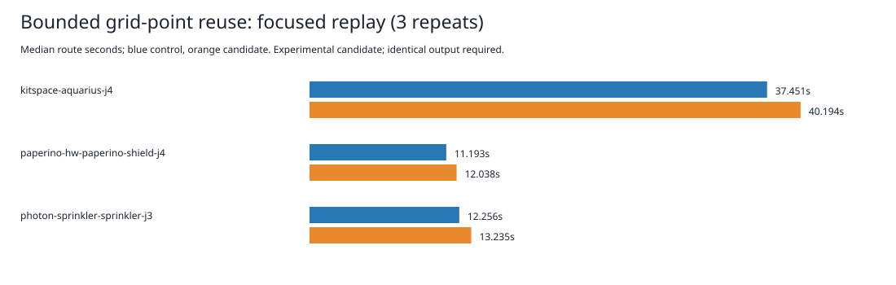

# Bounded grid-point reuse experiment

Rejected at the focused timing gate. No production engine code is changed by this evidence package.

The isolated candidate adds a search-owned, direct-mapped cache of at most 4,096 grid points in each A* invocation. Exact cell keys disambiguate collisions; replacements cannot invalidate retained points because objects are never recycled or mutated. Point coordinates still come from the original callback. Reconstruction calls the original callback and returns fresh points. Nothing is cached across searches.

Reuse requires an explicit internal `reusePoints` opt-in: `pointOf` must be pure, and search callbacks must not mutate points or depend on point identity. Existing external search callers keep the original callback behavior unless they opt in. Only the two production grid-search spaces opt in. Their point callbacks use origin plus grid-coordinate times step; their edge callbacks read coordinates through clearance queries. The current geometry contract describes those operations as pure. This ownership requirement is narrower than the existing mutable `Pt` type and is not an assertion about arbitrary callers. Search queues, costs, rules, geometry predicates, recovery defaults and native checking are unchanged.

Same host, cores 12–19, nice 10, sequential alternating pairs, three repeats per case. Each attempt has a 180-second timeout and a five-second kill grace. p95 is the maximum of three observations. Shared host load is uncontrolled. Timings cover engine replay, excluding import/export conversion and native checking.

| Case | Control median / p95 (s) | Candidate median / p95 (s) | Median change |
|---|---:|---:|---:|
| kitspace-aquarius-j4 | 37.450715 / 38.807650 | 40.194109 / 40.515479 | +7.33% |
| paperino-hw-paperino-shield-j4 | 11.193285 / 11.194992 | 12.037906 / 12.424648 | +7.55% |
| photon-sprinkler-sprinkler-j3 | 12.256282 / 12.275601 | 13.234863 / 13.806425 | +7.98% |

Sum of nine engine durations: control 183.586128s; candidate 196.211095s (+6.88%). This version regresses all three medians and p95s. The measurements do not isolate cache lookup, allocation, or garbage collection as a cause.

All 18 sessions match the retained references byte for byte. Full settings/results/reports match after removing only `report.wallClockMs`. Engine incomplete counts remain 8/2/6 for Aquarius/sprinkler/shield with zero represented violations added; these are not native scores. No full native 26×3, dense6, ladder or whole slow-acceptance rerun follows the focused rejection. Existing native thermal failures remain unresolved, and recovery remains default off.

The differential probe compares single-sheet and layered results and complete edge-callback coordinate traces across 120 deterministic cases, both opted-in and default behavior, 4/8 directions, negative grid bounds, blocked nodes/edges, rip ids, vias, multiple starts, and early budget exits. It uses frozen callback points. The wide regions use a width of 4,096 so rows deliberately alias the same slots; the probe records 12,851 slot replacements with distinct cell keys. It does not prove equivalence for all inputs. The aggregate original callback count falls from 188,324 to 128,730 in these probes, with 960 result/trace comparisons passing.

Reproduce from the repository root:

```bash
python3 docs/pr-assets/agent-fab-router-perf-local-rescue/point-reuse/reproduce.py /tmp/point-reuse-replay
python3 docs/pr-assets/agent-fab-router-perf-local-rescue/point-reuse/verify.py
python3 docs/pr-assets/agent-fab-router-perf-local-rescue/point-reuse/test_verify.py
```

`--prepare-only` reconstructs both variants from the adjacent retained source archive, checks all source/spec hashes, and runs the differential probe without routing. `prepare.py` is the exact candidate transformation. `attempts.tar.xz` retains every measured output, report, timing and process log. No attempt was stopped, omitted or repeated. The unchanged root matches all 1,488 archived source/spec hashes; six ignored historical acceptance output CSVs are outside this source audit.



Final unchanged-root checks: typecheck PASS; layer checks PASS (71 files, zero violations); 914 tests, zero failures, 649,747 assertions, 304.94 seconds. Candidate typecheck PASS. No tests, expectations, checker or rules were weakened.

The isolated candidate also passes the two unchanged targeted route-core and performance-invariance test files: 19 tests, 74 assertions, zero failures, 7.21 seconds. Their root hashes are recorded in targeted-tests.json. The full candidate suite was not run after timing rejection. Independent source reconstruction and the final collision probe pass; the public verifier passes and rejects timing, schedule, summary and session corruptions even after rehashing the manifest.
