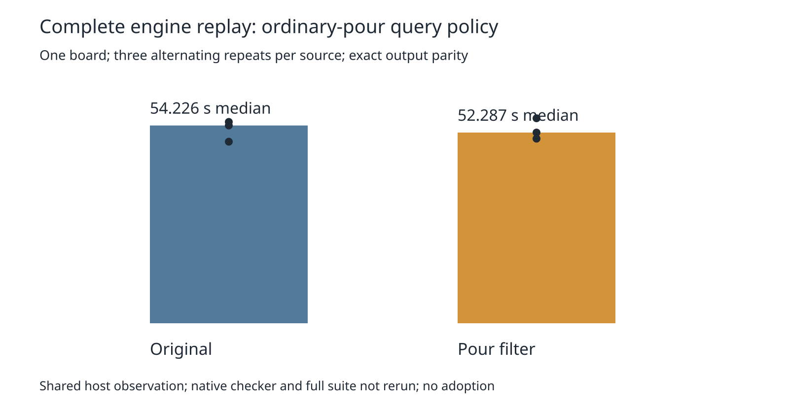

# Ordinary-pour query policy: inconclusive complete-board timing

The preceding obstacle census found 42,363,705 pour candidates with zero blocking decisions on the complete board. This experiment adds an explicit routing-only sweep-query policy that omits ordinary pours before constructing result references and sorting. Only track clearance enables it. General box/sweep queries, raw slots, prior copper, and the exact clearance rules are preserved. The policy reads the live directory entry and origin on every candidate; it does not cache metadata. Existing same-net/ignore decisions for prior copper still run in `hitBlocks`.

The hypothesis was that avoiding references, sorting and downstream obstacle dispatch would save time. Counts alone did not establish that cost, and the new directory lookup also costs work. No claim about allocation, JIT behavior or causal overhead follows from this measurement.

Three alternating complete replays per source, on the same input/settings/host, produced mixed timing: original 49.781157 / 55.206309 / 54.226449 seconds; candidate 50.609843 / 56.204693 / 52.286535 seconds. Median decreases 54.226449 → 52.286535 seconds (3.58%), but maximum increases 55.206309 → 56.204693 seconds (1.81%), and the candidate loses two of three pairs. **Parked, not adopted:** this small shared-host sample does not establish reliable speed nonregression. No discarded attempt, unchanged retry, or selection of favorable runs. This does not prove that ordinary-pour filtering in general cannot help.

[The complete table](table.md) and [timings](summary.json) preserve every repeat. This is one complete exported engine workload, with existing recovery enabled identically; it is not the full native suite. Cores 12–19, nice 10, sequential sources, 240-second per-replay limit; all six commands exit zero. Preparation pins `423a26d`. Of 1,536 tracked implementation/spec/test files, only `src/lattice/grid.ts` and `src/route/clear.ts` differ. Independent preparation reproduces the audit and both complete candidate modules byte for byte.

All six sessions, input/settings, final statistics and reports (excluding wall clock) match the independent native-workload control. Recovery decisions match after removing only nested elapsed seconds. Each replay still has 8 engine opens, zero exact errors, 130 barrels and 1731.113126537 mm track length. **No fresh native check:** the suite's known 27 thermal errors remain unresolved, and engine exact checks are not a native-clean claim. Full 26×3, dense6, ladder L2/L3 and enabled slow acceptance are not run for this inconclusive prerequisite. Production source/defaults and consumer pin remain unchanged.



Three scratch policy tests cover general/raw queries, live prior origin mutation, item replacement/removal, free-slot reuse, rebuild, shelf filtering, and retained result snapshots: three pass / ten assertions against the candidate; all three fail against the original unsupported policy. These test the experimental API rather than claim a pre-existing production bug. Existing oracle/invariance tests remain unchanged. Both sources pass typecheck, layer checks (71 files / zero violations) and all 912 tests / 399,733 assertions. Candidate and original test times are 349.39 and 325.36 seconds; complete gate times are 350.88 and 326.88 seconds. Logs and supervisor exits are retained in `checks-exits.json`.

Nine deliberate corruptions must fail: session, final statistics, settings, recovery decisions, repeat identity, each candidate module's bytes, original source hash, and unexpected changed source. `validate.py` and `verify.py` independently reconstruct parity/timings from the lossless six-record archive. The manifest binds the published scripts, modules, records, logs and chart.

Exact reproduction from the repository root (unused work path, existing Bun dependencies):

```sh
asset=./docs/pr-assets/agent-fab-router-perf-local-rescue/pour-filter
work=/tmp/pour-filter-reproduction
python3 "$asset/prepare.py" "$work"
POUR_FILTER_SOURCE="$work/candidate" taskset -c 12-19 nice -n 10 timeout 60 bun test "$asset/policy.fixture.ts"
python3 "$asset/checks.py" "$work"
python3 "$asset/run.py" "$work"
# Verify published results without routing:
PYTHONDONTWRITEBYTECODE=1 python3 "$asset/verify.py" /tmp/pour-filter-summary.json
PYTHONDONTWRITEBYTECODE=1 python3 "$asset/validate.py" /tmp/pour-filter-validation.json
python3 "$asset/report.py" "$asset"
rsvg-convert -w 1600 "$asset/timing.svg" -o /tmp/pour-filter.png
```

The runner invokes the existing complete-workload driver with `taskset -c 12-19 nice -n 10 timeout 240 bun docs/pr-assets/agent-fab-router-perf-local-rescue/point-components/profile.ts SOURCE INPUT OUTPUT` in alternating original/candidate order. Raw logs and exact sessions are retained. Frozen inputs, native checker, scoring and shared runtime are untouched.

A distinct next hypothesis is to avoid the additional directory lookup through slot-associated live item references, but any such design must preserve raw replacement/removal, metadata mutation and prior semantics and needs its own measurement. Do not repeat this unchanged policy as a speed claim.
