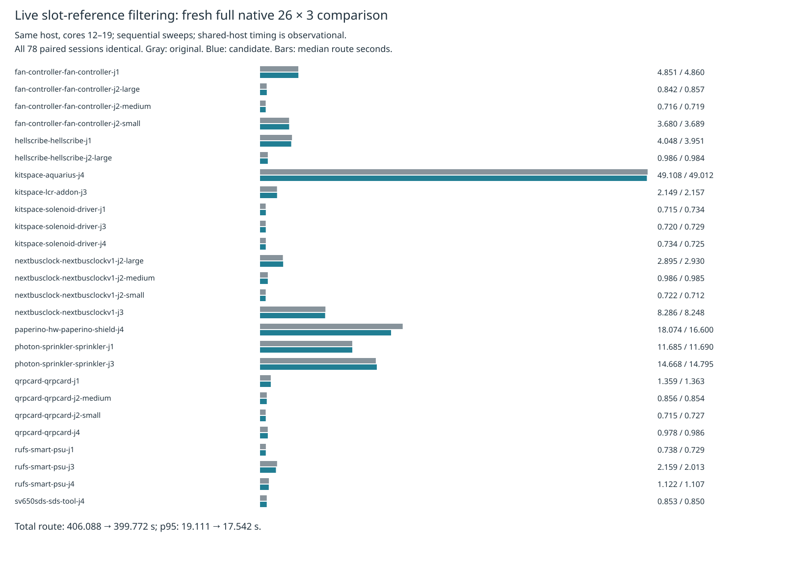

# Live slot-reference filtering: mixed full native timing, not adopted

The preceding [complete-board prerequisite](../pour-slot/README.md) replaces per-candidate directory lookup with slot-associated live item references for a routing-only ordinary-pour filter. This fresh full native comparison tests the exact candidate; only two implementation modules differ. Existing recovery is enabled identically through the same wrapper. Production source/defaults and the consumer pin remain unchanged.

**Parked:** total route time falls 1.56% and p95 falls 8.21%, but the aggregate median rises 1.08%. Thirteen of 26 case medians and twelve case p95s increase. This sequential shared-host measurement does not establish across-case speed nonregression, an allocation/JIT cause, or a reliable gain. No measured attempt is rerun or discarded. Dense6, ladder L2/L3 and enabled slow acceptance were not run after this mixed primary speed result; adoption and a consumer pin bump are not justified.

| Full native metric (26 cases × 3 repeats) | Original | Slot references |
|---|---:|---:|
| Passed / 78 | 48 | 48 |
| Valid cases / 26 | 16 | 16 |
| Opens | 90 | 90 |
| New native errors (known, unresolved) | 27 | 27 |
| Median route seconds | 1.047014 | 1.058299 |
| p95 route seconds | 19.110520 | 17.542152 |
| Sum route seconds | 406.088035 | 399.772232 |
| Sweep wall seconds | 516.717916 | 510.492362 |
| Sum case medians seconds | 134.643768 | 133.005068 |
| Sum case p95 seconds | 142.483007 | 138.916661 |
| Sum vias | 2826 | 2826 |
| Sum length mm | 60450.378202 | 60450.378202 |

Both sweeps complete all 78 attempts with preserved controls and no interruption according to the benchmark. All 78 sessions and final engine statistics are identical. Native finding geometry/multiplicity, warning geometry, fidelity and effective settings show no regression. The 27 existing thermal errors remain unresolved; this is not a native-clean claim. Per-case median/p95, passed, opens and errors are in [table.md](table.md); nearest-rank p95 uses maximum for three repeats, and order statistic 75 of 78 for the aggregate. Vias and length are sums across all repeats.



An operational failure is retained rather than concealed: the original outer supervisor terminated with exit 143, while its benchmark child continued. A bounded observer verified that the original completed with preserved controls; its process exit code is unavailable. The first candidate launch then failed with exit 2 on the exclusive run lock while original report generation finished. It ran zero attempts and created no candidate output directory. After the original process exited, the measured candidate completed with exit 0. The runs were sequential, not overlapping. The observer, failed launch logs, completion controls and `operational-notes.json` preserve this distinction; do not claim all supervisors exited zero. Original wall time is taken from benchmark controls, not reconstructed supervisor time.

The first gate exposed accidental discovery of a legacy opt-in documentation test (912 router passes plus one missing-environment error). The documentation fixtures were renamed in both sources, preserving the failed gate and identical router bytes. Both sources then pass the required typecheck, layer checks and test suite; exact counts and timings are in compressed logs and `checks-exits.json`. Four policy tests and a deliberate missing-update regression control are documented in the prerequisite. Existing tests/rules are unchanged. The complete source audit covers implementation/spec/test/tools/config/wrapper bytes; the original implementation hashes also match the independent native-profile control. The lossless native archive contains all 156 checks, records, settings, DSNs, sessions, manifests and engine reports. Captured input licenses/provenance are included. Independent archive reconstruction verifies the comparison and rejects four corruptions: missing repeat, session drift, added native finding and changed effective setting.

Exact reproduction from this repository root, existing private benchmark runtime and installed dependencies:

```sh
asset=./docs/pr-assets/agent-fab-router-perf-local-rescue/pour-slot
native=docs/pr-assets/agent-fab-router-perf-local-rescue/pour-slot-native
work=/tmp/pour-slot-native-reproduction
python3 "$asset/prepare.py" "$work"
python3 "$asset/native-run.py" "$work" "$HOME/bench/wt/fp-perf"
python3 "$native/compare.py" "$work/native-original" "$work/native-candidate" "$work/comparison.json"
python3 "$asset/checks.py" "$work"
# Replay the archived evidence without routing/native tools:
PYTHONDONTWRITEBYTECODE=1 python3 "$native/verify.py"
python3 "$native/report.py" "$native/comparison.json" /tmp/pour-slot-native-report
rsvg-convert -w 1600 /tmp/pour-slot-native-report/timings.svg -o /tmp/pour-slot-native.png
```

Each native sweep invokes `taskset -c 12-19 nice -n 10 timeout 3000 python3 benchmarks/autorouter/benchmark.py --router fab-router --fab-router-source SOURCE/entry --out OUTPUT` from the benchmark worktree. The wrapper only sets `localRecovery:true`; frozen inputs, settings, checker, scoring, attempt safety limit and shared runtime remain unchanged. No own heavy test job overlaps routing measurements. The original supervisor anomaly and setup-only retry are retained; a new reproduction need not experience them.

Do not repeat this unchanged candidate or adopt it on the strength of aggregate savings. A future distinct hypothesis needs fresh paired full-suite speed/quality measurements and the remaining stress/acceptance gates.

Final clean checks: typecheck passes, layer checker reports 71 files and zero violations, and each source passes 912 tests / 399,733 assertions. Candidate test time is 332.18 seconds (333.533320 seconds for the full gate); original test time is 342.48 seconds (343.936061 seconds for the full gate). Both final gate supervisors exit zero.
