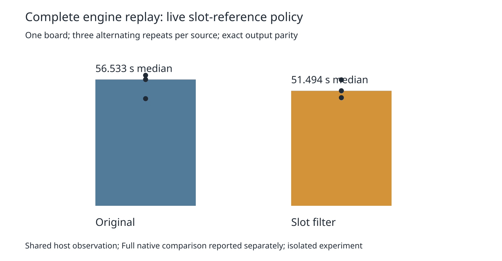

# Live slot-reference query policy: complete-board prerequisite

This isolated experiment follows the parked directory-lookup policy with a distinct implementation: each live lattice slot holds its directory entry, avoiding a map lookup in the routing-only ordinary-pour filter. The entry retains the actual item object, so origin metadata remains live. Slot release clears the reference; allocation binds it anew. Registering an item also updates pre-existing raw slots, including when that item adds no geometry. Only track-clearance sweeps enable the policy; raw/general queries and prior copper remain included. No rule or production source changes.

Three alternating complete engine replays per source on the same input/settings/host produced median 56.532909 → 51.494405 seconds and maximum 58.409293 → 56.376875 seconds. Candidate loses the first pair and wins the other two. Every session, final statistic, effective setting and report (excluding elapsed wall clock) matches the independent native-workload control. Recovery decisions match after excluding only nested elapsed seconds. Each replay has 8 engine opens, zero exact errors, 130 barrels and 1731.113126537 mm length. This one-board prerequisite alone does not establish speed nonregression or native cleanliness; [the subsequent fresh full native comparison](../pour-slot-native/README.md) is mixed, and the candidate is parked.



Preparation pins `287971e`. Only `src/lattice/grid.ts` and `src/route/clear.ts` differ among 1,536 tracked implementation/spec/test files. Independent preparation reproduces the source audit and both candidate modules exactly. Four experimental policy tests pass with 13 assertions. They cover raw/general queries, live prior mutation, replacement/removal/reuse, shelf/rebuild, snapshots, and raw slots acquiring metadata without item geometry. Removing the metadata update deliberately makes the fourth test fail. The original unsupported API fails all four tests; this is experimental API coverage, not a production bug claim. Existing tests and DRC rules remain unchanged. Required checks for both sources are retained in `checks-exits.json` and compressed logs.

Nine corruption controls reject session/statistics/settings/recovery/repeat drift, changed candidate modules, original-source drift and unexpected changed source. Full six-record lossless evidence is in `records.json.gz`; `source-audit.json` binds both complete candidate modules.

Reproduce from the repository root with installed dependencies and an unused work directory:

```sh
asset=./docs/pr-assets/agent-fab-router-perf-local-rescue/pour-slot
work=/tmp/pour-slot-reproduction
python3 "$asset/prepare.py" "$work"
POUR_SLOT_SOURCE="$work/candidate" taskset -c 12-19 nice -n 10 timeout 60 bun test "$asset/policy.fixture.ts"
python3 "$asset/run.py" "$work"
python3 "$asset/checks.py" "$work"
# Independently replay the published measurements without routing:
PYTHONDONTWRITEBYTECODE=1 python3 "$asset/verify.py" /tmp/pour-slot-summary.json
PYTHONDONTWRITEBYTECODE=1 python3 "$asset/validate.py" /tmp/pour-slot-validation.json
python3 "$asset/report.py" "$asset"
rsvg-convert -w 1600 "$asset/timing.svg" -o /tmp/pour-slot.png
```

The runner uses `taskset -c 12-19 nice -n 10 timeout 240 bun docs/pr-assets/agent-fab-router-perf-local-rescue/point-components/profile.ts SOURCE INPUT OUTPUT` for each replay, with no overlapping own heavy jobs. Inputs and the independent control are inherited from the committed `native-profile` evidence. The frozen native suite, checker, scoring and shared runtime are untouched.

The first required gate failed with 912 passing router tests plus one documentation-module error: Bun discovered the earlier opt-in `pour-filter/policy.test.ts`, which requires an explicit source environment variable. That failed gate is preserved in `discovery-failure-*`. Both old and new opt-in assets now use `policy.fixture.ts`; explicit test commands still execute them. Preparation applies the same documentation-only rename to both pinned sources before the clean gate. Source audit and measured router modules remain byte-identical. The historical pour-filter manifest and README are updated for the rename. This repairs default test discovery without weakening any router assertion or changing DRC.

Final clean checks: typecheck passes, layer checker reports 71 files and zero violations, and each source passes 912 tests / 399,733 assertions. Candidate test time is 332.18 seconds (333.533320 seconds for the full gate); original test time is 342.48 seconds (343.936061 seconds for the full gate). Both final gate supervisors exit zero.
