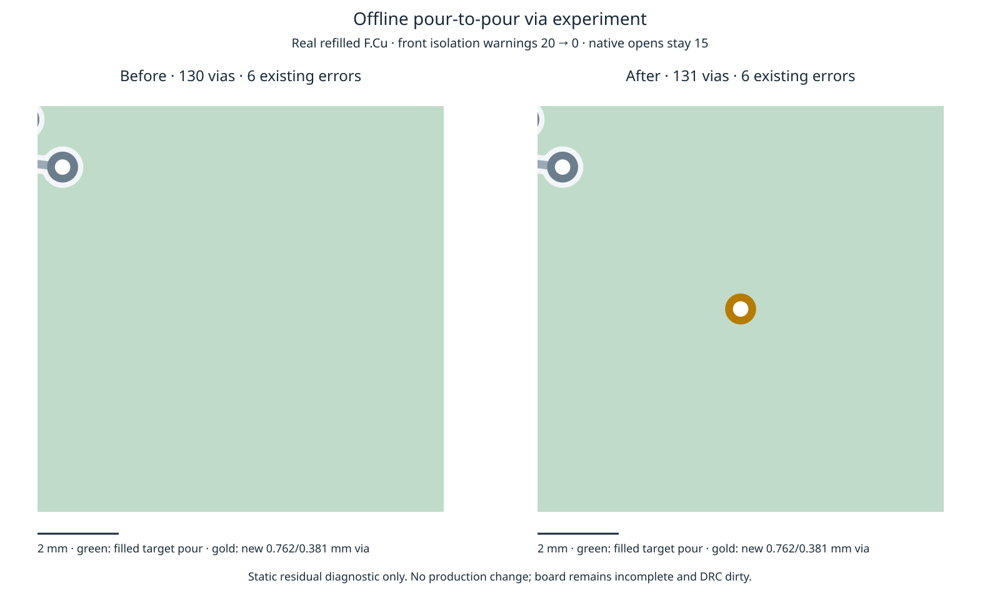

# Offline local pour-to-pour via experiment

The remaining original pour-to-pour target has no existing compatible point anchor. This **offline residual experiment**, outside the production route path, proposes an existing permitted via at the centre of the two pour bounding boxes' XY intersection. A ring enumeration is available only if that first candidate fails: at most 31×31 points, existing via forms only, a 100000-candidate cap and a cooperative 15-second check before each candidate. The measured board accepts the first candidate on every repeat, so no ring-search efficacy is established.

The probe resolves the exported native hole and copper-to-edge overrides, checks `barrelFits`, then uses the existing journal transaction against the **original two pour ids**, with exact DRC, original-target connectivity, retained copper, prior terminal connectivity and a fixed local region gate. No copper/rule is shrunk, no track is added, and no existing copper is moved or removed. The native via is 0.762 mm diameter / 0.381 mm drill, within the exported board diameter/drill/annular floors.

This is **not integrated or adopted**: production `src`, `spec/types`, tests, settings, tools and consumer pin remain unchanged. Existing `localRecovery` remains default off and does not propose these vias. The probe does not implement the production shared item/work/cancellation schedule, charge geometry traversal, bind searches to filled native polygons, handle general component pairs, or guarantee hard latency bounds. Exact/connectivity validation is synchronous. Bounding-box intersection is only a proposal heuristic; the exact transaction and native refill/check determine the measured outcome. No general applicability, speed gain or native completion gain is claimed.

## Paired result

Same supplied native residual and copper, same host/cores 12–19, three repeats per mode. Import/refill/check run fresh for all six outputs. These are static diagnostics, **not scored router attempts or full end-to-end routing measurements**. All three repetitions give the same result:

| Metric per repeat | Before | After offline via |
| --- | ---: | ---: |
| Engine incomplete connections | 8 | 7 |
| Exact engine violations | 0 | 0 |
| Native opens | 15 | 15 |
| Native new errors versus frozen input | 6 | 6 |
| Native front-pour isolation warnings | 20 | 0 |
| All native new warnings | 36 | 16 |
| Native `ground_connected` | false | false |
| Vias | 130 | 131 |
| Track length mm | 1731.113127 | 1731.113127 |
| Lost native pad-terminal pairs | 0 | 0 |

The six errors existed in the routed residual and remain unresolved. Geometry and multiplicity of native errors and remaining warnings are unchanged (fresh imported item UUIDs are ignored; descriptions, positions and multiplicity are retained). Every preexisting native copper item is retained exactly. Rule sidecars remain byte-identical. The inserted via reaches 56 pads, but all pad-terminal partitions are identical before/after. The board remains incomplete, fails the ground-connectivity gate and is **not manufacturing clean**. Reducing the engine's incomplete count is not sufficient evidence of a native completion gain.



The image uses real refilled front-zone polygons, tracks and vias in a fixed 10 mm crop. The green region includes copper that already existed before insertion; its colour does not imply that it was connected. Gold is the newly measured via.

## Small fixture and validation

`controls.ts` creates a one-open two-layer/two-pour fixture. Current public recovery leaves it unsupported; the offline permitted via joins it through the real transaction. Six scenarios × three repeats cover legal closure, pour-hole non-contact, foreign copper, full-copper region rejection, cancellation during a transaction, and no permitted via. Every failed/cancelled trial preserves session bytes and exact zero violations. Portable published-driver replay repeats the fixture controls and the three real residual evaluations, with identical outcomes and session bytes. These controls are not extra router benchmark rows.

The initial real-layout probe accidentally used default edge/hole overrides (hole clearance disabled). It is retained in the archive. The corrected probe uses the exported 0.5 mm edge and 0.25 mm hole values, rechecks the candidate, and produces byte-identical before/after sessions for all three repeats. The six fresh native checks bind those same bytes. `verify-probe.py` verifies this identity. No native result from a different copper output is substituted. An initial warning comparison treated regenerated imported UUIDs as geometry changes; the final comparator removes only UUIDs and checks full finding geometry/multiplicity.

Required engine checks passed: typecheck, 70 layer files/zero violations, 892 tests/zero failures/399191 assertions. The two published TS drivers also pass strict standalone typecheck. All 85 runtime/type files match engine commit `c9f946d`. No fresh slow acceptance, dense/ladder comparison or CPU profile is claimed for this unadopted probe; previous measurements and adverse timed observations remain in the PR.

## Reproduction

Run from this router checkout, with the benchmark checkout available. All commands use only local files/native tooling. `residual-evidence.tar.gz` includes the original DSN/session/exported rule manifest, before/after sessions and all six native imports/refills/check reports and command logs. Frozen input/checker remain in the benchmark checkout.

```bash
ASSET=docs/pr-assets/agent-fab-router-perf-local-rescue/pour-via-probe
BENCH=/home/hyper/bench/wt/fp-perf/benchmarks/autorouter
REPLAY=/home/hyper/bench/agents/codex-fabpcb-perf/scratch/cycle39-replay
mkdir -p "$REPLAY"
tar -xzf "$ASSET/residual-evidence.tar.gz" -C "$REPLAY"
python3 "$ASSET/verify-probe.py" "$REPLAY"
taskset -c 12-19 nice -n 10 /usr/bin/python3 "$ASSET/audit-native.py" "$REPLAY" "$BENCH"
taskset -c 12-19 nice -n 10 bun "$ASSET/controls.ts" "$REPLAY/fixture-controls.json"
taskset -c 12-19 nice -n 10 timeout 90 bun "$ASSET/probe.ts" "$REPLAY/inputs/board.dsn" "$REPLAY/inputs/board.ses" "$REPLAY/inputs/dsn-manifest.json" "$REPLAY/fresh-probe"
taskset -c 12-19 nice -n 10 /usr/bin/python3 "$ASSET/plot.py" "$REPLAY" "$REPLAY/probe.png"
```

For six fresh native checks, use a new directory, copy `fresh-probe` to its `probe` child, and run the native driver. This is a diagnostic import of output sessions, not a hand-repaired scored benchmark.

```bash
FRESH=/home/hyper/bench/agents/codex-fabpcb-perf/scratch/cycle39-native-replay
mkdir -p "$FRESH"
cp -r "$REPLAY/fresh-probe" "$FRESH/probe"
taskset -c 12-19 nice -n 10 timeout 900 python3 "$ASSET/native-probe.py" "$FRESH" "$BENCH"
```

For the independent default-off full suite:

```bash
cd /home/hyper/bench/wt/fp-perf
taskset -c 12-19 nice -n 10 timeout 2400 python3 benchmarks/autorouter/benchmark.py --router fab-router --fab-router-source /home/hyper/bench/wt/fr-perf --out /home/hyper/bench/agents/codex-fabpcb-perf/scratch/cycle39/native-control
cd /home/hyper/bench/wt/fr-perf
taskset -c 12-19 nice -n 10 timeout 1200 bash -c 'bun run typecheck && bun run check:layers && bun run test'
```

This full sweep uses production **default off**, not the offline via probe. The historical/fresh default-off control comparison and all 26 per-case times/quality appear in `control-results.md` after completion. Shared-host tests overlap the fresh sweep; timings are descriptive, not a causal performance comparison.

Next: only integrate a pour-contact proposal after adding production shared work/item/cancellation accounting and preserving ordinary-point charged traces. It still needs full paired enabled sweeps and larger-input evidence, plus an actual native completion improvement, before default promotion. The broader local spacing/width/grid relaxation stages remain unimplemented; board minima must never be inferred from net-class defaults.
