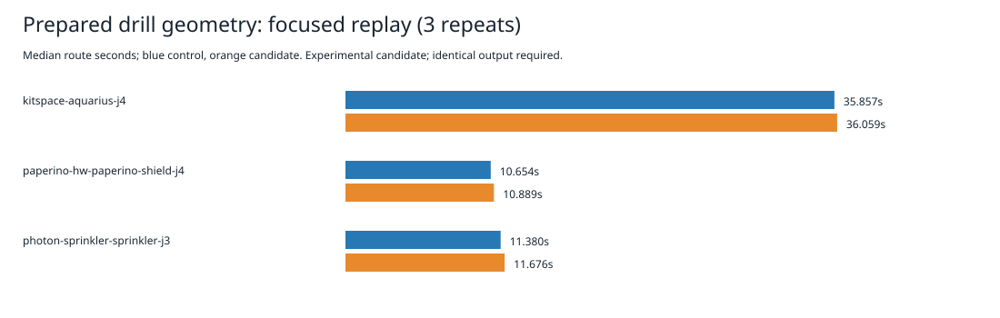

# Prepared drill geometry experiment

Rejected at the focused timing gate; production sources are unchanged.

The isolated candidate prepares pad and barrel drill geometry during lattice insertion and exposes it through the indexed item view. Clearance-hit checks read that view instead of repeatedly looking up forms and allocating drill records. Removal discards preparation, reinsertion rebuilds it, and grid rebuild preserves it. Shared form changes require reinserting affected items, as for the existing bounds/shape caches. No global cache, rule, search, recovery default, or checker change is introduced. The extra indexed-view field and preparation have costs; these timings do not isolate their causes.

Same host, cores 12–19, nice 10, sequential alternating pairs, three repeats per case. Each replay has a 180-second timeout and five-second kill grace. p95 is the maximum of three observations. Shared host load is uncontrolled. These timings measure engine replay without import/export conversion or native checking.

| Case | Control median / p95 (s) | Candidate median / p95 (s) |
|---|---:|---:|
| kitspace-aquarius-j4 | 35.857 / 36.450 | 36.059 / 38.709 |
| paperino-hw-paperino-shield-j4 | 10.654 / 11.294 | 10.889 / 10.943 |
| photon-sprinkler-sprinkler-j3 | 11.380 / 12.654 | 11.676 / 11.951 |


Sum of nine engine durations: 174.903017s control → 176.330604s candidate (+0.82%). All three medians regress. This is no measured speed improvement.

All 18 corrected sessions match retained references byte for byte. Full settings/results/reports match after removing only report.wallClockMs. Engine residuals remain 8/2/6 for Aquarius/sprinkler/shield, with zero represented additions; these are not native scores. No full native 26×3, dense6, ladder, or whole slow-acceptance run follows focused rejection. Existing native thermal failures remain unresolved; recovery remains default off.

The differential probe passes 20,903 comparisons: 903 insertion/removal/rebuild/movement/replacement/form-change lifecycle checks and 20,000 full clearance-result comparisons against the unmodified implementation on a seeded synthetic layout. This is bounded coverage, not proof for arbitrary geometry or custom lattice implementations. The unchanged three targeted test files pass; see candidate-tests.log and their recorded hashes.

The initial invalid version omitted the prepared field from the itemOf projection. Its lifecycle probe failed. One initial control replay completed; its candidate was terminated during execution. Both are retained under initial-invalid in attempts.tar.xz and excluded from the corrected comparison. The probe setup subsequently failed with incomplete settings; the corrected probe uses full defaults. All 18 corrected timing attempts are retained; none was stopped, omitted or repeated. See method.md.

Reproduce from the repository root:

```bash
python3 docs/pr-assets/agent-fab-router-perf-local-rescue/prepared-drill/reproduce.py /tmp/prepared-drill-replay
python3 docs/pr-assets/agent-fab-router-perf-local-rescue/prepared-drill/verify.py
python3 docs/pr-assets/agent-fab-router-perf-local-rescue/prepared-drill/test_verify.py
```

--prepare-only reconstructs both variants from the adjacent source archive, validates all 1,488 source/spec hashes per variant, and runs the lifecycle/differential probe. prepare.py is the exact transformation; synth.ts is the unchanged test helper used by that probe. attempts.tar.xz retains corrected outputs/reports/timings/logs and initial invalid artifacts. root-audit.json confirms the unchanged root matches the measured control, excluding ignored historical generated outputs.



Final unchanged-root checks: typecheck PASS; layer checks PASS (71 files, zero violations); 914 tests, zero failures, 649,747 assertions, 333.82 seconds. Candidate typecheck PASS and targeted 26 tests/39,827 assertions PASS (8.85 seconds). Full candidate suite was not run after focused rejection. No test, checker, rule or expectation was weakened.
